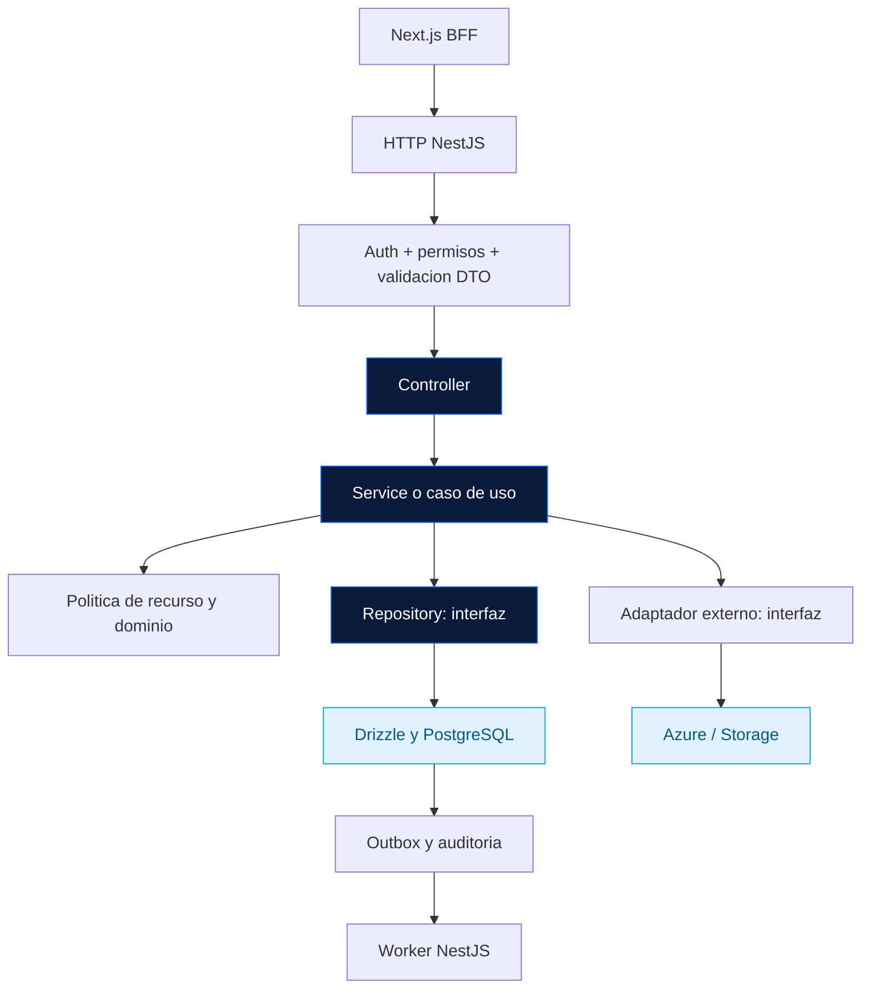
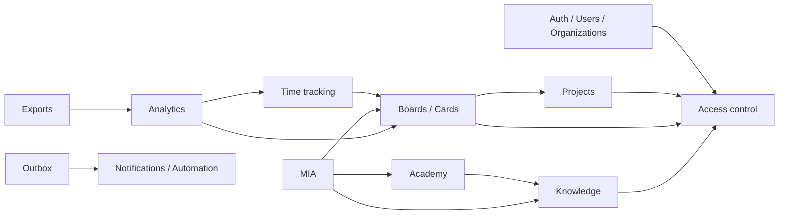
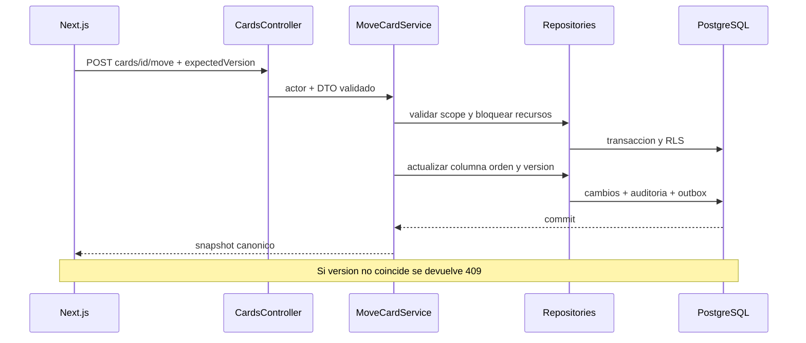

# MTA NEXUS | Arquitectura modular Backend

    

**Versión:** 1.0 | **Estado:** arquitectura propuesta | **Aplicación:** `apps/api`  
**Base:** `MTA_Nexus_Especificacion.md`, `MTA_Nexus_Stack_Backend_v1.1.md`, `MTA_Nexus_Stack_Frontend_v1.1.md` y `MTA_Nexus_Arquitectura_Frontend.md`.

`OBLIGATORIO` = requisito técnico. `MVP` = primera implementación. `AVANZADO` = incorporar gradualmente. `DEMO` = simulación identificada. `AZURE` = servicio sujeto a cuota/crédito. Los badges de cabecera son imágenes remotas opcionales; ningún proceso backend depende de ellas. Sin emojis.

> Este documento establece una arquitectura modular de NestJS, comprensible para un equipo que ya trabaja con features en Next.js. Define archivos objetivo, contratos, dependencias y reglas. No es código desplegado ni afirma haber comprobado las credenciales o el saldo Azure. No es necesario contratar software de pago para desarrollar y probar localmente.

## 1. Enfoque: monolito modular, no microservicios prematuros

MTA Nexus necesita gestionar proyectos, tableros, tareas, horas, Academy, conocimiento, MIA, analítica, comercial y seguridad con transacciones coherentes. Una única API NestJS dividida en módulos ofrece una frontera clara sin la complejidad y costo operativo de múltiples servicios. Cada módulo es responsable de un dominio; puede exportar capacidades limitadas a otros módulos. PostgreSQL es fuente de verdad operativa, Supabase Auth maneja identidad y Storage maneja archivos privados. Los SDK de Azure están encapsulados detrás de interfaces.

Analogía con el frontend:

| Next.js | NestJS | Responsabilidad |
|---|---|---|
| `app/page.tsx` | Controller | Entrada de una vista/solicitud |
| Componentes y hooks | Controller + DTO | Traducir interacción a contrato (no equivalencia literal) |
| Service frontend | Service / caso de uso backend | El primero llama API; el segundo ejecuta lógica real |
| Types y schemas | Interfaces, DTO, domain | Contratos, validación y reglas |
| Mocks | Repositorios/adaptadores fake en tests | Datos de prueba, nunca fallback productivo |
| Services HTTP | Repository y adapters | Comunicación con persistencia/proveedores |
| `features/` | `modules/` | Organización por capacidad |

No duplicar lógica en frontend y backend. Nest verifica autorización y transiciones aunque la UI haya validado. No trasladar reglas de negocio a controladores, triggers SQL sin diseño ni servicios Azure. Separar lecturas/escrituras con métodos claros sin adoptar CQRS complejo por obligación. Los módulos pueden crecer internamente sin volverse aplicaciones independientes.

## 2. Flujo de una petición



1. BFF valida sesión/origen de escritura y llama a `/api/v1/...` con token del usuario. No confía en identidad suministrada por browser.
2. Nest aplica guards, rate limit, DTO validation y correlation ID. Controller extrae actor autenticado y delega.
3. Service comprueba membresía, alcance, permiso y reglas; inicia transacción cuando hay persistencia relacionada.
4. Repository encapsula consultas y filtros. DB aplica RLS y restricciones.
5. Audit y outbox se insertan en la misma transacción cuando el evento lo requiera. Worker procesa acciones posteriores con idempotencia.
6. Controller devuelve DTO sin campos privados. Filtros normalizan errores. Logs estructurados no contienen secretos ni cuerpos sensibles.

No llamar Azure dentro de una transacción de escritura larga. Separar reserva/estado del job, llamada externa y actualización final. No existe garantía exactly-once para proveedores remotos; usar identificadores de operación, reintentos seguros y reconciliación.

## 3. Repositorio y estructura global NestJS

```text
mta-nexus/
├── apps/
│   ├── web/                       # Next.js en su propia raíz
│   └── api/
├── packages/
│   ├── api-client/                # Cliente y tipos generados
│   ├── design-tokens/
│   └── config/
├── supabase/
│   ├── migrations/                # Única fuente de DDL
│   ├── seed.sql
│   └── config.toml
├── docs/
├── pnpm-workspace.yaml
└── pnpm-lock.yaml
```

```text
apps/api/
├── src/
│   ├── main.ts
│   ├── worker.ts
│   ├── app.module.ts
│   ├── worker.module.ts
│   ├── config/
│   ├── common/
│   ├── infrastructure/
│   └── modules/
├── test/
│   ├── e2e/
│   ├── integration/
│   ├── factories/
│   └── helpers/
├── scripts/
│   ├── generate-openapi.ts
│   └── seed-demo.ts
├── .env.example
├── nest-cli.json
├── tsconfig.json
├── tsconfig.build.json
├── eslint.config.mjs
├── jest.config.ts
├── package.json
└── README.md
```

`main.ts` arranca HTTP, configura seguridad, validación, CORS explícito, Swagger solo en entornos autorizados, prefijo global `api/v1` y shutdown hooks. `worker.ts` arranca un contexto Nest sin servidor HTTP para jobs persistentes; puede ejecutarse en la misma PC. `AppModule` importa módulos HTTP; `WorkerModule` importa los proveedores necesarios para procesar jobs, no controladores innecesarios. No crear workers duplicados si se ejecuta un scheduler dentro de API. El scheduler encola y los workers reclaman con locking/lease.

## 4. Carpetas transversales (sin reglas específicas de feature)

```text
src/config/
├── app.config.ts
├── database.config.ts
├── auth.config.ts
├── storage.config.ts
├── azure.config.ts
├── mail.config.ts
├── security.config.ts
├── features.config.ts
├── jobs.config.ts
├── budget.config.ts
└── env.schema.ts

src/common/
├── decorators/
│   ├── current-actor.decorator.ts
│   ├── require-permissions.decorator.ts
│   ├── public.decorator.ts
│   └── idempotent.decorator.ts
├── guards/
│   ├── auth.guard.ts
│   ├── active-membership.guard.ts
│   ├── permission.guard.ts
│   └── mfa.guard.ts
├── filters/
│   └── global-exception.filter.ts
├── interceptors/
│   ├── correlation-id.interceptor.ts
│   ├── response-envelope.interceptor.ts
│   └── request-logging.interceptor.ts
├── pipes/
│   └── parse-identifier.pipe.ts
├── dto/
│   ├── pagination.dto.ts
│   └── date-range.dto.ts
├── interfaces/
│   ├── actor.interface.ts
│   ├── api-response.interface.ts
│   ├── paginated.interface.ts
│   └── clock.interface.ts
├── constants/
│   ├── error-codes.constants.ts
│   └── request-limits.constants.ts
├── errors/
│   ├── domain.error.ts
│   └── conflict.error.ts
├── utils/
│   ├── cursor.util.ts
│   ├── date.util.ts
│   └── redact.util.ts
├── security/
│   ├── request-context.ts
│   └── safe-headers.ts
└── idempotency/
    ├── idempotency.module.ts
    └── idempotency.service.ts
```

`common/` contiene mecanismos reutilizables, no el significado de una tarjeta finalizada o una evaluación aprobada. El guard de permisos puede depender de un puerto de autorización, enlazado por AccessControlModule en composición, pero no debe importar repositorios privados. Los códigos específicos de dominio pertenecen a cada módulo. Las interfaces son contratos TS; no son entidades DB ni DTO runtime.

```text
src/infrastructure/
├── database/
│   ├── database.module.ts
│   ├── database.provider.ts
│   ├── database.tokens.ts
│   ├── unit-of-work.ts
│   ├── transaction-context.ts
│   ├── schema/                    # Drizzle mapea DDL de Supabase
│   └── health.repository.ts
├── auth/
│   ├── supabase-auth.module.ts
│   ├── supabase-token-verifier.ts
│   └── supabase-admin.adapter.ts
├── storage/
│   ├── storage.module.ts
│   ├── storage.port.ts
│   ├── storage.tokens.ts
│   └── supabase-storage.adapter.ts
├── azure/
│   ├── azure.module.ts
│   ├── azure-credential.provider.ts
│   ├── foundry.adapter.ts
│   ├── search.adapter.ts
│   ├── speech.adapter.ts
│   └── ml-scoring.adapter.ts
├── mail/
│   ├── mail.module.ts
│   ├── mail.port.ts
│   └── smtp.adapter.ts
├── observability/
│   ├── logging.module.ts
│   └── metrics.service.ts
└── clock/
    └── system-clock.provider.ts
```

Los puertos específicos de IA (chat, indexación, predicción) pertenecen al módulo consumidor; los adapters de Azure implementan esos puertos y se enlazan en su módulo/composición. Evitar circularidad: contratos de puerto se importan sin importar módulos Nest que los consumen. Los adapters no ejecutan políticas de negocio. En pruebas se sustituyen tokens con `overrideProvider`, no se cambia cada controller. ConfigModule valida flags y dependencias; no iniciar Azure por solo importar un módulo.

## 5. Estructura estándar por módulo

```text
src/modules/projects/
├── projects.module.ts
├── controllers/
│   └── projects.controller.ts
├── services/
│   └── projects.service.ts
├── dto/
│   ├── create-project.dto.ts
│   ├── update-project.dto.ts
│   ├── project-query.dto.ts
│   └── project-response.dto.ts
├── interfaces/
│   ├── projects.repository.interface.ts
│   └── projects-reader.interface.ts
├── repositories/
│   └── drizzle-projects.repository.ts
├── domain/
│   ├── project-status.ts
│   └── project.rules.ts
├── policies/
│   └── projects.policy.ts
├── mappers/
│   └── project.mapper.ts
├── constants/
│   └── projects.tokens.ts
├── types/
│   └── project.types.ts
├── utils/                        # Solo si hay funciones puras del módulo
├── events/                       # Si publica/consume eventos
└── tests/
    ├── projects.service.spec.ts
    └── projects.policy.spec.ts
```

| Carpeta | Función | Ejemplo |
|---|---|---|
| `controllers` | Ruta, DTO, actor y llamada a service | POST /projects |
| `services` | Casos de uso y coordinación | crear, mover, aprobar |
| `dto` | Clases con validación runtime y OpenAPI | CreateProjectDto |
| `interfaces` | Puertos para persistencia/integraciones | ProjectsRepository |
| `repositories` | Implementación DB con Drizzle | DrizzleProjectsRepository |
| `domain` | Reglas puras e invariantes | transición de estado |
| `policies` | Permisos por recurso y alcance | puede editar proyecto |
| `mappers` | DB → modelo → DTO de respuesta | ocultar campos internos |
| `constants` | Tokens DI y códigos del módulo | PROJECTS_REPOSITORY |
| `types` | Uniones y tipos TS del dominio | ProjectStatus |
| `events` | Eventos tipados para outbox | project.created |
| `tests` | Casos unitarios del feature | rechazo por scope |

Para módulo pequeño: controller, service, dto, módulo y tests bastan. Añadir repositorio si persiste, interface si necesita puerto explícito, policy si controla recursos. Para casos grandes (`MoveCard`, `PublishDocument`, `ApproveTimeEntry`) crear `services/move-card.service.ts` o `services/use-cases/`; no duplicar carpeta application y services con la misma función. No crear carpetas vacías ni imponer una clase por operación simple. No usar `@Global()` para todos los módulos. Exportar fachada/puerto de lectura solo cuando sea necesario.

## 6. Ejemplo completo de Nest: Controller, DTO, Service, Interface y Repository

Ejemplo representativo de proyecto, enfocado en entender dependencias. Los helpers de autorización/transacción se describen como contratos; los fragmentos requieren implementación y pruebas, no son un proyecto listo para copiar y ejecutar. La API de listado final será paginada; si se comienza con listado simple de demo, conservar contrato coordinado con frontend antes de activar paginación.

`dto/create-project.dto.ts`

```ts
import { ApiProperty } from '@nestjs/swagger';
import { IsString, Length } from 'class-validator';
import { Transform } from 'class-transformer';
export class CreateProjectDto {
  @ApiProperty({ minLength: 3, maxLength: 100 })
  @Transform(({ value }) => typeof value === 'string' ? value.trim() : value)
  @IsString()
  @Length(3, 100)
  name!: string;
}
```

`types/project.types.ts`

```ts
export type Project = {
  id: string;
  organizationId: string;
  name: string;
  status: 'active' | 'archived';
  updatedAt: Date;
};
```

`interfaces/projects.repository.interface.ts`

```ts
import type { Project } from '../types/project.types';
import type { TransactionContext } from '@/infrastructure/database/transaction-context';
export interface ProjectsRepository {
  insert(tx: TransactionContext, input: {
    organizationId: string;
    name: string;
    createdBy: string;
  }): Promise<Project>;
  // Agregar lecturas paginadas con scope y filtros validados.
}
```

`constants/projects.tokens.ts`

```ts
export const PROJECTS_REPOSITORY = Symbol('PROJECTS_REPOSITORY');
```

Una interface TypeScript no existe como valor en tiempo de ejecución. Por ello Nest usa `Symbol` como token para inyectarla. No declarar el token dentro de `projects.module.ts` e importarlo desde el service (puede producir ciclo).

`services/projects.service.ts`

```ts
import { Inject, Injectable } from '@nestjs/common';
import type { Actor } from '@/common/interfaces/actor.interface';
import { UnitOfWork } from '@/infrastructure/database/unit-of-work';
import { PROJECTS_REPOSITORY } from '../constants/projects.tokens';
import type { ProjectsRepository } from '../interfaces/projects.repository.interface';
import type { CreateProjectDto } from '../dto/create-project.dto';
import { ProjectsPolicy } from '../policies/projects.policy';
import { AuditWriter } from '@/modules/audit/services/audit-writer.service';
import { toProjectResponse } from '../mappers/project.mapper';

@Injectable()
export class ProjectsService {
  constructor(
    @Inject(PROJECTS_REPOSITORY) private readonly repository: ProjectsRepository,
    private readonly uow: UnitOfWork,
    private readonly policy: ProjectsPolicy,
    private readonly audit: AuditWriter,
  ) {}
  async create(actor: Actor, dto: CreateProjectDto) {
    return this.uow.withActor(actor, async tx => {
      await this.policy.assertCanCreate(tx, actor);
      const project = await this.repository.insert(tx, {
        organizationId: actor.organizationId,
        name: dto.name,
        createdBy: actor.userId,
      });
      await this.audit.append(tx, {
        actor, action: 'project.created', resourceId: project.id,
      });
      // Registrar membresía inicial y outbox aquí si el caso lo exige.
      return toProjectResponse(project);
    });
  }
}
```

El actor se obtiene de la identidad validada, nunca del `organizationId` del body. En una implementación real, crear membresía inicial, registrar auditoría/outbox y devolver respuesta en la misma transacción; si algo falla, rollback. La policy consulta permisos efectivos con el contexto transaccional. La función mapper solo retorna `id`, `name`, `status`, `updatedAt` ISO y otros campos explícitamente públicos para el usuario. No devolver fila completa.

`repositories/drizzle-projects.repository.ts`

```ts
import { Injectable } from '@nestjs/common';
import { projects } from '@/infrastructure/database/schema/projects';
import type { TransactionContext } from '@/infrastructure/database/transaction-context';
import type { ProjectsRepository } from '../interfaces/projects.repository.interface';

@Injectable()
export class DrizzleProjectsRepository implements ProjectsRepository {
  async insert(tx: TransactionContext, input: {
    organizationId: string; name: string; createdBy: string;
  }) {
    const [row] = await tx.db.insert(projects).values({
      organizationId: input.organizationId,
      name: input.name,
      createdBy: input.createdBy,
      status: 'active',
    }).returning();
    if (!row) throw new Error('No se pudo insertar proyecto');
    return row;
  }
}
```

El esquema Drizzle deberá definir IDs, valores por defecto y fechas con tipos compatibles con `Project`. `tx.db` representa la transacción recibida, no pool global. El acceso siempre respeta RLS; la query de lectura incluye alcance y límites. El repositorio no recibe un request Express ni un DTO de transporte como contrato de dominio.

`controllers/projects.controller.ts`

```ts
import { Body, Controller, Post } from '@nestjs/common';
import { ApiBearerAuth, ApiTags } from '@nestjs/swagger';
import { CurrentActor } from '@/common/decorators/current-actor.decorator';
import { RequirePermissions } from '@/common/decorators/require-permissions.decorator';
import type { Actor } from '@/common/interfaces/actor.interface';
import { CreateProjectDto } from '../dto/create-project.dto';
import { ProjectsService } from '../services/projects.service';

@ApiTags('Projects')
@ApiBearerAuth()
@Controller('projects')
export class ProjectsController {
  constructor(private readonly service: ProjectsService) {}
  @Post()
  @RequirePermissions('project.create')
  create(@CurrentActor() actor: Actor, @Body() dto: CreateProjectDto) {
    return this.service.create(actor, dto);
  }
}
```

`projects.module.ts`

```ts
import { Module } from '@nestjs/common';
import { DatabaseModule } from '@/infrastructure/database/database.module';
import { AccessControlModule } from '@/modules/access-control/access-control.module';
import { AuditModule } from '@/modules/audit/audit.module';
import { ProjectsController } from './controllers/projects.controller';
import { ProjectsService } from './services/projects.service';
import { ProjectsPolicy } from './policies/projects.policy';
import { PROJECTS_REPOSITORY } from './constants/projects.tokens';
import { DrizzleProjectsRepository } from './repositories/drizzle-projects.repository';

@Module({
  imports: [DatabaseModule, AccessControlModule, AuditModule],
  controllers: [ProjectsController],
  providers: [ProjectsService, ProjectsPolicy,
    { provide: PROJECTS_REPOSITORY, useClass: DrizzleProjectsRepository }],
  exports: [ProjectsService], // Reducir a una fachada de lectura al crecer.
})
export class ProjectsModule {}
```

DatabaseModule exporta `UnitOfWork`; AuditModule exporta `AuditWriter`; AccessControlModule exporta evaluación de permisos. Guard global registrado mediante `APP_GUARD` cuando requiere DI. El decorador RequirePermissions solo establece metadata, no autoriza por sí mismo. `AppModule` importa ProjectsModule; no registrar ProjectsService dos veces. Para pruebas, reemplazar token de repositorio por fake; las pruebas de integración verifican RLS real, no solo mocks.

## 7. Reglas de dependencias entre módulos



Diagrama conceptual: las flechas de lectura representan uso de fachadas/contratos, no import de repositorios internos. Auth verifica identidad; access-control puede consultar membresías mediante puerto, evitando que Auth y AccessControl se importen circularmente. Projects no importa Boards para calcular todo su detalle: usar composición de lectura o eventos. Cards es autoridad de tarjetas; Boards controla columnas/orden y el caso de uso mover coordina ambos mediante contratos claros. Comments, Checklists, Labels, Dependencies y Attachments pueden empezar como subcapacidades de Cards para mantener transacción sencilla; promoverlos a módulos independientes cuando exista necesidad. No mantener dos autoridades para una misma tabla.

MIA puede leer herramientas autorizadas de otros dominios; ninguno de esos dominios depende de MIA. Academy no depende de MIA para persistir progreso; interfaz de chat compone contexto Academy en frontend o módulo MIA. Analytics usa consultas/read models, no modifica registros fuente. Notificaciones y automatizaciones consumen outbox, no son import obligatorio de cada módulo. Evitar `forwardRef` como solución normal; si aparece un ciclo, extraer contrato/fachada/evento y revisar dirección. `AuditWriter` y outbox deben ser puertos de bajo nivel sin dependencia de módulos que los invocan.

## 8. Inventario de módulos y responsabilidades

La organización siguiente conserva las capacidades de la especificación y del Stack Backend v1.1. Se distinguen módulos técnicos y dominios. Los módulos agrupados pueden comenzar como carpetas dentro del mismo módulo Nest; el inventario representa destino, no obliga a generar todo el primer día. Cada ruta se antepone con `/api/v1`. Los nombres de permisos son iniciales y deben fijarse en el catálogo antes de implementar. Cada módulo hereda el patrón controllers/services/dto/interfaces/repositories/domain/policies/types/constants cuando corresponda.

### 8.1. `auth` — Identidad

Verifica token Supabase, sesión activa y MFA. No crea contraseñas propias. Invitación de un uso, expiración y revocación; administración de Auth aislada.

**API orientativa:** `GET /auth/me; POST /auth/invitations/accept`

```text
modules/auth/
├── auth.module.ts
├── controllers/
│   ├── auth.controller.ts
│   └── invitations.controller.ts
├── services/
│   ├── auth.service.ts
│   └── invitations.service.ts
├── dto/
│   ├── accept-invitation.dto.ts
│   └── session-response.dto.ts
├── interfaces/
│   └── identity-provider.interface.ts
├── policies/                 # Cuando existan permisos de recurso
├── constants/               # Tokens y constantes del dominio
└── tests/
    └── auth.service.spec.ts
```

### 8.2. `users` — Usuarios y perfil

Identidad interna enlazada al subject de Auth; perfil editable por propietario; administración delegada, suspensión efectiva y privacidad. No confundir usuario con membresía.

**API orientativa:** `GET/PATCH /profile; GET /admin/users`

```text
modules/users/
├── users.module.ts
├── controllers/
│   ├── users.controller.ts
│   └── profile.controller.ts
├── services/
│   ├── users.service.ts
│   └── profile.service.ts
├── dto/
│   ├── update-profile.dto.ts
│   └── user-query.dto.ts
├── interfaces/
│   └── users.repository.interface.ts
├── repositories/
│   └── drizzle-users.repository.ts
├── policies/                 # Cuando existan permisos de recurso
├── constants/               # Tokens y constantes del dominio
└── tests/
    └── users.service.spec.ts
```

### 8.3. `organizations` — Organizaciones y preferencias

Configuración de organización, locale, zona horaria, catálogos, preferencias personales. No confiar en organización enviada sin validar membresía.

**API orientativa:** `GET/PATCH /admin/organization; GET/PATCH /settings`

```text
modules/organizations/
├── organizations.module.ts
├── controllers/
│   ├── organizations.controller.ts
│   └── settings.controller.ts
├── services/
│   ├── organizations.service.ts
│   └── settings.service.ts
├── dto/
│   ├── organization-settings.dto.ts
│   └── user-preferences.dto.ts
├── interfaces/
│   └── organizations.repository.interface.ts
├── repositories/
│   └── drizzle-organizations.repository.ts
├── policies/                 # Cuando existan permisos de recurso
├── constants/               # Tokens y constantes del dominio
└── tests/
    └── organizations.service.spec.ts
```

### 8.4. `access-control` — Roles y permisos

RBAC y alcance org/proyecto. Líder es practicante con membresía específica. Evaluar actor, recurso, acción, vigencia y separación de funciones. Auditar cambios.

**API orientativa:** `GET /admin/roles; POST /admin/grants; DELETE /admin/grants/:id`

```text
modules/access-control/
├── access-control.module.ts
├── controllers/
│   ├── roles.controller.ts
│   └── grants.controller.ts
├── services/
│   ├── access-control.service.ts
│   ├── roles.service.ts
│   └── grants.service.ts
├── dto/
│   ├── grant-permission.dto.ts
│   └── role-response.dto.ts
├── interfaces/
│   ├── authorization-reader.interface.ts
│   └── grants.repository.interface.ts
├── repositories/
│   └── drizzle-access-control.repository.ts
├── policies/                 # Cuando existan permisos de recurso
├── constants/               # Tokens y constantes del dominio
└── tests/
    └── access-control.service.spec.ts
```

### 8.5. `team` — Equipo

Directorio mínimo, capacidades, invitaciones y membresías de proyecto, sin autoelevación. Auth provee alta; AccessControl autoriza.

**API orientativa:** `GET /team; GET /team/:id; POST /projects/:id/members`

```text
modules/team/
├── team.module.ts
├── controllers/
│   └── team.controller.ts
├── services/
│   ├── team.service.ts
│   └── memberships.service.ts
├── dto/
│   ├── invite-member.dto.ts
│   └── update-membership.dto.ts
├── interfaces/
│   └── team.repository.interface.ts
├── repositories/
│   └── drizzle-team.repository.ts
├── policies/                 # Cuando existan permisos de recurso
├── constants/               # Tokens y constantes del dominio
└── tests/
    └── team.service.spec.ts
```

### 8.6. `dashboard` — Lectura de dashboard

Composición de indicadores autorizados por scope/fecha; sin duplicar métricas de analytics ni leer todas las filas en memoria.

**API orientativa:** `GET /dashboard`

```text
modules/dashboard/
├── dashboard.module.ts
├── controllers/
│   └── dashboard.controller.ts
├── services/
│   └── dashboard.service.ts
├── dto/
│   ├── dashboard-query.dto.ts
│   └── dashboard-response.dto.ts
├── interfaces/
│   └── dashboard-reader.interface.ts
├── policies/                 # Cuando existan permisos de recurso
├── constants/               # Tokens y constantes del dominio
└── tests/
    └── dashboard.service.spec.ts
```

### 8.7. `projects` — Portafolio

Ciclo de vida, hitos y metadatos; archivo sin borrado masivo; membresías iniciales en transacción. Exponer fachada de lectura.

**API orientativa:** `GET/POST /projects; GET/PATCH /projects/:id; POST /projects/:id/archive`

```text
modules/projects/
├── projects.module.ts
├── controllers/
│   ├── projects.controller.ts
│   └── milestones.controller.ts
├── services/
│   ├── projects.service.ts
│   └── milestones.service.ts
├── dto/
│   ├── create-project.dto.ts
│   ├── update-project.dto.ts
│   └── project-query.dto.ts
├── interfaces/
│   ├── projects.repository.interface.ts
│   └── projects-reader.interface.ts
├── repositories/
│   └── drizzle-projects.repository.ts
├── policies/                 # Cuando existan permisos de recurso
├── constants/               # Tokens y constantes del dominio
└── tests/
    └── projects.service.spec.ts
```

### 8.8. `boards` — Tablero y columnas

Orden de columnas, mapeo semántico de estados, WIP opcional, vista snapshot, plantillas; no modificar tarjetas mediante SQL ajeno a Cards.

**API orientativa:** `GET /boards/:id; POST /boards/:id/columns; PATCH /columns/:id`

```text
modules/boards/
├── boards.module.ts
├── controllers/
│   ├── boards.controller.ts
│   └── columns.controller.ts
├── services/
│   ├── boards.service.ts
│   ├── columns.service.ts
│   └── board-templates.service.ts
├── dto/
│   ├── create-column.dto.ts
│   ├── reorder-columns.dto.ts
│   └── board-query.dto.ts
├── interfaces/
│   ├── boards.repository.interface.ts
│   └── board-order.interface.ts
├── repositories/
│   └── drizzle-boards.repository.ts
├── policies/                 # Cuando existan permisos de recurso
├── constants/               # Tokens y constantes del dominio
└── tests/
    └── boards.service.spec.ts
```

### 8.9. `cards` — Tarjetas y mis tareas

Tarjeta, descripción, fechas, prioridad, responsable, versionado, cierre/reapertura, duplicar/archivar. Valida columna, actor, dependencias y miembros. Audita en misma transacción.

**API orientativa:** `GET /tasks; POST /boards/:id/cards; GET/PATCH /cards/:id; POST /cards/:id/move`

```text
modules/cards/
├── cards.module.ts
├── controllers/
│   ├── cards.controller.ts
│   └── tasks.controller.ts
├── services/
│   ├── cards.service.ts
│   ├── move-card.service.ts
│   ├── task-inbox.service.ts
│   └── card-template.service.ts
├── dto/
│   ├── create-card.dto.ts
│   ├── update-card.dto.ts
│   ├── move-card.dto.ts
│   └── assign-card.dto.ts
├── interfaces/
│   ├── cards.repository.interface.ts
│   └── cards-reader.interface.ts
├── repositories/
│   └── drizzle-cards.repository.ts
├── policies/                 # Cuando existan permisos de recurso
├── constants/               # Tokens y constantes del dominio
└── tests/
    └── cards.service.spec.ts
```

### 8.10. `labels` — Etiquetas

Paleta y nombre validados, unicidad por tablero/organización según alcance, vínculo muchos a muchos, archivo sin borrar historial.

**API orientativa:** `GET/POST /boards/:id/labels; PATCH /labels/:id; POST /cards/:id/labels`

```text
modules/labels/
├── labels.module.ts
├── controllers/
│   └── labels.controller.ts
├── services/
│   └── labels.service.ts
├── dto/
│   ├── create-label.dto.ts
│   ├── update-label.dto.ts
│   └── attach-label.dto.ts
├── interfaces/
│   └── labels.repository.interface.ts
├── repositories/
│   └── drizzle-labels.repository.ts
├── policies/                 # Cuando existan permisos de recurso
├── constants/               # Tokens y constantes del dominio
└── tests/
    └── labels.service.spec.ts
```

### 8.11. `comments` — Comentarios y menciones

Rich text saneado, menciones validadas por acceso, edición versionada, autor/fecha, soft delete y evento de notificación.

**API orientativa:** `GET/POST /cards/:id/comments; PATCH/DELETE /comments/:id`

```text
modules/comments/
├── comments.module.ts
├── controllers/
│   └── comments.controller.ts
├── services/
│   ├── comments.service.ts
│   └── mentions.service.ts
├── dto/
│   ├── create-comment.dto.ts
│   └── update-comment.dto.ts
├── interfaces/
│   └── comments.repository.interface.ts
├── repositories/
│   └── drizzle-comments.repository.ts
├── policies/                 # Cuando existan permisos de recurso
├── constants/               # Tokens y constantes del dominio
└── tests/
    └── comments.service.spec.ts
```

### 8.12. `checklists` — Checklists y subtareas

Items con orden/estado y auditoría; permisos de tarjeta; progreso derivado de items, no contador enviado por cliente.

**API orientativa:** `POST /cards/:id/checklists; PATCH /checklist-items/:id`

```text
modules/checklists/
├── checklists.module.ts
├── controllers/
│   └── checklists.controller.ts
├── services/
│   └── checklists.service.ts
├── dto/
│   ├── create-checklist.dto.ts
│   └── update-checklist-item.dto.ts
├── interfaces/
│   └── checklists.repository.interface.ts
├── repositories/
│   └── drizzle-checklists.repository.ts
├── policies/                 # Cuando existan permisos de recurso
├── constants/               # Tokens y constantes del dominio
└── tests/
    └── checklists.service.spec.ts
```

### 8.13. `dependencies` — Dependencias

Evita ciclos, autorrelación y referencias fuera de ámbito; bloqueos coherentes y política de cierre.

**API orientativa:** `POST /cards/:id/dependencies; DELETE /dependencies/:id`

```text
modules/dependencies/
├── dependencies.module.ts
├── controllers/
│   └── dependencies.controller.ts
├── services/
│   └── dependencies.service.ts
├── dto/
│   └── create-dependency.dto.ts
├── interfaces/
│   └── dependencies.repository.interface.ts
├── repositories/
│   └── drizzle-dependencies.repository.ts
├── policies/                 # Cuando existan permisos de recurso
├── constants/               # Tokens y constantes del dominio
└── tests/
    └── dependencies.service.spec.ts
```

### 8.14. `attachments` — Adjuntos

Verificar acceso, tamaño, MIME/firma, hash cuando proceda, bucket privado, URL firmada breve; cuarentena/validación y revisión, sin prometer antivirus no configurado.

**API orientativa:** `POST /cards/:id/attachments; POST /attachments/:id/complete; GET /attachments/:id/download`

```text
modules/attachments/
├── attachments.module.ts
├── controllers/
│   └── attachments.controller.ts
├── services/
│   ├── attachments.service.ts
│   └── upload-session.service.ts
├── dto/
│   ├── create-upload.dto.ts
│   └── complete-upload.dto.ts
├── interfaces/
│   ├── attachments.repository.interface.ts
│   └── file-validation.interface.ts
├── repositories/
│   └── drizzle-attachments.repository.ts
├── policies/                 # Cuando existan permisos de recurso
├── constants/               # Tokens y constantes del dominio
└── tests/
    └── attachments.service.spec.ts
```

### 8.15. `time-tracking` — Horas y temporizadores

Un temporizador activo por usuario, instantes UTC, validación de solapamiento, duración de servidor, estimación frente a real y capacidad autorizada.

**API orientativa:** `POST /timers/start; POST /timers/stop; GET/POST /time; POST /time/:id/submit`

```text
modules/time-tracking/
├── time-tracking.module.ts
├── controllers/
│   ├── time.controller.ts
│   └── timers.controller.ts
├── services/
│   ├── time-tracking.service.ts
│   ├── timers.service.ts
│   └── capacity.service.ts
├── dto/
│   ├── start-timer.dto.ts
│   ├── create-time-entry.dto.ts
│   └── time-query.dto.ts
├── interfaces/
│   └── time.repository.interface.ts
├── repositories/
│   └── drizzle-time-tracking.repository.ts
├── policies/                 # Cuando existan permisos de recurso
├── constants/               # Tokens y constantes del dominio
└── tests/
    └── time-tracking.service.spec.ts
```

### 8.16. `approvals` — Aprobaciones

No autoaprobar. Supervisor autorizado, motivo y correcciones auditadas. Coordinar con time-tracking sin doble autoridad sobre horas.

**API orientativa:** `GET /time/approvals; POST /time/:id/approve; POST /time/:id/reject`

```text
modules/approvals/
├── approvals.module.ts
├── controllers/
│   └── approvals.controller.ts
├── services/
│   ├── approvals.service.ts
│   └── time-approval.service.ts
├── dto/
│   ├── approve-time.dto.ts
│   └── reject-time.dto.ts
├── interfaces/
│   └── approvals.repository.interface.ts
├── repositories/
│   └── drizzle-approvals.repository.ts
├── policies/                 # Cuando existan permisos de recurso
├── constants/               # Tokens y constantes del dominio
└── tests/
    └── approvals.service.spec.ts
```

### 8.17. `calendar` — Agenda

Proyecta vencimientos, hitos, cursos y reuniones permitidos, distingue evento propio de fecha de tarea. Microsoft Graph opcional con autorización.

**API orientativa:** `GET/POST /calendar/events; PATCH /calendar/events/:id`

```text
modules/calendar/
├── calendar.module.ts
├── controllers/
│   └── calendar.controller.ts
├── services/
│   ├── calendar.service.ts
│   └── calendar-reader.service.ts
├── dto/
│   ├── calendar-query.dto.ts
│   └── create-event.dto.ts
├── interfaces/
│   └── calendar.repository.interface.ts
├── repositories/
│   └── drizzle-calendar.repository.ts
├── policies/                 # Cuando existan permisos de recurso
├── constants/               # Tokens y constantes del dominio
└── tests/
    └── calendar.service.spec.ts
```

### 8.18. `support` — Bloqueos y soporte

Incidencias, prioridad, asignación, estados, resolución y propuesta de guía para Knowledge. No publicar automáticamente una solución sin aprobación.

**API orientativa:** `GET/POST /support/tickets; GET/PATCH /support/tickets/:id`

```text
modules/support/
├── support.module.ts
├── controllers/
│   └── support.controller.ts
├── services/
│   ├── support.service.ts
│   └── ticket-resolution.service.ts
├── dto/
│   ├── create-ticket.dto.ts
│   └── resolve-ticket.dto.ts
├── interfaces/
│   └── support.repository.interface.ts
├── repositories/
│   └── drizzle-support.repository.ts
├── policies/                 # Cuando existan permisos de recurso
├── constants/               # Tokens y constantes del dominio
└── tests/
    └── support.service.spec.ts
```

### 8.19. `notifications` — Notificaciones

Eventos dirigidos a usuarios autorizados, deduplicación, preferencias, contador, canal SSE y correo opcional; verificar permisos al abrir recurso.

**API orientativa:** `GET /notifications; PATCH /notifications/:id/read; POST /notifications/read-all`

```text
modules/notifications/
├── notifications.module.ts
├── controllers/
│   └── notifications.controller.ts
├── services/
│   ├── notifications.service.ts
│   └── notification-dispatch.service.ts
├── dto/
│   ├── notification-query.dto.ts
│   └── update-notification-preferences.dto.ts
├── interfaces/
│   └── notifications.repository.interface.ts
├── repositories/
│   └── drizzle-notifications.repository.ts
├── policies/                 # Cuando existan permisos de recurso
├── constants/               # Tokens y constantes del dominio
└── tests/
    └── notifications.service.spec.ts
```

### 8.20. `automation` — Automatizaciones

Reglas limitadas y tipadas (sin ejecutar código arbitrario), plantillas recurrentes, límites de profundidad y actor/alcance; revalidar al ejecutar.

**API orientativa:** `GET/POST /boards/:id/rules; PATCH /rules/:id`

```text
modules/automation/
├── automation.module.ts
├── controllers/
│   └── automation.controller.ts
├── services/
│   ├── automation.service.ts
│   └── rule-executor.service.ts
├── dto/
│   ├── create-rule.dto.ts
│   └── update-rule.dto.ts
├── interfaces/
│   └── automation.repository.interface.ts
├── repositories/
│   └── drizzle-automation.repository.ts
├── policies/                 # Cuando existan permisos de recurso
├── constants/               # Tokens y constantes del dominio
└── tests/
    └── automation.service.spec.ts
```

### 8.21. `knowledge` — Documentos y RAG

Versionado, ACL, revisión, publicación, retirada e indexación asíncrona; recuperar solo fuentes vigentes autorizadas, no usar contenido como instrucciones.

**API orientativa:** `GET/POST /documents; POST /documents/:id/versions; POST /documents/:id/publish`

```text
modules/knowledge/
├── knowledge.module.ts
├── controllers/
│   ├── documents.controller.ts
│   └── knowledge-review.controller.ts
├── services/
│   ├── knowledge.service.ts
│   ├── document-versions.service.ts
│   ├── publication.service.ts
│   ├── indexing.service.ts
│   └── retrieval.service.ts
├── dto/
│   ├── create-document.dto.ts
│   ├── create-version.dto.ts
│   ├── publish-document.dto.ts
│   └── knowledge-query.dto.ts
├── interfaces/
│   ├── documents.repository.interface.ts
│   ├── document-index.interface.ts
│   └── knowledge-reader.interface.ts
├── repositories/
│   └── drizzle-knowledge.repository.ts
├── policies/                 # Cuando existan permisos de recurso
├── constants/               # Tokens y constantes del dominio
└── tests/
    └── knowledge.service.spec.ts
```

### 8.22. `academy` — MIA Academy

Rutas, cursos, lecciones, onboarding, intentos, rúbricas, mentoría, foro, certificados, logros. Autoridad de progreso en servidor, respuesta correcta oculta, laboratorios sin ejecutar código arbitrario.

**API orientativa:** `GET /academy/courses; GET /academy/paths; POST /academy/courses/:id/enroll; POST /academy/attempts`

```text
modules/academy/
├── academy.module.ts
├── controllers/
│   ├── courses.controller.ts
│   ├── learning-paths.controller.ts
│   ├── assessments.controller.ts
│   ├── mentoring.controller.ts
│   └── forum.controller.ts
├── services/
│   ├── academy.service.ts
│   ├── lessons.service.ts
│   ├── enrollment.service.ts
│   ├── progress.service.ts
│   ├── assessments.service.ts
│   ├── mentoring.service.ts
│   ├── forum.service.ts
│   └── achievements.service.ts
├── dto/
│   ├── create-course.dto.ts
│   ├── submit-attempt.dto.ts
│   ├── update-progress.dto.ts
│   └── create-mentor-session.dto.ts
├── interfaces/
│   ├── academy.repository.interface.ts
│   ├── assessments.repository.interface.ts
│   └── academy-reader.interface.ts
├── repositories/
│   └── drizzle-academy.repository.ts
├── policies/                 # Cuando existan permisos de recurso
├── constants/               # Tokens y constantes del dominio
└── tests/
    └── academy.service.spec.ts
```

### 8.23. `mia` — MIA Assistant

Agent Foundry existente; historial por actor, fuentes, herramientas tipadas, respuestas restringidas a contexto, rechazo por falta de información; ninguna escritura automática.

**API orientativa:** `POST /mia/chat; GET /mia/conversations; POST /mia/actions/:id/confirm`

```text
modules/mia/
├── mia.module.ts
├── controllers/
│   ├── mia.controller.ts
│   └── conversations.controller.ts
├── services/
│   ├── mia.service.ts
│   ├── conversation.service.ts
│   ├── tool-router.service.ts
│   ├── source-policy.service.ts
│   └── action-preview.service.ts
├── dto/
│   ├── chat-request.dto.ts
│   ├── confirm-action.dto.ts
│   └── conversation-query.dto.ts
├── interfaces/
│   ├── foundry-client.interface.ts
│   ├── conversations.repository.interface.ts
│   └── mia-tool.interface.ts
├── repositories/
│   └── drizzle-mia.repository.ts
├── policies/                 # Cuando existan permisos de recurso
├── constants/               # Tokens y constantes del dominio
└── tests/
    └── mia.service.spec.ts
```

### 8.24. `speech` — Voz y avatar

Token efímero según proveedor, cuota, opt-in de micrófono; fallback texto/voz local según navegador. Nunca exponer claves permanentes.

**API orientativa:** `POST /speech/session; POST /speech/session/:id/close`

```text
modules/speech/
├── speech.module.ts
├── controllers/
│   └── speech.controller.ts
├── services/
│   ├── speech.service.ts
│   └── voice-session.service.ts
├── dto/
│   └── create-speech-session.dto.ts
├── interfaces/
│   └── speech-provider.interface.ts
├── policies/                 # Cuando existan permisos de recurso
├── constants/               # Tokens y constantes del dominio
└── tests/
    └── speech.service.spec.ts
```

### 8.25. `analytics` — Indicadores

Métricas por alcance y período, retraso definido, horas aprobadas, históricos etiquetados; agregaciones SQL y diccionario estable, no inventar datos faltantes.

**API orientativa:** `GET /analytics; GET /analytics/workload`

```text
modules/analytics/
├── analytics.module.ts
├── controllers/
│   └── analytics.controller.ts
├── services/
│   ├── analytics.service.ts
│   └── analytics-reader.service.ts
├── dto/
│   ├── analytics-query.dto.ts
│   └── analytics-response.dto.ts
├── interfaces/
│   └── analytics-reader.interface.ts
├── policies/                 # Cuando existan permisos de recurso
├── constants/               # Tokens y constantes del dominio
└── tests/
    └── analytics.service.spec.ts
```

### 8.26. `predictions` — Machine Learning

Clasificación Retraso y regresión Horas_reales. Validar entradas y esquema/versiones de modelos. Sin endpoint real devuelve no disponible; no estimar con IA generativa.

**API orientativa:** `POST /predictions; GET /models`

```text
modules/predictions/
├── predictions.module.ts
├── controllers/
│   ├── predictions.controller.ts
│   └── models.controller.ts
├── services/
│   ├── predictions.service.ts
│   └── model-registry.service.ts
├── dto/
│   ├── prediction-input.dto.ts
│   └── prediction-response.dto.ts
├── interfaces/
│   ├── model-scoring.interface.ts
│   └── model-registry.repository.interface.ts
├── repositories/
│   └── drizzle-predictions.repository.ts
├── policies/                 # Cuando existan permisos de recurso
├── constants/               # Tokens y constantes del dominio
└── tests/
    └── predictions.service.spec.ts
```

### 8.27. `services` — Catálogo comercial

Servicios, categorías, características y revisión/publicación; público solo catálogo aprobado; no mezclar datos internos.

**API orientativa:** `GET/POST /services; GET /public/services`

```text
modules/services/
├── services.module.ts
├── controllers/
│   ├── services.controller.ts
│   └── public-services.controller.ts
├── services/
│   ├── services.service.ts
│   └── published-catalog.service.ts
├── dto/
│   ├── create-service.dto.ts
│   └── publish-service.dto.ts
├── interfaces/
│   └── services.repository.interface.ts
├── repositories/
│   └── drizzle-services.repository.ts
├── policies/                 # Cuando existan permisos de recurso
├── constants/               # Tokens y constantes del dominio
└── tests/
    └── services.service.spec.ts
```

### 8.28. `plans` — Planes y precios

Moneda explícita, montos decimal, vigencia, versión y aprobación; no inventar tarifas; conservar histórico.

**API orientativa:** `GET/POST /plans; POST /plans/:id/publish`

```text
modules/plans/
├── plans.module.ts
├── controllers/
│   └── plans.controller.ts
├── services/
│   ├── plans.service.ts
│   └── price-history.service.ts
├── dto/
│   ├── create-plan.dto.ts
│   └── publish-plan.dto.ts
├── interfaces/
│   └── plans.repository.interface.ts
├── repositories/
│   └── drizzle-plans.repository.ts
├── policies/                 # Cuando existan permisos de recurso
├── constants/               # Tokens y constantes del dominio
└── tests/
    └── plans.service.spec.ts
```

### 8.29. `quotes` — Cotizaciones

Borrador, ítems, snapshot de precio y vigencia, emisión autorizada; PDF reproducible, no envío automático al cliente.

**API orientativa:** `GET/POST /quotes; POST /quotes/:id/issue`

```text
modules/quotes/
├── quotes.module.ts
├── controllers/
│   └── quotes.controller.ts
├── services/
│   ├── quotes.service.ts
│   └── quote-pdf.service.ts
├── dto/
│   ├── create-quote.dto.ts
│   └── update-quote.dto.ts
├── interfaces/
│   └── quotes.repository.interface.ts
├── repositories/
│   └── drizzle-quotes.repository.ts
├── policies/                 # Cuando existan permisos de recurso
├── constants/               # Tokens y constantes del dominio
└── tests/
    └── quotes.service.spec.ts
```

### 8.30. `audit` — Auditoría

Registro append-only de cambios de negocio y técnicos, actor, alcance, correlation id; campos permitidos, sin contraseñas ni contenido sensible innecesario.

**API orientativa:** `GET /cards/:id/activity; GET /system/audit`

```text
modules/audit/
├── audit.module.ts
├── controllers/
│   └── audit.controller.ts
├── services/
│   ├── audit-writer.service.ts
│   └── audit-reader.service.ts
├── dto/
│   └── audit-query.dto.ts
├── interfaces/
│   └── audit.repository.interface.ts
├── repositories/
│   └── drizzle-audit.repository.ts
├── policies/                 # Cuando existan permisos de recurso
├── constants/               # Tokens y constantes del dominio
└── tests/
    └── audit.service.spec.ts
```

### 8.31. `imports` — Importación de datos

Validación, preview, mapear categorías, idempotencia por lote/hash, origen demo, errores por fila y reversión controlada; no crear cuentas de personas del CSV.

**API orientativa:** `POST /imports; POST /imports/:id/confirm`

```text
modules/imports/
├── imports.module.ts
├── controllers/
│   └── imports.controller.ts
├── services/
│   ├── imports.service.ts
│   └── csv-validation.service.ts
├── dto/
│   ├── create-import.dto.ts
│   └── confirm-import.dto.ts
├── interfaces/
│   └── imports.repository.interface.ts
├── repositories/
│   └── drizzle-imports.repository.ts
├── policies/                 # Cuando existan permisos de recurso
├── constants/               # Tokens y constantes del dominio
└── tests/
    └── imports.service.spec.ts
```

### 8.32. `exports` — Reportes y exportaciones

Filtros autorizados, CSV/XLSX/PDF, job asíncrono, protección de fórmulas, descarga firmada y expiración. Revalidar permiso al procesar/descargar.

**API orientativa:** `POST /exports; GET /exports/:id; GET /exports/:id/download`

```text
modules/exports/
├── exports.module.ts
├── controllers/
│   └── exports.controller.ts
├── services/
│   ├── exports.service.ts
│   └── report-renderer.service.ts
├── dto/
│   └── create-export.dto.ts
├── interfaces/
│   ├── exports.repository.interface.ts
│   └── report-renderer.interface.ts
├── repositories/
│   └── drizzle-exports.repository.ts
├── policies/                 # Cuando existan permisos de recurso
├── constants/               # Tokens y constantes del dominio
└── tests/
    └── exports.service.spec.ts
```

### 8.33. `jobs` — Cola y outbox

Postgres con lease, SKIP LOCKED, backoff, idempotencia, DLQ y monitor; no Redis obligatorio. Separar reintentos con efectos externos.

**API orientativa:** `GET /jobs/:id; GET /system/jobs; POST /system/jobs/:id/retry`

```text
modules/jobs/
├── jobs.module.ts
├── controllers/
│   └── jobs.controller.ts
├── services/
│   ├── jobs.service.ts
│   ├── job-runner.service.ts
│   └── outbox-dispatcher.service.ts
├── dto/
│   └── job-query.dto.ts
├── interfaces/
│   ├── jobs.repository.interface.ts
│   └── job-handler.interface.ts
├── repositories/
│   └── drizzle-jobs.repository.ts
├── policies/                 # Cuando existan permisos de recurso
├── constants/               # Tokens y constantes del dominio
└── tests/
    └── jobs.service.spec.ts
```

### 8.34. `integrations` — Integraciones y cuotas

Estados y configuración técnica, Azure opcional, cuotas de aplicación, límites, auditoría. No devolver secretos. Microsoft Graph solo con permisos autorizados.

**API orientativa:** `GET /capabilities; GET /system/integrations; GET /system/quotas`

```text
modules/integrations/
├── integrations.module.ts
├── controllers/
│   └── integrations.controller.ts
├── services/
│   ├── integrations.service.ts
│   ├── budget.service.ts
│   └── capabilities.service.ts
├── dto/
│   ├── update-integration.dto.ts
│   └── quota-policy.dto.ts
├── interfaces/
│   └── integrations.repository.interface.ts
├── repositories/
│   └── drizzle-integrations.repository.ts
├── policies/                 # Cuando existan permisos de recurso
├── constants/               # Tokens y constantes del dominio
└── tests/
    └── integrations.service.spec.ts
```

### 8.35. `health` — Salud técnica

Liveness mínima, readiness DB y dependencias necesarias; detalles privados para superadmin. No revelar host, credenciales ni stack traces.

**API orientativa:** `GET /health/live; GET /health/ready; GET /system/health`

```text
modules/health/
├── health.module.ts
├── controllers/
│   └── health.controller.ts
├── services/
│   └── health.service.ts
├── dto/
│   └── health-response.dto.ts
├── interfaces/
│   └── health-check.interface.ts
├── policies/                 # Cuando existan permisos de recurso
├── constants/               # Tokens y constantes del dominio
└── tests/
    └── health.service.spec.ts
```

### 8.36. `admin` — Administración funcional

Composición de capacidades administrativas, catálogos delegados, no duplicar usuarios o roles. Superadmin técnico no obtiene permisos de negocio por defecto.

**API orientativa:** `GET /admin/overview; GET/POST /admin/catalogs`

```text
modules/admin/
├── admin.module.ts
├── controllers/
│   ├── admin.controller.ts
│   └── catalogs.controller.ts
├── services/
│   ├── admin.service.ts
│   └── catalogs.service.ts
├── dto/
│   └── catalog-item.dto.ts
├── interfaces/
│   └── catalogs.repository.interface.ts
├── repositories/
│   └── drizzle-admin.repository.ts
├── policies/                 # Cuando existan permisos de recurso
├── constants/               # Tokens y constantes del dominio
└── tests/
    └── admin.service.spec.ts
```

## 9. Persistencia PostgreSQL, Drizzle y seguridad por filas

`OBLIGATORIO` | `MVP`

- Supabase CLI local ejecuta Postgres, Auth y Storage para desarrollo. Usar `supabase/migrations/` como única fuente DDL; Drizzle mapea esquema existente y sirve de query builder. No mantener dos cadenas de migraciones ni ejecutar `push` contra producción. Separar owner/migrator del rol de API, worker y adaptador administrativo; roles de ejecución no son dueños ni tienen BYPASSRLS.
- `database.provider.ts` configura pool con límites y TLS según entorno. `UnitOfWork.withActor(actor, callback)` inicia transacción y configura actor y organización con parámetros (`set_config('app.user_id', ..., true)` y `set_config('app.organization_id', ..., true)`); scope de transacción, nunca conexión reutilizada sin limpieza. El actor proviene de JWT verificado y membresía vigente. RLS deniega si falta contexto, y verifica relaciones/ACL además de organización. Usar esquema no expuesto por PostgREST para datos internos, grants mínimos. Storage tiene políticas separadas; no hereda contexto SQL de API.
- Cada repository recibe `TransactionContext` en escritura, usa `.returning()` o verifica filas afectadas y no ejecuta consultas en otra conexión durante transacción. Los repositorios de lectura también operan con contexto de actor; filtros autorizados antes de contar/paginar. No confiar en filtro de org enviado por usuario. Probar RLS bajo rol no propietario y acceso cruzado.
- UUIDs opacos, timestamps UTC, `createdAt/updatedAt`, `version` para edición concurrente, `archivedAt` si aplica, índices por org/recurso/fecha/orden; FKs y restricciones de consistencia. Montos en `numeric` o unidades menores según contrato, no float; minutos de trabajo enteros o segundos, horas decimales para UI/reportes. Fechas de vencimiento distinguir fecha local vs instante. Zona de presentación America/Lima o preferencia del usuario.

Mapa lógico (no DDL final):

| Dominio | Entidades principales |
|---|---|
| Identidad | users, organizations, memberships, roles, permissions, role_permissions, project_members, scoped_grants |
| Proyectos | projects, milestones, boards, board_columns, cards, card_assignees, labels, card_labels |
| Colaboración | card_comments, checklists, checklist_items, card_dependencies, attachments, activity_events |
| Tiempo | timers, time_entries, time_approvals |
| Conocimiento | documents, document_versions, document_acl, index_jobs, indexed_chunks/references |
| Academy | learning_paths, courses, course_versions, lessons, enrollments, lesson_progress, assessments, attempts, mentor_sessions, forum_posts, achievements |
| MIA | conversations, messages, citations, action_previews, usage_records |
| Comercial | services, plans, price_versions, quotes, quote_items |
| Operación | notifications, preferences, automation_rules, jobs, outbox, audit_log, import_batches, export_jobs, integrations |

El diseño SQL detallado será un documento posterior. Definir scopes exactos y cardinalidades antes de migrar, incluyendo claves compuestas para prevenir cruces de organización. No crear una tabla por componente visual ni duplicar `tasks` y `cards`: las tareas personales son una vista de tarjetas autorizadas.

## 10. Identidad, roles y permisos

| Rol | Permisos objetivo | Límite |
|---|---|---|
| Practicante | leer proyectos asignados, actualizar tarjetas propias, registrar horas, Academy y MIA autorizada | no asignación global ni autoaprobación |
| Líder | permisos de practicante + coordinación de equipo/proyecto asignado | no autoridad fuera de su proyecto |
| Supervisor | supervisar cartera, validar entregas, aprobar horas y documentos según delegación | no acceso a todo el sistema |
| Administrador | usuarios, roles delegados, catálogos y configuración funcional | no leer chat privado ni editar tareas sin permiso |
| Superadministrador | salud, integraciones, seguridad, cuotas, configuración técnica | no bypass de permisos de negocio |

Usar Supabase Auth, JWT firmado verificado mediante JWKS cuando se usen claves asimétricas; para configuración heredada usar mecanismo oficial del proveedor. Validar issuer, audience, expiración, algoritmo y firma; consultar estado actual y membresía. `user_metadata` y roles enviados por cliente no son autoridad. El BFF protege sesión, Nest verifica identidad independientemente. Aplicar MFA a operaciones privilegiadas cuando esté disponible y comprobar nivel requerido en servidor. Revocar/invalidar acceso efectivo cuando se suspenda la cuenta. Invitación y recuperación local mediante Mailpit; correo real sujeto a proveedor/cuotas.

Guard global de autenticación con rutas públicas explícitas; guard de membresía y metadata de permiso cuando corresponda. Validación de recurso dentro del service (especialmente escritura). `@RequirePermissions('card.move')` es una comprobación inicial, no prueba de acceso a tarjeta concreta. Verificar proyecto, columna destino, asignados y adjuntos del mismo ámbito. Para rutas públicas se utiliza catálogo publicado independiente y rate limit. No enviar tools de MIA que el actor no puede ejecutar. Revalidar cada tool call, aunque el modelo afirme estar autorizado.

## 11. HTTP, DTO, contratos, errores y OpenAPI

```ts
// Configuración orientativa de main.ts
app.setGlobalPrefix('api/v1');
app.useGlobalPipes(new ValidationPipe({
  transform: true, whitelist: true, forbidNonWhitelisted: true,
}));
app.enableShutdownHooks();
```

Añadir Helmet, CORS solo orígenes permitidos (si existe comunicación directa autorizada), límites de body, rate limit por actor/operación, configuración proxy segura y logs. No usar CORS como autenticación. Configurar guards/interceptors/filter mediante DI cuando dependan de servicios. Para rutas SSE, descarga binaria y upload streaming, omitir response envelope automático según metadata específica; no romper framing. Swagger documenta auth, códigos, request/response DTO y schemas; generar cliente TS en `packages/api-client` en CI. `DTO` usa clases para validación runtime; interfaces se usan internamente y no validan JSON por sí solas.

```json
{
  "data": { "id": "example-id", "name": "Proyecto de ejemplo", "status": "active", "updatedAt": "2026-01-01T00:00:00.000Z" },
  "meta": { "correlationId": "example-request-id" }
}
```

```json
{
  "error": { "code": "VERSION_CONFLICT", "message": "La tarjeta fue modificada por otro usuario." },
  "meta": { "correlationId": "example-request-id" }
}
```

Paginación por cursor (orden estable con desempate ID), tamaños máximos y filtros allowlist; metadata `nextCursor` y `hasMore`. Para listados pequeños de demo se puede usar array, acordar antes de implementar endpoint paginado. Errores: 400 JSON inválido, 401 sesión inválida, 403 prohibido, 404 no encontrado/no revelación, 409 concurrencia o transición, 422 validación semántica, 429 cuota, 503 servicio no disponible. Si se desea 422 para DTO usar exceptionFactory consistente; Nest por defecto responde 400. No retornar detalles SQL/SDK o stack traces. `Idempotency-Key` asociado a actor/ámbito/ruta/hash del body, con expiración y respuesta de operación almacenada; mismo key con payload distinto devuelve conflicto. Exportación de archivos y SSE tienen sus contratos propios.

## 12. Caso de uso: mover una tarjeta tipo Trello



`MoveCardDto`: `targetColumnId`, `beforeCardId` o `afterCardId` (según estrategia de orden), `expectedVersion`, ID de operación idempotente. No aceptar posición arbitraria como verdad ni permitir referencias cruzadas. `MoveCardService` bloquea filas/columnas en orden estable para evitar deadlocks, comprueba estado actual, membresía, permisos, semántica de columna destino, dependencias y restricciones WIP si configuradas. Calcula posición server-side (orden entero espaciado o estrategia fraccional revisada), reequilibra transaccionalmente si es necesario; no usa floats sin control. Incrementa versión. Si movimiento a columna finalizada requiere checklist, horas o aprobación, verificar regla explícita; no concluir por texto de etiqueta de columna. Registrar evento `card.moved` con antes/después mínimos, outbox y retornar snapshot. Cliente revierte optimismo si conflicto. Realtime solo notifica a suscriptores autorizados, no emite toda la tarjeta indiscriminadamente.

## 13. Etiquetas, badges, horas y auditoría

Backend devuelve códigos semánticos, no JSX ni clase Tailwind. Los nombres/códigos definitivos se pactan con frontend; etiquetas personalizadas tienen `name`, `colorKey` de paleta aprobada (o hex validado si permitido), `scopeId`, `archivedAt`, `version`. Normalizar nombre, límite de longitud, unicidad case-insensitive por ámbito; no permitir HTML/CSS arbitrario. `status` de columna no equivale a prioridad ni indicador de retraso. El frontend traduce textos y colores en claro/oscuro con su sistema de diseño. Preferencia de tema es `light | dark | system`, no estado de dominio; se puede sincronizar en settings sin impedir cambio local inmediato.

| Estado/código orientativo | Semántica para interfaz |
|---|---|
| `todo`, `draft` | Neutral |
| `in_progress`, `indexing` | Información |
| `review` | Revisión |
| `done`, `approved`, `published` | Éxito |
| `due_soon`, `high` | Atención |
| `blocked`, `overdue`, `failed` | Riesgo |
| `unavailable` | Funcionalidad no conectada |

Horas: registrar instantes UTC, derivar duración en servidor, un timer activo por usuario (restricción/locking), rechazar solapamientos según política; al detener crear parte y cerrar timer atómicamente. Estados borrador/enviado/aprobado/rechazado; corrección posterior mediante nueva versión y razón. Supervisor autorizado distinto del autor. Reportes distinguen horas registradas vs aprobadas, estimadas vs reales y ausencia de datos. Auditoría append-only: actor, organización, recurso, acción, fecha, motivo, cambios permitidos, correlation ID y provenance demo/real. No registrar contraseñas, tokens, claves, contenidos de conversaciones o adjuntos completos. Historial de tarjeta es lectura filtrada de eventos; logs técnicos no sustituyen auditoría. Permitir archivo/restauración con autorización; política de retención definida antes de uso empresarial.

## 14. MIA, conocimiento y adaptadores Azure

`AZURE` | `MVP` para conexión documental; `AVANZADO` para voz/avatar, tool calls y scoring.

### 14.1 Puertos para proveedores

```ts
export interface FoundryClient {
  stream(input: AuthorizedChatRequest, signal: AbortSignal): AsyncIterable<ChatEvent>;
}
export interface DocumentIndex {
  upsert(input: ApprovedDocumentVersion): Promise<IndexOperation>;
  remove(input: IndexReference): Promise<void>;
  search(input: AuthorizedSearchRequest): Promise<KnowledgeSource[]>;
}
export interface ModelScoring {
  predict(input: PredictionInput): Promise<ModelPrediction>;
}
```

Los tipos nombrados son contratos a implementar. Registrar tokens `FOUNDRY_CLIENT`, `DOCUMENT_INDEX`, `MODEL_SCORING` por módulo mediante providers; infraestructura implementa adaptadores reales y adapters disabled devuelven error de capacidad no disponible. Fakes solo en tests/demo identificada, nunca para esconder fallo Azure. API real del agente Foundry depende de versión/configuración; verificar endpoint, modo API y versión guardada del agente `mta-knowledge-assistant`, identidad Entra y permisos antes de escribir adapter. No llamar a un modelo genérico en sustitución del agente y anunciarlo como MIA.

### 14.2 Flujo MIA

1. `MiaController` recibe mensaje, conversationId, contexto opcional (recurso) y modalidad; valida límite de tamaño. Identidad y permisos del actor no proceden del texto.
2. `MiaService` comprueba propiedad de conversación, reserva cuota, consulta herramientas permitidas y llama adapter Foundry. La identidad MIA saluda y se presenta; solo conocimiento autorizado de MTA Software. Fuera de contexto y sin evidencia se distinguen. No asumir planes futuros, precios ni métricas.
3. `ToolRouter` recibe nombre/argumentos tipados, valida esquema y permite únicamente herramientas registradas (consulta tarjetas, documentación, métricas, catálogo publicado, cursos); no SQL libre, no HTTP arbitrario. Revalida permisos por actor, recurso y alcance. Las fuentes devueltas conservan ID/version/ACL.
4. El modelo genera respuesta con fuentes. Validar referencias antes de exponer; si la fuente no está autorizada, no entregar esa evidencia. No confiar en instrucciones del contenido documental. Probar ataques de prompt injection y filtraciones; no prometer garantía absoluta del prompt.
5. Stream `delta`, `citation`, `tool_status`, `done`, `error` con secuencia y correlationId. Al desconectar, cancelar upstream si admite cancelación y cerrar recursos. Guardar historial según política y consumo, no logs con contenido sensible.
6. Acción asistida: generar propuesta tipada (ejemplo checklist), mostrar preview con expiración, actor y versión; confirmar en endpoint separado, revalidar política y ejecutar use case normal. Nunca permitir al LLM cambiar precios, roles, aprobar horas o ejecutar operaciones automáticamente. Las acciones habilitadas se aprueban explícitamente.

### 14.3 Actualizar conocimiento

Carga a storage privado → validación de contenido/tamaño → versión borrador → revisión → aprobación/publicación → outbox job → indexación → estado ready/error. Un archivo aprobado no se anuncia como recuperable hasta indexación exitosa. Mantener checksum, versión, permisos, vigencia y fuente. Retirada bloquea acceso inmediatamente en recuperación, después borra índice de forma asíncrona. Si el agente/vector store no soporta ACL fiable por consulta, usar corpus separados por ámbito o herramienta de recuperación controlada en Nest; no conectar todos los PDFs privados a un único agente público. Revalidar fuentes en cada consulta y no reutilizar contexto de chat después de pérdida de permiso sin sanitización/reinicio. Las tareas se consultan directamente mediante tools a PostgreSQL, no regenerar PDF tras cada cambio.

### 14.4 Speech, avatar y ML

SpeechService genera sesión/token efímero solo si habilitado y proveedor/región permiten; quota por usuario, duración, stop y cierre. No enviar claves permanentes. Avatar Microsoft puede consumir mientras activo; frontend ofrece fallback local o texto. ML recibe `Proyecto`, `Especialidad`, `Tipo_tarea`, `Complejidad`, `Prioridad`, `Dependencias`, `Horas_estimadas` según esquema verificado del modelo entrenado; clasificación objetivo `Retraso`, regresión `Horas_reales`. Revisar categorías, tipos y versiones reales antes de scoring. No incluir variables que revelan objetivo futuro. Respuesta incluye modelo, versión, fecha, resultado, disponibilidad y probabilidad solo si modelo la proporciona. No inventar métricas de evaluación ni desplegar endpoint siempre activo sin presupuesto. Si se exporta artefacto ejecutable de ML y licencia/runtime lo permiten, evaluar scoring local como alternativa; no se afirma que sea posible para todo pipeline AutoML.

## 15. Jobs, realtime, archivos y reportes

PostgreSQL permite empezar sin Redis/BullMQ: tabla jobs con status `queued/running/succeeded/failed/dead`, attempt, availableAt, leaseUntil, operationKey, scope y payload mínimo. Reclamar lote con `FOR UPDATE SKIP LOCKED` en transacción corta, lease renovable, retry con backoff y jitter, máximo de intentos, recuperar lease vencido, dead-letter para revisión. Nunca mantener lock durante llamadas de red. Outbox insertado con cambios de negocio y publicado por worker; entrega al menos una vez, consumidor idempotente. Una automatización se ejecuta con actor/scope revalidado; evitar cascadas infinitas. Si PC está apagada, jobs se reanudan al iniciar, no se garantiza notificación puntual.

SSE autenticado para eventos de dominio y notificaciones. Emitir IDs y cambios mínimos; antes de publicar verificar acceso, cerrar conexión al revocar sesión/ámbito o revalidar periódicamente. `Last-Event-ID` o refetch al reconectar; no usar `LISTEN/NOTIFY` como única persistencia de eventos. Evitar canal global público. Chat SSE POST separado, no mezclar eventos de datos con tokens del modelo.

Adjuntos: iniciar carga con nombre saneado y límite, clave aleatoria por ámbito, URL firmada breve, completar y verificar objeto real, MIME/firma/hash, estado cuarentena/ready. No utilizar rutas derivadas de nombres de usuario sin saneamiento. Rechazar ejecutables peligrosos según política; si se requiere antivirus real evaluar ClamAV local y capacidad; no afirmar escaneo si no existe. Descargar solo tras permiso y con URL de expiración corta. Borrar archivo solo cuando no existan referencias o política lo permita.

Exportar CSV/XLSX/PDF con `csv-stringify`, `exceljs`, `pdfkit`; filtrar filas y columnas antes de serializar. Prevenir fórmula CSV/XLSX en textos que comiencen con `=`, `+`, `-`, `@` u otros caracteres peligrosos, respetando campos numéricos legítimos. Jobs grandes con streaming/paginación; snapshots o cutoff de datos claramente indicado. Metadata: filtros, fecha, zona, provenance y modelo si aplica. URLs firmadas tras revalidar permiso; expiración y cleanup. Importación de 500 registros académicos: preview, mapeo, validación de nulos, hash/lote y duplicados, separación demo, confirmación y error por fila. No crear usuarios reales ni inventar asignaciones nuevas.

## 16. Configuración, entornos y presupuesto

```dotenv
NODE_ENV=development
PORT=4000
API_PREFIX=api/v1
WEB_ORIGIN=http://localhost:3000
DATABASE_URL=
SUPABASE_URL=
SUPABASE_PUBLISHABLE_KEY=
SUPABASE_JWT_ISSUER=
SUPABASE_JWT_AUDIENCE=authenticated
SUPABASE_SERVICE_ROLE_KEY=
FOUNDRY_PROJECT_ENDPOINT=
FOUNDRY_AGENT_NAME=mta-knowledge-assistant
FOUNDRY_AGENT_ID=
FOUNDRY_AGENT_VERSION=
FOUNDRY_API_MODE=
AZURE_TENANT_ID=
AZURE_CLIENT_ID=
AZURE_SPEECH_REGION=
AZURE_SPEECH_KEY=
AZURE_ML_CLASSIFICATION_ENDPOINT=
AZURE_ML_REGRESSION_ENDPOINT=
ENABLE_FOUNDRY=false
ENABLE_SPEECH=false
ENABLE_AZURE_AVATAR=false
ENABLE_ML_ENDPOINTS=false
ENABLE_DOCUMENT_SYNC=false
```

Solo placeholders. No añadir secretos reales al repositorio. Preferir identidad CLI/administrada para Azure donde proceda; claves de scoring o client secret solo en entorno servidor si se necesitan. Env schema valida URL, tipo, flags y combinación de configuración; no exigir Azure para probar proyectos localmente. `capabilities` devuelve disponibilidad sin secretos, no confundir flag habilitado con proveedor sano. BFF conoce API base privada; Nest no conoce claves de navegador innecesarias. Los puertos de adapters deben estar registrados también cuando se desactiva el servicio, con implementación disabled explícita.

Node.js LTS compatible (propuesta previa Node 24), NestJS, Drizzle, pg, Supabase local, Swagger/OpenAPI, class-validator, class-transformer, Zod config, Pino, Jest/Supertest. Lockfile reproducible y versiones exactas tras verificar compatibilidad. No pagar Vercel Pro, Redis hospedado, Auth premium ni librerías enterprise. Azure for Students: presupuesto de referencia USD 100 otorgados, no saldo confirmado; comprobar crédito restante, región, cuotas y elegibilidad. Definir límites de tokens, concurrencia y sesiones de voz, rate limit por actor, kill switch por capacidad, logs de uso y alertas. Alertas de Azure no son un tope garantizado. Apagar/eliminar endpoints de ML y sesiones avatar cuando no se utilicen; verificar costes residuales de almacenamiento/indexación y otros recursos. No activar servicios facturables automáticamente al ejecutar pruebas. No prometer hosting gratuito ilimitado; desarrollo y demo local por defecto.

## 17. Pruebas, CI y orden de construcción

| Nivel | Prueba mínima |
|---|---|
| Unit | reglas de estado, policy, mapper, DTO, cálculo de horas, validación de etiquetas |
| Integration | repositorio con PostgreSQL, RLS por roles reales, transacciones, rollback, orden concurrente, jobs |
| API E2E | 401/403/404, DTO inválido, 409, filtros, idempotencia, exportación y carga |
| Contrato | OpenAPI y cliente TS generado, schemas frontend compatibles, SSE event format |
| Seguridad | IDOR, cruce de organización, role escalation, autoaprobación, acceso a adjuntos, MIA tool ACL |
| Azure | adapter fake en CI; pruebas reales limitadas y autorizadas en entorno separado |

Orden recomendado:
1. Bootstrap Nest, config, DB, migraciones base, Auth y AccessControl; health y errores.
2. Projects, Boards/Cards, etiquetas, comentarios, checklists, adjuntos y auditoría; contratos OpenAPI para migrar services frontend.
3. Time, approvals, dashboard, calendar, soporte, notificaciones y jobs.
4. Academy y Knowledge con versionado/aprobación; importación demo y exportaciones.
5. MIA Foundry real y tools de lectura autorizadas; documentación y fuentes verificables.
6. Analytics y predicciones reales opcionales; Speech/avatar sujeto a crédito.
7. Comercial, admin, superadmin, portal público si aprobado y pruebas integrales.

Definición de terminado por módulo: endpoints documentados, DTO validados, servicio con políticas, repositorio y scope/RLS, errores, auditoría, tests y contrato consumible por Next. No exponer rutas a usuario sin permiso. No dejar mocks en API productiva, no sustituir integraciones desconectadas con resultados ficticios. Pruebas de carga local, logs redactados, health y readiness, backups/restauración probados antes de datos reales.

## 18. Referencias y decisiones pendientes

- NestJS Modules: https://docs.nestjs.com/modules
- NestJS Custom providers: https://docs.nestjs.com/fundamentals/custom-providers
- NestJS Guards: https://docs.nestjs.com/guards
- Supabase Auth: https://supabase.com/docs/guides/auth
- Drizzle: https://orm.drizzle.team/docs/overview
- PostgreSQL RLS: https://www.postgresql.org/docs/current/ddl-rowsecurity.html
- Microsoft Foundry: https://learn.microsoft.com/azure/ai-foundry/

La especificación y stacks v1.1 proporcionan los requisitos base. Se adopta monolito modular con carpetas familiares `controllers/services/dto/interfaces/repositories`, políticas de recurso y adaptadores técnicos. Los diagramas y rutas son propuestas, no contratos ya publicados. Pendiente diseñar DDL completo, aprobar catálogo de permisos y tarifas, confirmar modo API y permisos del agente Azure, disponibilidad de avatar/modelos, saldo y versiones de dependencias. Los ejemplos no se han compilado ni conectado a servicios reales. No se crean ni modifican recursos Azure con este documento.
