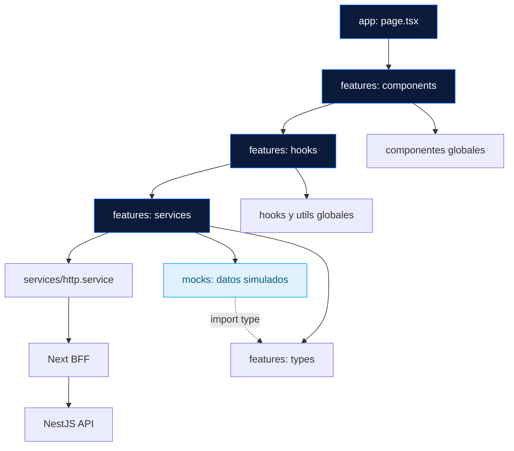

# MTA NEXUS | Arquitectura modular Frontend

    

**Versión:** 1.0 | **Estado:** propuesta de implementación | **Aplicación:** `apps/web`  
**Base:** `MTA_Nexus_Especificacion.md`, `MTA_Nexus_Stack_Frontend_v1.1.md` y `MTA_Nexus_Stack_Backend_v1.1.md`.

`OBLIGATORIO` = regla arquitectónica. `MVP` = primera implementación. `AVANZADO` = incorporar cuando exista necesidad. `DEMO` = datos simulados. `AZURE` = integración sujeta a créditos y disponibilidad.

> Los badges de cabecera son imágenes remotas opcionales de Shields.io. El sistema real utiliza componentes locales; no necesita conexión a dicho servicio. Los árboles son el diseño objetivo, no archivos ya implementados. No se usan emojis. Esta arquitectura concreta la estructura anterior: carpetas globales directamente en la raíz de la app web, features aisladas y services como única frontera de datos de cada módulo.

## 1. Objetivo y decisiones de arquitectura

MTA Nexus es un workspace de MTA Software con autenticación, proyectos, tablero tipo Trello, horas, calendario, soporte, MIA Assistant, MIA Academy, conocimiento, analítica, servicios, equipo y administración. La arquitectura debe permitir construir cada pantalla con datos simulados, probar interacciones y cambiar al backend NestJS sin reescribir las vistas.

- Next.js App Router para rutas, layouts, metadata y composición servidor/cliente. React + TypeScript estricto.
- Arquitectura **feature-based**: cada módulo contiene sus piezas de interfaz, lógica de presentación, contratos y acceso a datos. Las carpetas globales son exclusivamente transversales.
- Las páginas componen pantallas; no contienen cálculos complejos, mocks, fetch ni estados de formularios. Pueden resolver parámetros, metadata y protección SSR.
- Los componentes de pantalla usan hooks del módulo; los hooks llaman sus services; los services obtienen datos desde mocks o API. El flujo de respuesta vuelve por el camino inverso.
- Los componentes presentacionales pequeños reciben props: no se fuerza un hook por cada botón ni se dispara una consulta repetida por tarjeta.
- Zustand solo para estado UI compartido; TanStack Query es la autoridad del estado remoto/simulado consultable. Formularios con React Hook Form + Zod. Context solo para providers y dependencias transversales.
- Todo desarrollo local gratuito; servicios de Azure opcionales, nunca invocados desde un mock como si fueran reales.

## 2. Repositorio y raíz de la aplicación

```text
mta-nexus/
├── apps/
│   ├── web/                         # Next.js; raíz de frontend
│   └── api/                         # NestJS independiente
├── packages/
│   ├── api-client/                  # Tipos REST generados desde OpenAPI
│   ├── design-tokens/               # Tokens compartidos (si se requieren)
│   └── config/                      # TSConfig/ESLint compartidos
├── supabase/
│   ├── migrations/                  # Única autoridad DDL
│   ├── config.toml
│   └── seed.sql                     # Datos académicos separados
├── docs/
├── package.json
├── pnpm-workspace.yaml
├── pnpm-lock.yaml
└── .gitignore
```

`OBLIGATORIO`: se adopta una estructura **sin `src/` en web** para respetar que las carpetas globales estén directamente en la raíz. Al generar Next.js, seleccionar esa opción. El backend conserva `src/` por convención Nest. El alias `@/*` de web apunta a `./*`, no a `./src/*`. No mezclar ambas convenciones.

```text
apps/web/
├── app/                     # Rutas y layouts Next
├── components/              # Solo componentes globales
├── features/                # Cada dominio funcional
├── hooks/                   # Solo hooks transversales
├── services/                # Transporte y utilidades de datos globales
├── stores/                  # Solo estado global de interfaz
├── types/                   # Contratos compartidos
├── schemas/                 # Validaciones realmente transversales
├── context/                 # Providers globales
├── constants/               # Constantes de toda la app
├── utils/                   # Funciones puras globales
├── styles/                  # Tokens, temas y estilos globales
├── config/                  # SEO, OG, entorno, navegación y capacidades
├── lib/                     # Adaptadores técnicos transversales
├── mocks/                   # Datos simulados, eliminables
├── public/                  # Logo, imágenes y assets públicos
├── tests/                   # Pruebas transversales y E2E
├── scripts/                 # Generación/validación de contratos
├── next.config.ts
├── tsconfig.json
├── components.json
├── eslint.config.mjs
├── postcss.config.mjs
├── playwright.config.ts
├── vitest.config.ts
├── proxy.ts                 # Solo si la versión Next elegida lo soporta
├── .env.example
├── package.json
└── README.md
```

Si la versión fijada de Next utiliza `middleware.ts` en vez de `proxy.ts`, seguir su convención; no mantener los dos. La protección de rutas no sustituye autorización Nest. Los archivos de configuración técnica permanecen en raíz porque los frameworks los buscan allí; `config/` contiene configuración propia de la aplicación.

## 3. Carpetas globales: árbol y responsabilidad

```text
components/
├── layout/
│   ├── app-shell.tsx
│   ├── sidebar.tsx
│   ├── sidebar-item.tsx
│   ├── mobile-navigation.tsx
│   ├── workspace-header.tsx
│   ├── breadcrumbs.tsx
│   ├── public-header.tsx
│   ├── public-footer.tsx
│   └── auth-shell.tsx
├── ui/                      # shadcn/ui y primitivas sin dominio
│   ├── button.tsx
│   ├── badge.tsx
│   ├── input.tsx
│   ├── textarea.tsx
│   ├── select.tsx
│   ├── checkbox.tsx
│   ├── switch.tsx
│   ├── dialog.tsx
│   ├── alert-dialog.tsx
│   ├── dropdown-menu.tsx
│   ├── popover.tsx
│   ├── tooltip.tsx
│   ├── tabs.tsx
│   ├── command.tsx
│   ├── sheet.tsx
│   ├── card.tsx
│   ├── table.tsx
│   ├── avatar.tsx
│   ├── progress.tsx
│   ├── calendar.tsx
│   ├── scroll-area.tsx
│   ├── separator.tsx
│   ├── skeleton.tsx
│   └── resizable.tsx
├── feedback/
│   ├── loading-state.tsx
│   ├── error-state.tsx
│   ├── empty-state.tsx
│   ├── forbidden-state.tsx
│   ├── offline-banner.tsx
│   ├── demo-banner.tsx
│   ├── conflict-dialog.tsx
│   ├── confirm-dialog.tsx
│   ├── upload-progress.tsx
│   └── toaster.tsx
└── common/
    ├── page-header.tsx
    ├── section-header.tsx
    ├── data-table.tsx
    ├── pagination.tsx
    ├── filter-bar.tsx
    ├── active-filter-chip.tsx
    ├── status-badge.tsx
    ├── label-chip.tsx
    ├── avatar-group.tsx
    ├── file-dropzone.tsx
    ├── date-range-picker.tsx
    ├── metric-card.tsx
    ├── chart-container.tsx
    ├── permission-gate.tsx
    ├── theme-switch.tsx
    ├── motion-section.tsx
    ├── stagger-list.tsx
    └── command-palette.tsx

hooks/
├── use-debounce.ts
├── use-media-query.ts
├── use-mounted.ts
├── use-online.ts
├── use-disclosure.ts
├── use-pagination.ts
├── use-query-filters.ts
└── use-reduced-motion-preference.ts

services/
├── http.service.ts          # HTTP same-origin, no dominio
├── stream.service.ts        # Fetch streaming / SSE
├── storage.service.ts       # LocalStorage defensivo y versionado
└── download.service.ts      # Blob/descarga y revocación URL

stores/
├── layout.store.ts          # Sidebar, paneles y command palette
├── preferences.store.ts     # Densidad, preferencias de UI no sensibles
└── workspace.store.ts       # Contexto seleccionado, nunca permisos confiables

types/
├── api.types.ts             # ApiResponse, ApiError, PageMeta
├── pagination.types.ts
├── identity.types.ts        # Actor/session view sin secretos
├── permission.types.ts
├── theme.types.ts
└── common.types.ts          # ID, fechas ISO, tipos reutilizados

schemas/
├── pagination.schema.ts
├── date-range.schema.ts
└── identifier.schema.ts

context/
├── app-providers.tsx
├── query-provider.tsx
├── theme-provider.tsx
└── workspace-provider.tsx   # Si se necesita composición por contexto

constants/
├── routes.constants.ts
├── permissions.constants.ts
├── query-keys.constants.ts  # Namespaces compartidos, no keys particulares
├── storage-keys.constants.ts
├── brand.constants.ts
├── limits.constants.ts
└── locale.constants.ts

utils/
├── cn.ts                    # clsx + tailwind-merge
├── format-date.ts
├── format-duration.ts
├── format-currency.ts
├── normalize-search.ts
├── parse-api-error.ts
├── safe-url.ts
└── color-contrast.ts

styles/
├── globals.css
├── tokens.css
├── themes.css
├── motion.css
├── typography.css
└── accessibility.css

config/
├── site.config.ts
├── seo.config.ts
├── open-graph.config.ts
├── navigation.config.ts
├── theme.config.ts
├── motion.config.ts
├── query.config.ts
├── env.config.ts
├── server-env.config.ts    # server-only
├── features.config.ts
├── storage.config.ts
└── security.config.ts

lib/
├── auth/
│   ├── supabase-browser.ts
│   ├── supabase-server.ts
│   └── session.server.ts
├── bff/
│   ├── allowlist.server.ts
│   ├── forward-request.server.ts
│   └── csrf.server.ts
└── contracts/
    └── api-client.ts
```

### Regla de promoción a global

Un componente `card-checklist.tsx` pertenece a `features/boards/`, aunque se use en varias pantallas de ese módulo. Solo se promueve a `components/common` si es realmente reusable sin conocer tarjetas, proyectos ni entidades de negocio. `use-board` nunca pasa a hooks globales; `use-debounce` sí. Un `card.service.ts` nunca pasa a services globales, aunque varios módulos deban consultar tarjetas: se exporta una interfaz pública del feature o se consulta un endpoint transversal en el feature consumidor. Evitar duplicar tipos y archivos `utils.ts` gigantes.

Los globales no dependen de features, con la excepción explícita de los puntos de composición en `app/` (por ejemplo el layout integra un componente de notificaciones). El header global recibe `slots` o props; no importa por sí mismo datos de Academy o MIA. `permission-gate` recibe permisos ya calculados para presentación; no es seguridad real.

## 4. Regla de dependencias y flujo de datos



La flecha indica **quién importa/llama a quién**, no el sentido de los datos devueltos. Los mocks importan los tipos con `import type`, nunca los services, hooks o componentes. Los datos regresan a services, hooks y componentes. La capa API real reemplaza únicamente la implementación de acceso a datos.

| Origen | Permitido | Prohibido |
|---|---|---|
| `app` | componentes de feature, layout, config y helpers SSR de sesión | mocks, queries directas a DB, reglas de negocio |
| `features/*/components` | hooks del feature, UI global, types, constantes y helpers de presentación | mocks, fetch, SDK Azure, llamadas directas a service de negocio |
| `features/*/hooks` | services del feature, schemas, stores UI y hooks globales | mocks, acceso directo a DB, importar componentes |
| `features/*/services` | tipos, schemas, transporte global y mocks de su propio dominio en demo | hooks React, JSX, services con ciclos |
| `mocks` | `import type` de features/global, fixtures propios | lógica de presentación, service de negocio, Azure |
| `components`, `hooks`, `utils`, `services` globales | otros globales compatibles | importar implementación privada de features o mocks |
| `features/A` hacia `features/B` | API pública deliberada de B, tipos compartidos, composición | rutas internas de B y acceso a sus mocks |

Establecer `index.ts` público por módulo para componentes de pantalla y contratos que se comparten. No crear barrels que mezclen módulos cliente y servidor; separar exports `server.ts` si se requieren. Dentro del módulo importar archivos directamente, no su propio barrel. Revisar dependencias con ESLint `no-restricted-imports` y comprobación CI de grafos/regex para aliases y rutas relativas. Prohibir referencias a `@/mocks` fuera de `features/*/services/` (también verificar imports relativos). Tests de servicios deben ejercitar su contrato, no acoplar UI a fixtures.

## 5. Rutas completas y composición App Router

```text
app/
├── layout.tsx                  # HTML, idioma, font y providers
├── error.tsx                   # Error boundary
├── global-error.tsx            # Error de layout raíz
├── not-found.tsx
├── robots.ts
├── sitemap.ts
├── manifest.ts
├── icon.png
├── apple-icon.png
├── opengraph-image.png         # Imagen corporativa local autorizada
├── (public)/
│   ├── layout.tsx
│   ├── page.tsx
│   ├── servicios/page.tsx
│   ├── servicios/[slug]/page.tsx
│   ├── planes/page.tsx
│   ├── contacto/page.tsx
│   ├── privacidad/page.tsx
│   └── terminos/page.tsx
├── (auth)/
│   ├── layout.tsx
│   ├── login/page.tsx
│   ├── invite/page.tsx
│   ├── forgot-password/page.tsx
│   ├── reset-password/page.tsx
│   ├── verify/page.tsx
│   └── onboarding/page.tsx
├── (workspace)/
│   ├── layout.tsx              # Sesión, shell y navegación autorizada
│   ├── loading.tsx
│   ├── error.tsx
│   ├── dashboard/page.tsx
│   ├── projects/
│   │   ├── page.tsx
│   │   ├── archived/page.tsx
│   │   ├── templates/page.tsx
│   │   └── [projectId]/
│   │       ├── page.tsx
│   │       ├── layout.tsx
│   │       ├── boards/[boardId]/page.tsx
│   │       ├── members/page.tsx
│   │       ├── milestones/page.tsx
│   │       └── settings/page.tsx
│   ├── tasks/page.tsx
│   ├── tasks/[cardId]/page.tsx
│   ├── time/page.tsx
│   ├── time/approvals/page.tsx
│   ├── reports/page.tsx
│   ├── calendar/page.tsx
│   ├── support/page.tsx
│   ├── support/[ticketId]/page.tsx
│   ├── mia/page.tsx
│   ├── mia/[conversationId]/page.tsx
│   ├── academy/page.tsx
│   ├── academy/paths/[pathId]/page.tsx
│   ├── academy/courses/[courseId]/page.tsx
│   ├── academy/courses/[courseId]/lessons/[lessonId]/page.tsx
│   ├── academy/assessments/[assessmentId]/page.tsx
│   ├── academy/labs/[labId]/page.tsx
│   ├── academy/mentoring/page.tsx
│   ├── academy/forum/page.tsx
│   ├── academy/achievements/page.tsx
│   ├── academy/manage/page.tsx
│   ├── knowledge/page.tsx
│   ├── knowledge/[documentId]/page.tsx
│   ├── knowledge/review/page.tsx
│   ├── analytics/page.tsx
│   ├── analytics/predictions/page.tsx
│   ├── analytics/models/page.tsx
│   ├── services/page.tsx
│   ├── services/plans/page.tsx
│   ├── services/quotes/page.tsx
│   ├── team/page.tsx
│   ├── team/[memberId]/page.tsx
│   ├── notifications/page.tsx
│   ├── profile/page.tsx
│   ├── settings/page.tsx
│   ├── settings/security/page.tsx
│   ├── settings/appearance/page.tsx
│   ├── settings/notifications/page.tsx
│   ├── admin/page.tsx
│   ├── admin/users/page.tsx
│   ├── admin/roles/page.tsx
│   ├── admin/catalogs/page.tsx
│   ├── admin/organization/page.tsx
│   ├── system/page.tsx
│   ├── system/integrations/page.tsx
│   ├── system/audit/page.tsx
│   ├── system/jobs/page.tsx
│   └── system/security/page.tsx
├── auth/callback/route.ts
└── api/bff/[...path]/route.ts   # Allowlist, no lógica empresarial
```

Los grupos entre paréntesis no forman parte de la URL. Las rutas `/servicios` públicas y `/services` privadas son distintas. La ruta de tarjeta puede abrir un dialog en el tablero y actualizar la URL por query `card=...` o enlazar a su vista completa `/tasks/[cardId]`; no mantener dos estados de tarjeta incompatibles. El layout del proyecto valida contexto y muestra pestañas; no carga todas las tarjetas. Incluir `loading.tsx` y `error.tsx` por segmento pesado cuando aporte valor.

Ejemplo de página dinámica (convención Next moderna; confirmar versión instalada):

```tsx
import { BoardScreen } from '@/features/boards';

type Props = { params: Promise<{ projectId: string; boardId: string }> };
export default async function Page({ params }: Props) {
  const { projectId, boardId } = await params;
  return <BoardScreen projectId={projectId} boardId={boardId} />;
}
```

`BoardScreen` es Client Component porque usa hooks y drag/drop. `page.tsx` permanece Server Component. Las páginas públicas pueden usar Server Components y datos publicados de un service server-only cuando se conecte Nest, sin pasar por hooks de navegador para SEO. Los layouts SSR pueden validar sesión y generar metadata; son excepciones de infraestructura, no atajos para importar mocks. En el prototipo, las pantallas interactivas mantienen exactamente el flujo solicitado.

## 6. Módulo feature: plantilla y responsabilidades

```text
features/projects/
├── components/
│   ├── projects-screen.tsx
│   ├── project-card.tsx
│   ├── project-detail-screen.tsx
│   ├── project-form.tsx
│   ├── project-filters.tsx
│   └── project-members-panel.tsx
├── hooks/
│   ├── use-projects.ts
│   ├── use-project.ts
│   ├── use-project-mutations.ts
│   └── use-project-filters.ts
├── services/
│   └── projects.service.ts
├── schemas/
│   └── project.schema.ts
├── types/
│   └── project.types.ts
├── constants/
│   ├── project-status.constants.ts
│   └── project-query-keys.ts
├── utils/
│   └── project-presenter.ts
├── stores/
│   └── project-view.store.ts
├── lib/                       # Solo si necesita integración particular
├── tests/
│   ├── projects.service.test.ts
│   └── projects-screen.test.tsx
└── index.ts                   # Contratos públicos
```

No crear carpetas vacías artificialmente. Un módulo sencillo puede tener cinco carpetas y crecer después. Si requiere context local (por ejemplo sesión de voz de MIA) se permite `context/` dentro del feature; no globalizarlo. `schemas` valida inputs y respuestas; `types` define modelos del módulo y puede inferir inputs Zod. No duplicar tipos generados OpenAPI: adaptar el DTO al modelo de vista si cambia semántica. `lib` encapsula un motor técnico particular (editor de Academy, audio, cálculo de layout). Los estados persistentes del dominio pertenecen al backend definitivo, no a stores de UI.

## 7. Arquitectura de mocks eliminables

`DEMO` | `OBLIGATORIO`

```text
mocks/
├── auth.mock.ts
├── dashboard.mock.ts
├── projects.mock.ts
├── boards.mock.ts
├── tasks.mock.ts
├── time.mock.ts
├── reports.mock.ts
├── calendar.mock.ts
├── support.mock.ts
├── mia.mock.ts
├── academy.mock.ts
├── knowledge.mock.ts
├── analytics.mock.ts
├── services.mock.ts
├── team.mock.ts
├── notifications.mock.ts
├── profile.mock.ts
├── settings.mock.ts
├── admin.mock.ts
├── system.mock.ts
└── public-portal.mock.ts
```

Los fixtures son TS tipado, deterministas y coherentes (IDs de proyecto/miembro comunes, fechas ISO, referencias válidas). El mock de auth solo representa roles de demostración con cuentas ficticias; no es seguridad ni login real. No crear contraseñas ni usar nombres personales reales sin autorización. Los mocks de chat contienen respuestas **de demostración predefinidas**, nunca se anuncian como respuestas del agente. Los de analytics son ejemplos y no resultados de modelos ejecutados; los precios no aprobados se muestran como ilustrativos. El CSV académico original de 500 tareas puede utilizarse en un entorno demo separado con procedencia, no como operación actual de la empresa.

### Contrato de cambio de proveedor

Se propone una interfaz de service con métodos async que imita el contrato real. Durante prototipo, `projects.service.ts` importa `projectsMock` y encapsula persistencia/latencia. Al integrar Nest, se reemplaza su cuerpo y se elimina su import de mock. No basta con borrar `mocks/` si quedan imports: primero migrar todos los services, después eliminar carpeta y bandera demo y verificar compilación. Para transición por módulos, cada service puede elegir mock/API explícitamente; no fallback silencioso a demo ante error real. Un selector `NEXT_PUBLIC_DATA_MODE=mock|api` es opcional durante transición, solo configura servicios. No es autorización ni secreto; el build productivo rechaza `mock` y los fixtures no deben incluirse en el bundle final. La opción más simple es no introducir selector y migrar el service directamente.

### Ejemplo coherente: proyecto, mock, service, hook y pantalla

`features/projects/types/project.types.ts`

```ts
export type Project = {
  id: string;
  name: string;
  status: 'active' | 'archived';
  updatedAt: string;
};
export type CreateProjectInput = { name: string };
export interface ProjectsService {
  list(): Promise<Project[]>;
  create(input: CreateProjectInput): Promise<Project>;
}
```

`mocks/projects.mock.ts`

```ts
import type { Project } from '@/features/projects/types/project.types';
export const projectsMock = [
  { id: 'demo-project-1', name: 'Proyecto de ejemplo', status: 'active',
    updatedAt: '2026-01-01T00:00:00.000Z' },
] satisfies Project[];
```

`features/projects/schemas/project.schema.ts`

```ts
import { z } from 'zod';
export const projectSchema = z.object({
  id: z.string(), name: z.string(), status: z.enum(['active', 'archived']),
  updatedAt: z.string(),
});
export const createProjectSchema = z.object({ name: z.string().trim().min(3).max(100) });
```

`features/projects/services/projects.service.ts` (primera fase, demo)

```ts
import { projectsMock } from '@/mocks/projects.mock';
import { readLocal, writeLocal } from '@/services/storage.service';
import { projectSchema, createProjectSchema } from '../schemas/project.schema';
import type { ProjectsService } from '../types/project.types';

const key = 'mta-nexus:v1:demo:local:projects';
export const projectsService: ProjectsService = {
  async list() {
    return readLocal(key, projectSchema.array(), structuredClone(projectsMock));
  },
  async create(input) {
    if (typeof window === 'undefined') throw new Error('Demo solo en navegador');
    const value = createProjectSchema.parse(input);
    const current = await this.list();
    const project = { id: crypto.randomUUID(), name: value.name,
      status: 'active' as const, updatedAt: new Date().toISOString() };
    writeLocal(key, [...current, project]);
    return project;
  },
};
```

Ejemplo simplificado de una sesión demo local, sin garantías de concurrencia entre pestañas ni permisos reales. Para demo multiusuario/organización, incorporar ID de workspace/actor ficticio a la clave y a las query keys. Las mutaciones mock de una misma colección se serializan en el service para evitar perder cambios en una pestaña. Para demostrar conflictos se usan versiones, no se promete colaboración real con LocalStorage.

`features/projects/constants/project-query-keys.ts`

```ts
export const projectKeys = {
  all: (scope: string) => ['projects', scope] as const,
  list: (scope: string) => [...projectKeys.all(scope), 'list'] as const,
};
```

`features/projects/hooks/use-projects.ts`

```ts
'use client';
import { useQuery, useMutation, useQueryClient } from '@tanstack/react-query';
import { projectsService } from '../services/projects.service';
import { projectKeys } from '../constants/project-query-keys';

export function useProjects(scope: string) {
  return useQuery({ queryKey: projectKeys.list(scope), queryFn: () => projectsService.list() });
}
export function useCreateProject(scope: string) {
  const client = useQueryClient();
  return useMutation({ mutationFn: projectsService.create.bind(projectsService),
    onSuccess: () => client.invalidateQueries({ queryKey: projectKeys.all(scope) }) });
}
```

`features/projects/components/projects-screen.tsx`

```tsx
'use client';
import { useProjects } from '../hooks/use-projects';
import { LoadingState } from '@/components/feedback/loading-state';
import { ErrorState } from '@/components/feedback/error-state';
import { EmptyState } from '@/components/feedback/empty-state';
import { ProjectCard } from './project-card';
export function ProjectsScreen({ scope }: { scope: string }) {
  const query = useProjects(scope);
  if (query.isPending) return <LoadingState />;
  if (query.isError) return <ErrorState onRetry={() => query.refetch()} />;
  if (!query.data.length) return <EmptyState />;
  return <section>{query.data.map(p => <ProjectCard key={p.id} project={p} />)}</section>;
}
```

`features/projects/index.ts` exporta `ProjectsScreen`. `app/(workspace)/projects/page.tsx` obtiene un `scope` seguro desde contexto SSR de sesión (en demo, `demo:local`), y renderiza `<ProjectsScreen scope={scope} />`. El scope de caché no otorga acceso; Nest valida organización y actor. Los componentes de feedback son contratos a implementar, no se afirma que existan ya.

### Migración del mismo service a API

```ts
import { http } from '@/services/http.service';
import { projectSchema, createProjectSchema } from '../schemas/project.schema';
import type { ProjectsService } from '../types/project.types';
export const projectsService: ProjectsService = {
  async list() {
    const response = await http.get('/projects');
    return projectSchema.array().parse(response.data);
  },
  async create(input) {
    const response = await http.post('/projects', createProjectSchema.parse(input));
    return projectSchema.parse(response.data);
  },
};
```

Este ejemplo usa un listado simple; para un endpoint paginado se define `Page<Project>` desde el primer mock y se preserva exactamente `data/meta`. El wrapper `http` se implementa una vez, con BFF, envelope y errores. No modifica hooks ni pantalla si el contrato coincide. Para pasar a producción se añade paginación, cancelación, idempotencia y validación de servidor. Los fragmentos son plantillas de implementación, no código compilado.

## 8. LocalStorage y estado persistente temporal

| Fuente | Contenido | Persistencia |
|---|---|---|
| TanStack Query | Proyectos, tareas, cursos, métricas de service | Caché en memoria, no persistir privados |
| Zustand global | Sidebar, densidad, paneles | Opcional, `partialize` de preferencias |
| Zustand feature | Selección de tarjetas, vista, filtros | Solo UI; URL para filtros compartibles |
| React local | Modal, input transitorio, hover | Ninguna |
| React Hook Form | Valores de formulario y errores | Ninguna por defecto |
| `next-themes` | Tema claro/oscuro/sistema | Clave dedicada de preferencia |
| LocalStorage demo | Fixtures modificados, checklists, horas simuladas | Solo prototipo identificado |
| Nest + PostgreSQL | Datos operativos reales | Autoridad definitiva |

`services/storage.service.ts` centraliza acceso al navegador, validación de JSON y versión de clave:

```ts
import type { ZodType } from 'zod';
export function readLocal<T>(key: string, schema: ZodType<T>, fallback: T): T {
  if (typeof window === 'undefined') return fallback;
  try {
    const raw = window.localStorage.getItem(key);
    if (!raw) return fallback;
    const parsed = schema.safeParse(JSON.parse(raw));
    return parsed.success ? parsed.data : fallback;
  } catch { return fallback; }
}
export function writeLocal<T>(key: string, value: T) {
  if (typeof window === 'undefined') throw new Error('Storage no disponible en servidor');
  try { window.localStorage.setItem(key, JSON.stringify(value)); }
  catch { throw new Error('No se pudo guardar la información de demostración'); }
}
```

La app informa errores de guardado, no muestra éxito si se agotó cuota. El estado se hidrata en cliente después del montaje para evitar diferencias SSR. No guardar JWT, refresh tokens, claves, información privada, permisos autoritativos, contraseñas, audio, adjuntos grandes o conversaciones reales. Los adjuntos de demo pueden mostrar nombre/tamaño ficticio o vista local temporal con URL de objeto revocada; persistir binarios requeriría IndexedDB y limpieza explícita, no Base64 en LocalStorage. Reinicio de demo elimina solo claves `mta-nexus:v1:demo:` previa confirmación; no `localStorage.clear()`. Los temas y preferencias no sensibles se conservan en producción. Los datos demo no se migran automáticamente a datos reales.

## 9. Sistema visual y dark mode

### Identidad visual

    

`styles/tokens.css` define marca y semántica. `themes.css` define overrides. `globals.css` importa Tailwind v4, tokens y demás CSS en orden compatible. shadcn consume variables semánticas, no hex repetidos en cada módulo.

```css
:root {
  --brand-deep: #0A1A3A;
  --brand-primary: #0066FF;
  --brand-cyan: #00A1FF;
  --brand-soft: #66C2FF;
  --brand-gray: #F2F6FA;
  --background: #F2F6FA;
  --foreground: #0A1A3A;
  --card: #FFFFFF;
  --card-foreground: #0A1A3A;
  --muted: #E8EEF6;
  --muted-foreground: #475569;
  --border: #CBD5E1;
  --primary: #0066FF;
  --primary-foreground: #FFFFFF;
  --ring: #0066FF;
  --status-success-bg: #DCFCE7;
  --status-success-fg: #166534;
  --status-warning-bg: #FEF3C7;
  --status-warning-fg: #92400E;
  --status-danger-bg: #FEE2E2;
  --status-danger-fg: #991B1B;
}
.dark {
  --background: #081224;
  --foreground: #E6EDF7;
  --card: #0F203D;
  --card-foreground: #E6EDF7;
  --muted: #192B47;
  --muted-foreground: #A8B9CF;
  --border: #334762;
  --primary: #66C2FF;
  --primary-foreground: #0A1A3A;
  --ring: #66C2FF;
  --status-success-bg: #123B2A;
  --status-success-fg: #86EFAC;
  --status-warning-bg: #422D0B;
  --status-warning-fg: #FCD34D;
  --status-danger-bg: #451C25;
  --status-danger-fg: #FCA5A5;
}
```

Valores iniciales sujetos a pruebas WCAG AA, incluyendo hover, focus, disabled, gráficos y etiquetas dinámicas. Completar tokens popover, accent, destructive, input, sidebar y chart-1..n antes de usar todos los componentes shadcn. Configurar `@custom-variant dark` y `@theme inline` para mapear tokens Tailwind v4 (por ejemplo `--color-background: var(--background)`). No depender de inversión automática de colores ni de filtros CSS sobre toda la página.

`context/theme-provider.tsx` usa `next-themes` con `attribute="class"`, `defaultTheme="system"`, `enableSystem` y storageKey `mta-nexus:theme`. En `app/layout.tsx` HTML usa `lang="es"` y `suppressHydrationWarning` solo en `<html>` para el tema; no esconder otros errores de hidratación. `theme-switch` muestra Claro/Oscuro/Sistema, usa estado montado antes de icono dependiente del cliente. Dashboard, Kanban, editor, PDF viewer (sin invertir documento), chat, avatar y gráficos consumen tokens. Logo con variante clara/oscura autorizada. Los portales de Radix heredan clase del documento.

### Badges y etiquetas

| Semántica | Código backend / UI | Claro fondo / texto | Uso |
|---|---|---|---|
| Neutral | `todo`, `draft` | #F1F5F9 / #334155 | Por hacer / borrador |
| Informativo | `in_progress`, `indexing` | #E8F0FF / #1746A2 | En progreso / indexación |
| Revisión | `review` | #E0F2FE / #075985 | Revisión |
| Éxito | `done`, `approved` | #DCFCE7 / #166534 | Finalizado / aprobado |
| Atención | `high`, `due_soon` | #FFEDD5 / #9A3412 | Prioridad alta / vencimiento |
| Riesgo | `blocked`, `overdue`, `failed` | #FEE2E2 / #991B1B | Bloqueo / retraso / fallo |
| Especialidad | `frontend`, `backend`, `qa` | Paleta por categoría | Etiquetas editables |

Los códigos definitivos se fijan en el contrato API. `Badge` es primitiva CVA; `StatusBadge` recibe variante semántica; `LabelChip` muestra nombre y color validado (preferir paleta permitida), tooltip y eliminación accesible. Cada feature traduce sus estados y define icono/variante en constants; no introducir reglas de dominio en UI global. En oscuro, usar pares de contraste propios por categoría. Color nunca es la única señal. Usar texto, Lucide y estado accesible; badge interactivo usa botón real. Roles, disponibilidad, vigencia, indexación, predicciones y logros se muestran como etiquetas cuando ayuden; no saturar toda la interfaz.

## 10. Movimiento, diseño profesional y componentes

- Motion (`motion/react`): entrada escalonada de KPI, layout animado de tarjetas, dialogs, cambios de pestaña, hover/tap y AnimatePresence. Presets en `config/motion.config.ts`; duración orientativa 120–250 ms para microinteracción, 250–450 ms para entrada. Evitar animar width/height de cientos de tarjetas.
- GSAP: solo secuencias especiales del portal o briefing de MIA, bajo import dinámico y limpieza al desmontar. No duplicar animaciones Motion en el mismo nodo. Three/R3F y Lottie son opcionales, recursos locales con licencia.
- dnd-kit: overlay de arrastre, sensor teclado, drop targets, scroll controlado y fallback de menú Mover. Motion no modifica el transform que dnd-kit necesita; separar wrappers. Respeto a `prefers-reduced-motion`; sin scroll hijacking, destellos ni cursor personalizado obligatorio.
- Dashboard: skeletons que conservan altura, count-up solo cuando cambia indicador con lectura accesible del valor final, tooltips, filtros sincronizados con URL, drill-down, responsive, filtros activos y personalización sin ocultar alertas críticas. Recharts con tokens y alternativa tabular.
- Estado: mostrar idle, loading, success, empty, error, forbidden, offline y conflicto. Botones de mutación deshabilitados durante envío y confirmaciones destructivas. Dialogs con foco, escape y restauración de foco.
- `next/image`, `next/font` (fuentes locales autorizadas como alternativa offline), SVG/iconos Lucide. No descargar librerías enteras desde CDN; lazy load de Monaco, PDF.js, gráficos pesados y avatar. No usar emojis.

## 11. Configuración SEO, Open Graph y privacidad

`config/site.config.ts`: nombre MTA Nexus, descripción pública, locale `es_PE`, idioma `es`, URL canónica configurada por entorno, nombre de marca, contactos únicamente aprobados. No inventar dominio público. `env.config.ts` valida variables públicas; `server-env.config.ts` valida entorno privado con `server-only` y nunca se importa desde cliente. `seo.config.ts` expone metadata base, helper de metadata pública y metadata privada. `open-graph.config.ts` centraliza descripción/imagen/locale/tamaño/tipo. `navigation.config.ts` lista permisos y destinos. `features.config.ts` usa capacidades reales de Nest para activar módulos; flags visuales no son control de acceso.

```ts
// config/seo.config.ts (solo servidor)
import 'server-only';
import type { Metadata } from 'next';
const siteUrl = process.env.SITE_URL ?? 'http://localhost:3000';
export const baseMetadata: Metadata = {
  metadataBase: new URL(siteUrl),
  title: { default: 'MTA Nexus', template: '%s | MTA Nexus' },
  description: 'Plataforma de gestión y conocimiento de MTA Software.',
  robots: { index: false, follow: false },
  openGraph: { type: 'website', siteName: 'MTA Nexus', locale: 'es_PE' },
};
export const privateMetadata: Metadata = {
  robots: { index: false, follow: false },
};
```

Ejemplo de base conservadora: solo las páginas públicas aprobadas habilitan indexación en producción con `robots: {index: true, follow: true}` y canonical propio (`alternates.canonical`). Publicación real exige `SITE_URL` HTTPS autorizado, no localhost ni dominio de preview. Metadata dinámica de `/servicios/[slug]` se genera en Server Component solo con contenido publicado, y no debe filtrar precios o datos de borrador. `generateMetadata` y export `metadata` no se colocan en componentes cliente. Next `app/robots.ts` y `app/sitemap.ts` son las convenciones que delegan a config; OG estático local de 1200×630 recomendado, favicon, apple icon y manifest. Si se generan imágenes dinámicas con ImageResponse, usar datos públicos, sin dependencias privadas ni nombres de clientes. JSON-LD Organization/Service únicamente con hechos confirmados; serializar con escape de `<` para evitar inyección. No usar reseñas falsas ni metas keywords irrelevantes.

| Entorno / ruta | SEO |
|---|---|
| Portal público en producción, aprobado | Indexable, canonical absoluto, OG, sitemap, contenido semántico |
| Portal local, preview o demo | Noindex; no sitemap público; autenticación de preview si procede |
| Login, recuperación, onboarding | Noindex, nofollow; no datos en OG |
| Workspace, admin, system, MIA, adjuntos y BFF | Noindex y protección real por sesión/permisos; no URLs privadas en sitemap |

`robots.txt` no protege datos ni garantiza desindexación de URL conocida; no usarlo como sustituto de `noindex` o autenticación. Evitar bloquear en robots páginas públicas cuyo noindex deba leer el crawler. En rutas privadas enviar también X-Robots-Tag cuando proceda y `Cache-Control: private, no-store`. No almacenar datos SSR privados en caché compartida. Objetivos: Core Web Vitals, navegación accesible, headings correctos, ALT de imágenes, links reales, sin metadatos que prometan funcionalidades inexistentes. La app interna no necesita posicionar tareas y practicantes.

## 12. Transporte, sesión y tiempo real

`services/http.service.ts` recibe paths relativos permitidos, construye `/api/bff/...`, aplica timeout y AbortSignal, interpreta envelope `data/meta`, normaliza `ApiError`, no lleva secretos. La ruta BFF valida sesión y origen para escrituras, limita paths/métodos/tamaño, reenvía bearer obtenido del servidor a Nest y evita proxy abierto/SSRF. Supabase SSR gestiona identidad, cookies según flujo oficial; no diseñar JWT propios ni almacenar credenciales en Zustand/LocalStorage. El cliente no consulta directamente tablas de negocio. Nest valida token, membresía, recurso, permiso y estado de cuenta. La navegación puede ocultar acciones, pero nunca constituye autorización.

- 401: reautenticar; 403/404: mostrar falta de acceso sin revelar recurso; 409: conflicto de versión con refrescar; 422: error de campo; 429: esperar cuota; 503: dependencia no disponible. Sin reintentar mutaciones automáticamente salvo idempotencia explícita.
- `stream.service.ts` maneja framing SSE y abortado, reconexión con backoff y limpieza. MIA usa POST streaming por fetch con eventos delta/citation/tool_status/done/error. No pasar texto de conversación en query string. Eventos de tareas/notificaciones por canal autorizado, invalidación de query keys. Si se pierde un evento, refetch.
- Archivos: pedir autorización a Nest, URL de subida limitada, finalizar/validar, mostrar estado de escaneo y progreso. No buckets públicos ni URLs firmadas persistidas. Cancelar y revocar previews al desmontar.
- QueryProvider mantiene instancia estable por app cliente; SSR nunca comparte QueryClient con usuarios distintos. Keys por scope org/actor/filtro. Al logout o cambio de organización limpiar caché, streams, borradores y stores del usuario; revocar sesión según flujo.

## 13. Inventario modular de pantallas, componentes, hooks y services

La siguiente sección define el árbol de trabajo para todos los módulos. Cada feature puede tener sus propios `schemas`, `types`, `constants`, `utils`, `stores` y `lib` únicamente cuando se necesiten. Los nombres de archivos son propuestas de implementación coherentes con las rutas de la sección 5. Los endpoints detallados se consolidan en el documento de backend.

### 13.1. `auth` — Autenticación y onboarding

Sesión Supabase SSR real; en demo solo selector ficticio de rol. Errores por campo, estados de MFA, invitación y redirección segura. No persistir tokens.

```text
features/auth/
├── components/
│   ├── login-screen.tsx
│   ├── invite-screen.tsx
│   ├── forgot-password-form.tsx
│   ├── reset-password-form.tsx
│   ├── mfa-challenge.tsx
│   └── onboarding-steps.tsx
├── hooks/
│   ├── use-login.ts
│   ├── use-invitation.ts
│   ├── use-reset-password.ts
│   └── use-onboarding.ts
├── services/
│   └── auth.service.ts
├── types/
│   └── auth.types.ts
├── schemas/
│   └── auth.schema.ts
├── constants/
│   └── auth-query-keys.ts
├── utils/                  # Solo helpers específicos si se requieren
├── stores/                 # Solo estado UI local si se requiere
└── index.ts
```

### 13.2. `dashboard` — Dashboard

Filtros por fecha/proyecto, drill-down, estados y widgets por permisos; métricas del service, nunca contar solo la página visible. Store UI para disposición de widgets.

```text
features/dashboard/
├── components/
│   ├── dashboard-screen.tsx
│   ├── kpi-grid.tsx
│   ├── activity-feed.tsx
│   ├── project-progress-chart.tsx
│   ├── delay-trend-chart.tsx
│   ├── workload-chart.tsx
│   ├── dashboard-filter-bar.tsx
│   └── widget-settings.tsx
├── hooks/
│   ├── use-dashboard.ts
│   ├── use-dashboard-filters.ts
│   └── use-dashboard-layout.ts
├── services/
│   └── dashboard.service.ts
├── types/
│   └── dashboard.types.ts
├── schemas/
│   └── dashboard-filter.schema.ts
├── constants/
│   └── dashboard-query-keys.ts
├── utils/                  # Solo helpers específicos si se requieren
├── stores/                 # Solo estado UI local si se requiere
└── index.ts
```

### 13.3. `projects` — Portafolio de proyectos

Alta/edición/archivo, hitos, miembros, permisos de proyecto y acceso a boards; filtros y vista grid/lista.

```text
features/projects/
├── components/
│   ├── projects-screen.tsx
│   ├── project-card.tsx
│   ├── project-detail-screen.tsx
│   ├── project-form.tsx
│   ├── project-filters.tsx
│   ├── project-members-panel.tsx
│   ├── milestone-timeline.tsx
│   └── project-settings-screen.tsx
├── hooks/
│   ├── use-projects.ts
│   ├── use-project.ts
│   ├── use-project-mutations.ts
│   ├── use-project-members.ts
│   └── use-milestones.ts
├── services/
│   ├── projects.service.ts
│   └── project-members.service.ts
├── types/
│   └── project.types.ts
├── schemas/
│   └── project.schema.ts
├── constants/
│   └── projects-query-keys.ts
├── utils/                  # Solo helpers específicos si se requieren
├── stores/                 # Solo estado UI local si se requiere
└── index.ts
```

### 13.4. `boards` — Tableros y tarjetas

Drag con teclado, reorder y move con versión, actualización optimista/reversión, comentarios, menciones, checklists, adjuntos y auditoría; board-view.store para UI, no persistir tarjetas en Zustand.

```text
features/boards/
├── components/
│   ├── board-screen.tsx
│   ├── board-toolbar.tsx
│   ├── kanban-column.tsx
│   ├── kanban-card.tsx
│   ├── add-column-dialog.tsx
│   ├── card-detail-dialog.tsx
│   ├── card-description-editor.tsx
│   ├── card-assignees.tsx
│   ├── card-label-picker.tsx
│   ├── card-checklist.tsx
│   ├── card-attachments.tsx
│   ├── card-comments.tsx
│   ├── card-activity-timeline.tsx
│   ├── card-time-panel.tsx
│   ├── card-dependencies.tsx
│   ├── card-move-dialog.tsx
│   └── board-template-dialog.tsx
├── hooks/
│   ├── use-board.ts
│   ├── use-board-columns.ts
│   ├── use-card.ts
│   ├── use-card-mutations.ts
│   ├── use-card-comments.ts
│   ├── use-card-checklists.ts
│   ├── use-card-attachments.ts
│   ├── use-card-activity.ts
│   ├── use-card-time.ts
│   ├── use-board-dnd.ts
│   ├── use-board-filters.ts
│   └── use-board-realtime.ts
├── services/
│   ├── boards.service.ts
│   ├── cards.service.ts
│   ├── comments.service.ts
│   ├── checklists.service.ts
│   ├── attachments.service.ts
│   ├── labels.service.ts
│   └── dependencies.service.ts
├── types/
│   ├── board.types.ts
│   ├── card.types.ts
│   └── label.types.ts
├── schemas/
│   ├── move-card.schema.ts
│   ├── card.schema.ts
│   └── column.schema.ts
├── constants/
│   └── boards-query-keys.ts
├── utils/                  # Solo helpers específicos si se requieren
├── stores/                 # Solo estado UI local si se requiere
└── index.ts
```

### 13.5. `tasks` — Mis tareas

Vista personal; las ediciones de tarjeta se componen con componentes públicos de boards para no duplicar mutaciones ni reglas.

```text
features/tasks/
├── components/
│   ├── tasks-screen.tsx
│   ├── task-inbox.tsx
│   ├── task-list.tsx
│   ├── task-calendar.tsx
│   ├── task-detail-screen.tsx
│   ├── task-filter-bar.tsx
│   └── due-date-group.tsx
├── hooks/
│   ├── use-my-tasks.ts
│   └── use-task-filters.ts
├── services/
│   └── tasks.service.ts
├── types/
│   └── task-summary.types.ts
├── schemas/
│   └── task-filter.schema.ts
├── constants/
│   └── tasks-query-keys.ts
├── utils/                  # Solo helpers específicos si se requieren
├── stores/                 # Solo estado UI local si se requiere
└── index.ts
```

### 13.6. `time` — Horas y capacidad

Cronómetro basado en startedAt, no sumar ticks como autoridad; envío, revisión y aprobación, zona horaria, auditoría. Demo guarda instantes ficticios; servidor valida solapamientos.

```text
features/time/
├── components/
│   ├── time-screen.tsx
│   ├── timer-widget.tsx
│   ├── time-entry-form.tsx
│   ├── timesheet-table.tsx
│   ├── approval-queue.tsx
│   ├── capacity-chart.tsx
│   └── time-history.tsx
├── hooks/
│   ├── use-active-timer.ts
│   ├── use-time-entries.ts
│   ├── use-time-mutations.ts
│   └── use-time-approvals.ts
├── services/
│   ├── time.service.ts
│   └── timers.service.ts
├── types/
│   ├── time-entry.types.ts
│   └── timer.types.ts
├── schemas/
│   └── time-entry.schema.ts
├── constants/
│   └── time-query-keys.ts
├── utils/                  # Solo helpers específicos si se requieren
├── stores/                 # Solo estado UI local si se requiere
└── index.ts
```

### 13.7. `reports` — Reportes

Excel/PDF/CSV, preview, filtros autorizados, estado de exportación y descarga firmada; no exportar datos ocultos.

```text
features/reports/
├── components/
│   ├── reports-screen.tsx
│   ├── report-builder.tsx
│   ├── export-format-picker.tsx
│   ├── report-job-table.tsx
│   └── report-preview.tsx
├── hooks/
│   ├── use-report-jobs.ts
│   └── use-export-report.ts
├── services/
│   └── reports.service.ts
├── types/
│   └── report.types.ts
├── schemas/
│   └── report-filter.schema.ts
├── constants/
│   └── reports-query-keys.ts
├── utils/                  # Solo helpers específicos si se requieren
├── stores/                 # Solo estado UI local si se requiere
└── index.ts
```

### 13.8. `calendar` — Calendario

FullCalendar estándar, rango de fechas, entregas, mentorías, eventos y navegación a tarea; permisos en reprogramación.

```text
features/calendar/
├── components/
│   ├── calendar-screen.tsx
│   ├── calendar-toolbar.tsx
│   ├── event-details.tsx
│   ├── event-form.tsx
│   └── agenda-list.tsx
├── hooks/
│   ├── use-calendar-events.ts
│   ├── use-calendar-filters.ts
│   └── use-event-mutations.ts
├── services/
│   └── calendar.service.ts
├── types/
│   └── calendar-event.types.ts
├── schemas/
│   └── calendar-event.schema.ts
├── constants/
│   └── calendar-query-keys.ts
├── utils/                  # Solo helpers específicos si se requieren
├── stores/                 # Solo estado UI local si se requiere
└── index.ts
```

### 13.9. `support` — Bloqueos y soporte

Registro de bloqueo, prioridad, asignación, comentarios, resolución y propuesta de guía revisada.

```text
features/support/
├── components/
│   ├── support-screen.tsx
│   ├── ticket-table.tsx
│   ├── ticket-detail.tsx
│   ├── ticket-form.tsx
│   ├── escalation-panel.tsx
│   └── resolution-editor.tsx
├── hooks/
│   ├── use-tickets.ts
│   ├── use-ticket.ts
│   └── use-ticket-mutations.ts
├── services/
│   └── support.service.ts
├── types/
│   └── ticket.types.ts
├── schemas/
│   └── ticket.schema.ts
├── constants/
│   └── support-query-keys.ts
├── utils/                  # Solo helpers específicos si se requieren
├── stores/                 # Solo estado UI local si se requiere
└── index.ts
```

### 13.10. `mia` — MIA Assistant

Streaming real por Foundry, fuente y cita verificables; modo texto/voz/briefing. Lib local audio y avatar si aplica, store solo controles; mock no genera IA. Cancelación, privacidad, permisos y coste.

```text
features/mia/
├── components/
│   ├── mia-screen.tsx
│   ├── conversation-sidebar.tsx
│   ├── message-list.tsx
│   ├── chat-composer.tsx
│   ├── citation-panel.tsx
│   ├── tool-status.tsx
│   ├── assistant-avatar.tsx
│   ├── voice-controls.tsx
│   ├── waveform.tsx
│   ├── action-confirmation.tsx
│   └── briefing-player.tsx
├── hooks/
│   ├── use-conversations.ts
│   ├── use-chat-stream.ts
│   ├── use-mia-capabilities.ts
│   ├── use-voice-session.ts
│   ├── use-avatar.ts
│   └── use-action-confirmation.ts
├── services/
│   ├── mia.service.ts
│   └── speech.service.ts
├── types/
│   ├── conversation.types.ts
│   ├── chat-event.types.ts
│   └── speech.types.ts
├── schemas/
│   └── message.schema.ts
├── constants/
│   └── mia-query-keys.ts
├── utils/                  # Solo helpers específicos si se requieren
├── stores/                 # Solo estado UI local si se requiere
└── index.ts
```

### 13.11. `academy` — MIA Academy

Rutas, cursos, onboarding, lecciones, rúbricas, mentoría, foro, constancias e insignias. Monaco diferido; no eval de código arbitrario; MIA Tech Coach consulta fuentes aprobadas. Lib local editor.

```text
features/academy/
├── components/
│   ├── academy-screen.tsx
│   ├── learning-path-card.tsx
│   ├── course-catalog.tsx
│   ├── course-detail.tsx
│   ├── lesson-player.tsx
│   ├── lesson-sidebar.tsx
│   ├── code-lab.tsx
│   ├── assessment-player.tsx
│   ├── mentoring-calendar.tsx
│   ├── forum-thread.tsx
│   ├── achievement-gallery.tsx
│   ├── course-editor.tsx
│   └── tech-coach-panel.tsx
├── hooks/
│   ├── use-learning-paths.ts
│   ├── use-courses.ts
│   ├── use-lesson.ts
│   ├── use-progress.ts
│   ├── use-assessment.ts
│   ├── use-lab.ts
│   ├── use-mentoring.ts
│   ├── use-forum.ts
│   ├── use-achievements.ts
│   └── use-course-editor.ts
├── services/
│   ├── academy.service.ts
│   ├── assessments.service.ts
│   ├── mentoring.service.ts
│   └── forum.service.ts
├── types/
│   ├── course.types.ts
│   ├── assessment.types.ts
│   └── progress.types.ts
├── schemas/
│   ├── lesson.schema.ts
│   └── assessment.schema.ts
├── constants/
│   └── academy-query-keys.ts
├── utils/                  # Solo helpers específicos si se requieren
├── stores/                 # Solo estado UI local si se requiere
└── index.ts
```

### 13.12. `knowledge` — Centro de conocimiento

Carga, versiones, borrador, aprobación, publicación, reindexación, retirar, ACL, PDF.js y pruebas de recuperación. Progreso de indexación no equivale a publicación.

```text
features/knowledge/
├── components/
│   ├── knowledge-screen.tsx
│   ├── document-library.tsx
│   ├── document-upload-dialog.tsx
│   ├── document-preview.tsx
│   ├── document-version-history.tsx
│   ├── approval-panel.tsx
│   ├── index-status-badge.tsx
│   ├── access-scope-editor.tsx
│   └── source-test-panel.tsx
├── hooks/
│   ├── use-documents.ts
│   ├── use-document.ts
│   ├── use-upload-document.ts
│   ├── use-document-versions.ts
│   ├── use-document-review.ts
│   └── use-index-status.ts
├── services/
│   └── knowledge.service.ts
├── types/
│   ├── document.types.ts
│   └── document-version.types.ts
├── schemas/
│   └── document.schema.ts
├── constants/
│   └── knowledge-query-keys.ts
├── utils/                  # Solo helpers específicos si se requieren
├── stores/                 # Solo estado UI local si se requiere
└── index.ts
```

### 13.13. `analytics` — AI Analytics

Distinguir histórico/demo y predicción real; modelos de clasificación Retraso y regresión Horas_reales, inputs validados, versión y métricas documentadas. Exportación por reports.

```text
features/analytics/
├── components/
│   ├── analytics-screen.tsx
│   ├── analytics-filter-bar.tsx
│   ├── kpi-card-grid.tsx
│   ├── delay-chart.tsx
│   ├── hours-variance-chart.tsx
│   ├── risk-form.tsx
│   ├── prediction-result.tsx
│   ├── model-registry.tsx
│   ├── model-metrics.tsx
│   └── export-panel.tsx
├── hooks/
│   ├── use-analytics.ts
│   ├── use-prediction.ts
│   ├── use-models.ts
│   └── use-analytics-filters.ts
├── services/
│   ├── analytics.service.ts
│   └── predictions.service.ts
├── types/
│   ├── analytics.types.ts
│   └── prediction.types.ts
├── schemas/
│   └── prediction.schema.ts
├── constants/
│   └── analytics-query-keys.ts
├── utils/                  # Solo helpers específicos si se requieren
├── stores/                 # Solo estado UI local si se requiere
└── index.ts
```

### 13.14. `services` — Servicios y planes comerciales

Tarifas aprobadas, moneda, vigencia, características, borrador/publicación, cotización; no inventar precios. Permisos separados de operaciones de proyectos.

```text
features/services/
├── components/
│   ├── services-screen.tsx
│   ├── service-card.tsx
│   ├── service-editor.tsx
│   ├── plans-comparison.tsx
│   ├── plan-editor.tsx
│   ├── price-history.tsx
│   ├── publish-dialog.tsx
│   ├── quotes-screen.tsx
│   └── quote-builder.tsx
├── hooks/
│   ├── use-services.ts
│   ├── use-plans.ts
│   ├── use-service-mutations.ts
│   └── use-quotes.ts
├── services/
│   ├── services.service.ts
│   ├── plans.service.ts
│   └── quotes.service.ts
├── types/
│   ├── service.types.ts
│   ├── plan.types.ts
│   └── quote.types.ts
├── schemas/
│   └── plan.schema.ts
├── constants/
│   └── services-query-keys.ts
├── utils/                  # Solo helpers específicos si se requieren
├── stores/                 # Solo estado UI local si se requiere
└── index.ts
```

### 13.15. `team` — Equipo

Directorio mínimo autorizado, especialidades, disponibilidad, membresías, invitaciones; no revelar información personal innecesaria.

```text
features/team/
├── components/
│   ├── team-screen.tsx
│   ├── member-card.tsx
│   ├── member-detail.tsx
│   ├── membership-editor.tsx
│   ├── invitation-dialog.tsx
│   └── team-capacity-grid.tsx
├── hooks/
│   ├── use-team.ts
│   ├── use-member.ts
│   └── use-membership-mutations.ts
├── services/
│   └── team.service.ts
├── types/
│   └── member.types.ts
├── schemas/
│   └── membership.schema.ts
├── constants/
│   └── team-query-keys.ts
├── utils/                  # Solo helpers específicos si se requieren
├── stores/                 # Solo estado UI local si se requiere
└── index.ts
```

### 13.16. `notifications` — Notificaciones

Leídas/no leídas, categorías, links seguros a recurso, marcar todo, realtime, contador y deduplicación.

```text
features/notifications/
├── components/
│   ├── notification-bell.tsx
│   ├── notification-popover.tsx
│   ├── notifications-screen.tsx
│   ├── notification-list.tsx
│   ├── notification-item.tsx
│   └── preferences-panel.tsx
├── hooks/
│   ├── use-notifications.ts
│   ├── use-unread-count.ts
│   ├── use-notification-mutations.ts
│   └── use-notification-stream.ts
├── services/
│   └── notifications.service.ts
├── types/
│   └── notification.types.ts
├── schemas/
│   └── notification-preference.schema.ts
├── constants/
│   └── notifications-query-keys.ts
├── utils/                  # Solo helpers específicos si se requieren
├── stores/                 # Solo estado UI local si se requiere
└── index.ts
```

### 13.17. `profile` — Mi perfil

Editar campos permitidos, foto, especialidad si aprobada; no editar rol ni membresía desde perfil.

```text
features/profile/
├── components/
│   ├── profile-screen.tsx
│   ├── profile-form.tsx
│   ├── avatar-upload.tsx
│   ├── personal-activity.tsx
│   └── profile-security-link.tsx
├── hooks/
│   ├── use-profile.ts
│   └── use-profile-mutations.ts
├── services/
│   └── profile.service.ts
├── types/
│   └── profile.types.ts
├── schemas/
│   └── profile.schema.ts
├── constants/
│   └── profile-query-keys.ts
├── utils/                  # Solo helpers específicos si se requieren
├── stores/                 # Solo estado UI local si se requiere
└── index.ts
```

### 13.18. `settings` — Preferencias personales

Tema, densidad, movimiento, idioma, zona horaria, sesiones, MFA y revocación. No confundir UI con seguridad.

```text
features/settings/
├── components/
│   ├── settings-screen.tsx
│   ├── appearance-settings.tsx
│   ├── security-settings.tsx
│   ├── notification-settings.tsx
│   ├── locale-settings.tsx
│   └── session-list.tsx
├── hooks/
│   ├── use-preferences.ts
│   ├── use-sessions.ts
│   └── use-security-settings.ts
├── services/
│   └── settings.service.ts
├── types/
│   └── preferences.types.ts
├── schemas/
│   └── preferences.schema.ts
├── constants/
│   └── settings-query-keys.ts
├── utils/                  # Solo helpers específicos si se requieren
├── stores/                 # Solo estado UI local si se requiere
└── index.ts
```

### 13.19. `admin` — Administración funcional

Usuarios y permisos delegados, configuración de catálogos y políticas; previsualizar impacto, validar alcance, confirmar y auditar.

```text
features/admin/
├── components/
│   ├── admin-screen.tsx
│   ├── users-table.tsx
│   ├── invite-user-dialog.tsx
│   ├── role-matrix.tsx
│   ├── catalog-editor.tsx
│   ├── organization-settings.tsx
│   └── approval-rules.tsx
├── hooks/
│   ├── use-admin-users.ts
│   ├── use-roles.ts
│   ├── use-catalogs.ts
│   └── use-organization-settings.ts
├── services/
│   ├── admin.service.ts
│   ├── roles.service.ts
│   └── catalogs.service.ts
├── types/
│   ├── admin-user.types.ts
│   └── role.types.ts
├── schemas/
│   └── grant.schema.ts
├── constants/
│   └── admin-query-keys.ts
├── utils/                  # Solo helpers específicos si se requieren
├── stores/                 # Solo estado UI local si se requiere
└── index.ts
```

### 13.20. `system` — Superadministración

Salud, cuotas, integraciones, jobs, auditoría técnica, configuración global; no acceso automático a contenido privado; secretos nunca devueltos.

```text
features/system/
├── components/
│   ├── system-screen.tsx
│   ├── health-panel.tsx
│   ├── integration-config.tsx
│   ├── audit-log-table.tsx
│   ├── jobs-monitor.tsx
│   ├── quota-panel.tsx
│   ├── security-policy-panel.tsx
│   └── feature-flags.tsx
├── hooks/
│   ├── use-system-health.ts
│   ├── use-integrations.ts
│   ├── use-audit-log.ts
│   ├── use-jobs.ts
│   └── use-quotas.ts
├── services/
│   ├── system.service.ts
│   ├── audit.service.ts
│   └── integrations.service.ts
├── types/
│   ├── health.types.ts
│   └── audit.types.ts
├── schemas/
│   └── integration.schema.ts
├── constants/
│   └── system-query-keys.ts
├── utils/                  # Solo helpers específicos si se requieren
├── stores/                 # Solo estado UI local si se requiere
└── index.ts
```

### 13.21. `public-portal` — Portal público opcional

Solo contenido aprobado; SEO público SSR mediante service server-only al conectar API. MIA pública aislada de herramientas internas; formulario con rate limit.

```text
features/public-portal/
├── components/
│   ├── landing-screen.tsx
│   ├── public-service-grid.tsx
│   ├── service-detail.tsx
│   ├── published-plans.tsx
│   ├── contact-form.tsx
│   └── public-mia-panel.tsx
├── hooks/
│   ├── use-contact.ts
│   └── use-public-mia.ts
├── services/
│   └── public-portal.service.ts
├── types/
│   └── public-service.types.ts
├── schemas/
│   └── contact.schema.ts
├── constants/
│   └── public-portal-query-keys.ts
├── utils/                  # Solo helpers específicos si se requieren
├── stores/                 # Solo estado UI local si se requiere
└── index.ts
```

## 14. Flujo avanzado de Kanban, MIA y Academy

### 14.1 Kanban

El tablero carga snapshot (columnas, tarjetas visibles, etiquetas y versiones) por `useBoard`. `BoardScreen` mantiene filtros y DndContext; `KanbanColumn` renderiza orden; `KanbanCard` recibe props resumidas; `CardDetailDialog` usa hooks de detalle para comentarios/actividad paginados. El service convierte interacción en `MoveCardInput` (cardId, targetColumnId, before/afterId, expectedVersion, mutationId). El hook cancela queries, guarda snapshot, actualiza caché de forma optimista, revierte en fallo y reconcilia respuesta canónica. Realtime invalida vistas de tablero y mis tareas. No actualizar a mano múltiples stores de dominio. El mock emula estos contratos y registra actividad ficticia de demo. Los estados y etiquetas viven en objetos tipados, no en hex de la tarjeta.

### 14.2 MIA multimodal

`useChatStream` posee AbortController por conversación; `mia.service` consume eventos, valida el framing y retorna stream tipado. `MessageList` renderiza Markdown saneado y fuentes; `CitationPanel` abre únicamente URLs autorizadas; `ActionConfirmation` muestra preview, permisos, coste y confirmación. La voz se encapsula en `speech.service` y `useVoiceSession`, permisos de micrófono solicitados explícitamente, cancelar grabación y liberar pistas al cerrar. Avatar real de Azure si habilitado; alternativa gratuita de avatar propio 3D/CSS con estados idle/listening/thinking/speaking/error. No anunciar que el avatar local sincroniza labios con precisión si solo reacciona a amplitud. Web Speech depende del navegador. No enviar datos personales a servicios de voz externos sin autorización. Desactivar autoescucha, parar audio con botón, subtítulos y fallback texto siempre disponibles.

### 14.3 MIA Academy

Catálogo, ruta y progreso cargan por hooks; la lección usa reproductor, notas y editor, con guardado de progreso a service. Evaluaciones reales no envían solución antes del intento; mock se etiqueta como demo. `CodeLab` usa Monaco cargado bajo demanda; ejecución arbitraria no forma parte del MVP. Tech Coach integra componente público MIA con contexto de curso y fuentes aprobadas; no importa implementación privada del feature. Certificados/insignias se muestran solo con logros verificados por API o fixture identificado. Edición de curso distingue borrador, revisión y publicado.

## 15. Variables de entorno y estrategia local

```dotenv
# apps/web/.env.example — placeholders, no secretos reales
NEXT_PUBLIC_DATA_MODE=mock
NEXT_PUBLIC_SUPABASE_URL=
NEXT_PUBLIC_SUPABASE_PUBLISHABLE_KEY=
SITE_URL=http://localhost:3000
API_BASE_URL=http://localhost:4000/api/v1
ENABLE_PUBLIC_PORTAL=false
```

Modo mock no requiere Azure ni Nest para dibujar vistas. Validar que las variables de Auth/API existan al habilitar modo real. Los flags de capacidades en servidor controlan navegación y botones; el backend sigue siendo autoridad. No utilizar prefijo `NEXT_PUBLIC_` para secretos ni claves Azure. Mantener `.env.example`, `.gitignore` y lockfile. Instalar únicamente bibliotecas que use la fase actual; las dependencias completas se encuentran en Stack Frontend v1.1. Hosting no obligatorio: `pnpm --filter ... dev` o scripts de workspace definidos tras crear los paquetes; no hay obligación de Vercel Pro ni servicios comerciales.

## 16. Pruebas, convenciones y control de calidad

- `kebab-case` en archivos/carpetas, PascalCase componentes, `useX` hooks, camelCase funciones, tipos explícitos, `import type`. `page.tsx`, `layout.tsx`, `route.ts` siguen convención Next. No `any` para respuestas API.
- Vitest/React Testing Library o Jest compatible con Next; elegir un runner principal. Tests de services en demo y API con transporte simulado, tests de schema, estado de errores y persistencia corrupta. Tests de integración de server components mediante build/E2E cuando corresponda.
- Playwright: login real o modo demo rotulado, rol líder vs practicante, crear/mover tarjeta, checklist, comentarios, adjuntos, horas, cambio de tema, recarga, filtros y exportación; MIA con cita/fuera de ámbito/no información; Academy progreso; documentos versiones. No realizar llamadas Azure costosas en CI por defecto.
- Contrato OpenAPI generado desde Nest, comprobar cambios incompatibles en CI. Validación runtime de respuestas críticas; no ocultar mismatch con type assertion. Claves de caché scope y limpieza al logout.
- CI ejecuta lint, typecheck, tests, build, revisión de importaciones, secretos y auditoría de dependencias; verificar versión de librerías y licencias antes de adoptar. Producción sin imports mock y sin bandera demo. Pruebas visuales en claro/oscuro, tamaños móviles, teclado, lector de pantalla y movimiento reducido.

## 17. Orden de implementación y criterio de terminado

| Fase | Trabajo | Resultado comprobable |
|---|---|---|
| 0 | Monorepo, alias, globales, config SEO, tema, componentes básicos | App compila, navegación y tema consistente |
| 1 | Auth demo, shell, dashboard, proyectos, boards, tasks, time | Flujo de trabajo con fixtures y persistencia local |
| 2 | Academy, conocimiento, soporte, notificaciones, reportes | Vistas completas con estados y flujos simulados |
| 3 | API real, auth Supabase, permisos, contracts | Cambiar services; mantener componentes/hooks |
| 4 | MIA real, fuentes y streaming, indexación | Respuestas autorizadas verificables |
| 5 | Analytics real, exportación, voz/avatar y scoring opcionales | Capacidad real o estado no disponible |
| 6 | Admin/system, comercial público opcional, auditoría y pruebas | Permisos efectivos, calidad y coste revisados |

Criterio por módulo: page delgada, screen, componentes, hook, service y tipos; sin import de mocks fuera de services; errores, loading, empty, forbidden, mobile, dark, acciones accesibles y tests. Antes de eliminar mocks: inventariar imports, completar services reales, quitar DEMO de build productivo, limpiar namespace demo y pasar typecheck/build/E2E. No prometer funcionalidades sin conexión ni presentar datos simulados como reales.

## 18. Referencias y decisiones abiertas

- Next.js: https://nextjs.org/docs/app/getting-started/server-and-client-components
- Metadata y OG: https://nextjs.org/docs/app/getting-started/metadata-and-og-images
- Robots: https://nextjs.org/docs/app/api-reference/file-conventions/metadata/robots
- Sitemap: https://nextjs.org/docs/app/api-reference/file-conventions/metadata/sitemap
- TanStack Query: https://tanstack.com/query/latest/docs/framework/react/overview
- shadcn/ui: https://ui.shadcn.com/docs
- Supabase SSR: https://supabase.com/docs/guides/auth/server-side/nextjs

Fuentes internas: especificación funcional y stacks v1.1 de MTA Nexus. Se mantiene paleta y alcance; la raíz sin `src/`, la carpeta `context/` y la capa `services/` por feature reemplazan la organización previa. Pendiente: fijar versiones, validar contrato de API con Nest, elegir dominio público autorizado, determinar permisos exactos, balance de Azure y probar los fragmentos en el repositorio real. Este documento es una arquitectura propuesta, no un frontend entregado ni verificado en ejecución.
