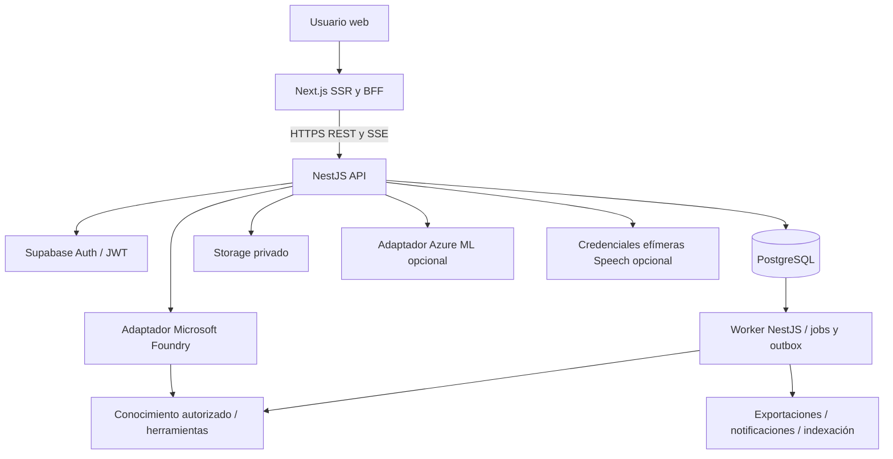

# MTA NEXUS — Stack tecnológico Backend

   

**Etiquetas de revisión:** `v1.1` · `Badges y etiquetas` · `Paleta MTA` · `Modo claro/oscuro` · `Sin emojis`

> Los badges de cabecera son una ayuda visual opcional del visor Markdown (imágenes remotas de Shields.io); los textos alternativos y etiquetas mantienen el significado sin conexión. La aplicación no dependerá de Shields.io ni de un servicio de badges externo.

**Documento:** arquitectura de servicios, persistencia, seguridad, IA y operación  
**Versión:** 1.1 — 24 de noviembre de 2026 (ampliación del sistema visual de badges y etiquetas)  
**Framework obligatorio:** NestJS + TypeScript + Node.js  
**Documento base:** `MTA_Nexus_Especificacion.md`, v1.0  
**Documento complementario:** `MTA_Nexus_Stack_Frontend_v1.1.md` (Next.js)

> Decisión: NestJS será el backend independiente y la única autoridad de lógica de negocio. Next.js solo implementará UI, SSR y un BFF limitado. Se conserva el alcance funcional y la identidad de MTA Nexus. El presupuesto disponible declarado es de USD 100 en créditos Azure for Students (saldo real por verificar); no se presupone ningún otro servicio de pago ni capacidad ilimitada de planes gratuitos. Este documento es un plan técnico, no una certificación de despliegue o de disponibilidad de recursos cloud.

## 1. Objetivo y decisiones fundamentales

El backend implementará proyectos, tablero Kanban, tarjetas, registro de horas, calendario, notificaciones, soporte, MIA Assistant, MIA Academy, biblioteca y recuperación de conocimiento, analítica y predicciones, catálogo comercial, equipo, permisos y administración técnica. Debe garantizar consistencia, trazabilidad, aislamiento de datos y protección del presupuesto. La IA es una capa de asistencia, no la autoridad sobre el estado del negocio.

- Monolito modular NestJS, con fronteras por dominio y un worker del mismo código base para tareas largas. No introducir microservicios, Kubernetes, Kafka, Elasticsearch o servicios administrados obligatorios para una demo pequeña.
- PostgreSQL como fuente de verdad. Supabase Auth, Storage y Postgres local o Free como plataforma inicial, con portabilidad vía SQL y almacenamiento abstracto.
- REST versionado, OpenAPI, SSE para streaming/realtime inicial. No exponer la DB directamente a la aplicación para operaciones de negocio.
- Todo acceso se valida por actor, organización, proyecto, membresía, permiso y clasificación del recurso, incluso herramientas de MIA y exports.
- Operaciones críticas transaccionales, auditoría append-only, outbox y jobs durables. No depender de colas únicamente en memoria.
- Las funcionalidades cloud se activan de forma independiente. Texto y operación web continúan aunque voz, avatar o predicción no estén disponibles.

## 2. Stack seleccionado

| Tecnología / paquete | Responsabilidad | Modelo económico |
|---|---|---|
| Node.js 24 LTS, TypeScript strict | Runtime y lenguaje | Abierto |
| NestJS (`@nestjs/common`, `@nestjs/core`, `@nestjs/platform-express`) | API modular, DI, guards, pipes, interceptores | Abierto; Express por simplicidad y compatibilidad |
| `@nestjs/config` + Zod | Configuración validada al arrancar | Abierto |
| `class-validator`, `class-transformer` | DTOs de entrada y transformación controlada | Abierto |
| `@nestjs/swagger` | OpenAPI, documentación y generación de cliente | Abierto |
| PostgreSQL | Entidades, restricciones, índices, transacciones y RLS | Abierto; local o Supabase Free con límites |
| `drizzle-orm` + `pg` | Consultas SQL tipadas y transacciones | Abierto; sin ORM cloud ni funciones de pago |
| Supabase CLI | Entorno local y migraciones SQL | Abierto; no exige servicio hospedado |
| Supabase Auth + `@supabase/supabase-js` + `jose` | Identidad, sesiones, MFA y validación de JWT | Local o Free; sujeto a límites y correo |
| Supabase Storage | Buckets privados y archivos firmados | Local o Free; sujeto a cuota |
| `@nestjs/throttler` | Límites de API | Abierto; almacenamiento local para instancia única, distribución si escala |
| `helmet` | Headers de seguridad | Abierto |
| `nestjs-pino` + `pino` | Logs estructurados y redacción de secretos | Abierto |
| `@nestjs/schedule` | Disparadores periódicos de jobs y recordatorios | Abierto; jobs persistentes en Postgres |
| `rxjs` (incluido en ecosistema Nest) | Streams y SSE | Abierto |
| `@azure/identity` | Autenticación Entra/identidad administrada | SDK abierto; permisos y recursos Azure aparte |
| `@azure/ai-projects` / REST oficial según API | Adaptador para el agente existente de Foundry | SDK abierto; inferencia/herramientas consumen Azure |
| Azure Speech | Voz y avatar opcionales | Facturable según SKU, región y uso |
| Azure Machine Learning | Scoring de modelos entrenados | Facturable si se despliegan recursos de cómputo |
| Azure AI Search / File Search | Recuperación documental opcional según configuración | Cuotas y cargos posibles |

Elegir versiones estables compatibles con Node 24 LTS y fijarlas en lockfile. No asumir que la última versión de un SDK coincide con la API del agente creado. Validar requisitos de Node de ambos frameworks y hacer prueba real de compilación y conexión. Revisar licencias transitivas; no contratar servicios de mantenimiento de paquetes ni versiones enterprise para cumplir el MVP.

### 2.1 Librerías adicionales por necesidad

| Paquete | Uso | Momento de incorporación |
|---|---|---|
| `file-type` | Verificar firma de archivos además de MIME/extensión | Adjuntos |
| `busboy` o adaptador Multer de Nest/Express | Carga streaming de archivos pequeños cuando no haya subida directa | Adjuntos; elegir uno según flujo |
| `csv-parse` / `csv-stringify` | Importar CSV de tareas y exportar datos | MVP |
| `exceljs` | Exportación XLSX con estilos y fórmulas controladas | Reportes |
| `pdfkit` | Reportes PDF, constancias y cotizaciones | Reportes/Academy |
| `sharp` | Miniaturas y optimización de imágenes permitidas | Opcional |
| `sanitize-html` | Saneamiento de rich text/HTML cuando sea necesario | Tarjetas/Academy |
| `nodemailer` | SMTP configurable si se necesita correo transaccional | Opcional; el SMTP real puede tener costos/cuotas |
| `@nestjs/terminus` | Health checks y readiness | MVP |
| `@opentelemetry/api` + SDK Node | Trazas locales y métricas opcionales | Avanzado; exportador cloud no obligatorio |
| `web-push` | Notificaciones push con opt-in | Avanzado; sin prometer entrega universal |
| `@microsoft/microsoft-graph-client` | Outlook/Teams y calendario si hay autorización | Evolución; no obligatorio |
| Jest + Supertest | Unitarias, integración y API E2E | MVP |
| Testcontainers o Supabase local | PostgreSQL real para pruebas | MVP; motor compatible y licencia aplicable |

No utilizar Redis/BullMQ como requisito: inicialmente PostgreSQL resuelve cola, outbox y locking. Si posteriormente se justifican por volumen, considerar BullMQ con Valkey/Redis compatible y revisar licencias y recursos; no comprar un servicio cache para el proyecto académico. No añadir ORM duplicado (Prisma y Drizzle a la vez), ni dos validadores diferentes para cada DTO; Zod es para configuración y contratos puntuales, class-validator para DTO REST.

## 3. Arquitectura general



El navegador no conoce secretos Azure ni credenciales DB. BFF no es un proxy abierto: rutas/métodos permitidos, sesión verificada, CSRF y cancelación de streams. Los servicios internos no se exponen públicamente por defecto. API y worker pueden correr en la misma PC y compartir base de datos. Los jobs tienen persistencia; si la máquina está apagada no se prometen notificaciones o trabajos en segundo plano hasta reanudarla.

### 3.1 Capas Nest por dominio

- `Controller`: HTTP, DTO, status, documentación, actor autenticado; no SQL ni reglas de negocio.
- `Application Service / Use Case`: orquesta permisos, transacciones, cambios de estado y eventos. Ejemplo: `MoveCardUseCase`, `ApproveTimeEntryUseCase`, `PublishDocumentUseCase`.
- `Domain`: reglas, enums, políticas de estados e invariantes que pueden probarse sin cloud. No importar controllers o SDK de Azure.
- `Repository`: queries tipadas, filtros por ámbito, bloqueo, persistencia. Usar unidad de trabajo para compartir una única transacción.
- `Infrastructure / Adapter`: Supabase, Azure, almacenamiento, proveedor de correo, render de archivos y reloj.
- `Guard / Policy`: autenticación, autorización basada en recurso y permisos explícitos; no solo roles globales.
- `Worker`: reintentos, idempotencia, notificaciones, exportación, reindexación y automatización. Debe revalidar autorización al operar en nombre de un usuario.

Inyección mediante interfaces/tokens donde haya infraestructura variable; no crear una abstracción innecesaria para cada función trivial. Controllers delgados, servicios cohesionados y módulos con imports/exports explícitos. Dependencias cruzadas por interfaces/eventos; evitar `forwardRef` como diseño habitual.

## 4. Organización del código

```text
mta-nexus/
  apps/web/                        # Next.js
  apps/api/                        # NestJS
  packages/api-client/             # Generado desde OpenAPI
  packages/design-tokens/
  packages/config/
  supabase/
    config.toml
    migrations/                    # Única fuente de migraciones DDL
    seed.sql                       # Solo datos demo sin secretos
  docs/
  pnpm-workspace.yaml
  pnpm-lock.yaml
```

```text
apps/api/src/
  main.ts
  worker.ts
  app.module.ts
  config/
  common/
    decorators/ guards/ filters/ interceptors/ pipes/
    errors/ logging/ pagination/ security/ idempotency/
  infrastructure/
    database/ storage/ auth/ azure/ mail/ observability/
  modules/
    auth/ users/ organizations/ access-control/
    projects/ boards/ cards/ comments/ checklists/
    attachments/ dependencies/ time-tracking/ approvals/
    calendar/ support/ notifications/ automation/
    knowledge/ academy/ mia/ speech/ analytics/ predictions/
    services/ plans/ quotes/ team/ profile/ settings/
    audit/ imports/ exports/ jobs/ integrations/ health/
  tests/
```

Ejemplo de estructura para cards: `cards.module.ts`, `cards.controller.ts`, `dto/`, `application/`, `domain/`, `infrastructure/`, `cards.policy.ts`, `__tests__/`. Evitar `utils.ts` gigantes con reglas de negocio. En el MVP, módulos pequeños relacionados pueden compartir frontera (por ejemplo comments/checklists dentro de cards) sin alterar los contratos.

## 5. Identidad, autorización y sesión

### 5.1 Autenticación

Supabase Auth es el proveedor de identidad inicial. No crear tabla de contraseñas propia ni otro flujo JWT casero. La API valida JWT mediante JWKS (`jose`, issuer, audience, firma, expiración y algoritmo fijado) si el proyecto usa claves asimétricas; si utiliza configuración heredada, emplear verificación oficial del servidor/Auth API adecuada, sin aceptar tokens no verificados. Rotación de claves contemplada. Nunca confiar en `user_metadata`, roles enviados por cliente o headers arbitrarios.

Flujo: administrador autorizado invita → aceptación de un solo uso y confirmación → alta de perfil/membresía → login → BFF SSR obtiene access token → Nest verifica token y estado actual de cuenta → consulta roles y permisos por recurso → operación. Supabase SSR gestiona sesión/cookies; BFF no genera tokens de identidad alternativos. MFA para admin/superadmin con TOTP si disponible; verificar nivel de autenticación en backend para operaciones privilegiadas. Suspensión y cambios de rol efectivos en la API aunque el JWT anterior siga vigente; revocar sesiones cuando corresponda. Invitaciones, recuperación y login usan mensajes que no revelan existencia de cuentas.

Correo: Supabase local usa Mailpit para demostración de invitación y recuperación. El proveedor SMTP incorporado de Supabase hospedado está pensado para pruebas, restringe destinatarios a miembros del equipo del proyecto y aplica límites bajos (documentación indica 2 correos/hora en endpoints de envío). Para usuarios reales, configurar SMTP autorizado y compatible con presupuesto; no prometer correo externo gratuito ilimitado. Durante demo se usa Mailpit o cuentas de prueba autorizadas; nunca quitar verificación/seguridad para compensar límites de correo.

### 5.2 RBAC + alcance de recurso

| Rol | Alcance | Restricciones |
|---|---|---|
| Practicante | proyectos asignados, propias tarjetas, horas, Academy y MIA autorizada | no asigna globalmente ni aprueba sus horas |
| Líder | permisos de practicante + coordinación dentro de proyectos donde es líder | no es privilegio global, no autoaprueba |
| Supervisor | cartera/equipos asignados, aprobación, revisión de guías y métricas | no accede fuera de cartera ni administra seguridad por defecto |
| Administrador | usuarios, catálogos y configuración delegada | no lee conversaciones privadas ni edita tareas sin permiso de recurso |
| Superadmin | salud, seguridad, integraciones, configuración global técnica | no adquiere automáticamente acceso a contenido de negocio ni puede elevarse sin flujo auditado |

Modelo de datos `roles`, `permissions`, `role_permissions`, `memberships`, `project_members`, `scoped_grants`. Permisos ejemplo `card.read`, `card.assign`, `board.manage`, `time.submit`, `time.approve`, `knowledge.publish`, `academy.edit`, `commercial.publish`, `system.integrations.manage`. Un líder puede ser miembro normal en otro proyecto. Los grants adicionales se restringen por ámbito, expiración y otorgante autorizado. Separación de funciones para aprobación propia, edición de precios y elevación técnica. Acceso excepcional de soporte solo si la organización aprueba un proceso temporal, justificado y auditado; no implementar bypass silencioso.

Guards: `AuthGuard` → `ActiveMembershipGuard` → `PermissionGuard` + política de recurso en use case/repository. Para listados, aplicar predicado en DB antes de contar o paginar. Para mutaciones, comprobar dentro de transacción cuando pueda cambiar la membresía. Devolver 404 cuando sea necesario evitar revelar existencia de recurso, 403 para operación conocida prohibida. Revisar cada FK suministrada (asignado, archivo, columna, tarjeta, curso) para evitar cruce de organización/proyecto.

### 5.3 Defensa en profundidad en PostgreSQL

- Conectar Nest con rol DB de aplicación no propietario, sin `BYPASSRLS`, sin superusuario y con privilegios mínimos. Separar rol migrador/owner, rol worker y credenciales de administración. No usar URL de propietario para requests de aplicación.
- SQL migrations en `supabase/migrations/` son la única autoridad DDL. Drizzle se usa como query builder y tipado con esquema sincronizado/revisado; no ejecutar `drizzle-kit push` ni una segunda cadena de migraciones en producción.
- Tablas internas preferentemente en esquema no expuesto por PostgREST; RLS obligatoria para tablas/recursos con datos de organización. Quitar grants directos innecesarios a `anon`/`authenticated`. Las rutas de lectura pública se implementan en Nest sobre datos publicados.
- Dentro de la misma transacción y conexión pool, establecer contexto desde identidad ya verificada con `set_config('app.user_id', $1, true)` y `set_config('app.organization_id', $2, true)`. Las políticas SQL usan ese contexto con lectura segura y deniegan cuando falta. No confiar en IDs de organización del cliente sin validar membresía. No persistir configuración entre requests. Probar comportamiento de pooler y RLS. Las políticas verifican relaciones/ACL, no solo igualdad de organización. Usar funciones auxiliares de permisos cuidadosamente revisadas para evitar recursión RLS; si son SECURITY DEFINER, fijar search_path y grants mínimos.
- Storage de Supabase usa políticas propias sobre `storage.objects` y JWT del usuario cuando aplica; no asumir que las variables `app.*` se propagan al servicio Storage. El backend crea URLs firmadas tras autorización. Credencial service role, si hace falta para operaciones administrativas/storage, se aísla en adaptador dedicado y nunca se usa como cliente general. Worker usa roles/job scope específicos y se audita.

Ejemplo conceptual (no migración lista para ejecutar): la política de lectura de cards exige pertenencia a la organización y membresía válida del proyecto o permiso explícito; la escritura exige además permiso sobre esa tarjeta y transición autorizada en el servicio. RLS complementa, no reemplaza, las invariantes de negocio de Nest.

## 6. Modelo de datos y persistencia

| Dominio | Entidades principales |
|---|---|
| Identidad | organizations, profiles (FK a identidad), memberships, roles, permissions, scoped_grants, invitations |
| Proyectos | projects, project_members, milestones, boards, board_columns, cards, card_assignees, labels, card_labels |
| Colaboración | comments, comment_mentions, reactions, checklists, checklist_items, card_dependencies, attachments, watchers |
| Tiempo | timers, time_entries, approval_history, capacity_rules |
| Agenda y soporte | calendar_events, tickets, ticket_comments, ticket_status_history |
| Academy | learning_paths, courses, course_versions, modules, lessons, enrollments, progress, quizzes, attempts, submissions, mentorships, certificates |
| Conocimiento | documents, document_versions, document_acl, indexing_jobs, source_refs |
| IA | conversations, messages, citations, tool_runs, action_proposals, model_versions, predictions, usage_ledger |
| Comercial | services, plans, plan_versions, prices, quote_requests, quotes, quote_items, commercial_approvals |
| Operación | notifications, notification_preferences, automation_rules, automation_runs, audit_events, outbox, jobs, import_batches, export_jobs, integration_settings |

Convenciones: UUID, `organization_id` en recursos privados, FK y restricciones consistentes, IDs humanos por proyecto para tarjetas, `created_at`, `updated_at` en UTC, `created_by`, `version` para concurrencia, `archived_at` para archivos lógicos. Dinero NUMERIC con código de moneda ISO, no float; duración en segundos/minutos enteros. Unique compuestos para aislar ámbito; índices por organización/proyecto, estado, fecha, columna/posición, usuario y jobs pendientes. Usar constraints para integridad y versionar migraciones. Evitar `cascade delete` accidental de auditoría o reportes.

### 6.1 Separación demo/operativa

El CSV académico tiene 500 registros: 470 finalizados, 30 pendientes y 163 finalizados con retraso (según SRS). Los cinco proyectos documentados y siete grupos de proyecto/especialidad no se confunden. Los registros simulados deben estar en un workspace/entorno demo separado; no crear credenciales reales desde los nombres del CSV ni inferir que son tareas actuales. Validar nuevamente el archivo al importar; conservar campos originales, nulos, procedencia, hash, batch_id y errores por fila. No inventar comentarios, checklist, archivos, horas por sesión o resultados de modelos. La importación debe ser reversible sin eliminar ediciones posteriores no relacionadas.

### 6.2 Concurrencia y auditoría

Usar transacciones PostgreSQL para movimiento, asignaciones, dependencias, aprobación, publicación y jobs. Versionado optimista `UPDATE ... WHERE id = ... AND version = ...`; si no coincide, retornar 409 con recurso actualizado si el usuario puede leerlo. Bloqueo de filas o advisory lock por dominio cuando se requiera serialización; respetar orden consistente para evitar deadlocks. Retry acotado para errores transitorios, no para validación. Auditoría crítica append-only en la misma transacción que el cambio; registro de actor, recurso, acción, timestamp, correlación y diff minimizado. No almacenar tokens, contraseñas ni cuerpo completo de chats en auditoría. Retención y acceso aprobados por MTA. La auditoría no es inmutable frente a un DBA con privilegios máximos; separar permisos y copias para reducir riesgo.

## 7. Contrato de API y seguridad transversal

Prefijo `/api/v1`; JSON por defecto; SSE para streams; signed URLs para archivos. DTOs por caso de uso, no exponer entidades directamente. `ValidationPipe({ whitelist: true, forbidNonWhitelisted: true, transform: true })` con conversiones explícitas, sin confiar en coerción implícita de booleanos. DTO de creación distinto del update para evitar mass assignment. OpenAPI genera cliente de Next, no compartir repositorios ni código de servidor. Swagger local o autenticado; no publicar contratos administrativos a cualquiera.

```json
{
  "data": { "id": "<uuid>", "version": 3 },
  "meta": { "requestId": "<correlation-id>" }
}
```

```json
{
  "error": {
    "code": "CARD_VERSION_CONFLICT",
    "message": "La tarjeta fue modificada por otro usuario.",
    "requestId": "<correlation-id>"
  }
}
```

HTTP: 200/201 éxito, 202 trabajo asíncrono, 204 sin contenido, 400 petición inválida, 401 sin autenticación, 403 prohibido, 404 inexistente/no revelable, 409 conflicto, 422 regla/validación de negocio, 429 cuota, 503 dependencia caída. Validación puede usar 400 por defecto en Nest; documentar y personalizar si se reserva 422 para dominio. Paginación cursor estable con límite máximo y filtros allowlist. `Idempotency-Key` con actor, ruta, hash de payload y resultado; conflicto ante reutilización con payload distinto. TTL y limpieza. No reintentar mutaciones no idempotentes automáticamente.

Seguridad: Helmet, TLS, límites de tamaño, timeouts, CORS con orígenes exactos si se necesita acceso directo (BFF same-origin por defecto), CSRF en rutas que consumen cookies, validación de Origin, rate limit login/chat/upload/export, SQL parametrizado, saneamiento de rich text, protección SSRF para URLs externas (preferir allowlist fija y no aceptar URL arbitraria), control de egress, secretos en variables protegidas. API nunca recibe permisos otorgados por el modelo. Revisar dependencias con `pnpm audit`, secret scanning y pruebas de autorización.

## 8. API y servicios por módulo

| Módulo | Rutas orientativas bajo `/api/v1` | Responsabilidad principal |
|---|---|---|
| Auth/identidad | `GET /me`, `GET /me/permissions`, `POST /invitations`, `POST /users/:id/suspend` | Identidad, perfiles, membresías y permisos; login/refresh mediante Auth |
| Dashboard | `GET /dashboard`, `GET /dashboard/activity` | Agregados exactos por ámbito, período y origen |
| Proyectos | `GET/POST /projects`, `GET/PATCH /projects/:id`, `POST /projects/:id/archive`, `/members`, `/milestones` | Portafolio, equipos, hitos, archivado |
| Kanban | `GET /boards/:id`, `POST /boards/:id/columns`, `PATCH /columns/:id`, `POST /columns/:id/reorder` | Tableros, columnas, orden, límites y semántica |
| Tarjetas | `POST /boards/:id/cards`, `GET/PATCH /cards/:id`, `POST /cards/:id/move`, `/archive`, `/restore`, `/duplicate`, `/submit-review`, `/approve` | Ciclo de vida y reglas de trabajo |
| Colaboración | `/cards/:id/comments`, `/checklists`, `/assignees`, `/labels`, `/dependencies`, `/activity` | Comentarios, menciones, checklist, dependencia y auditoría |
| Archivos | `POST /uploads`, `POST /uploads/:id/complete`, `GET /attachments/:id/download` | ACL, subida, validación y descarga firmada |
| Horas | `POST /timers/start`, `POST /timers/:id/stop`, `GET/POST /time`, `POST /time/:id/submit`, `/approve`, `/reject` | Reloj, partes y validación |
| Calendario | `GET/POST /calendar/events`, `PATCH /calendar/events/:id` | Eventos autorizados y sincronización opcional |
| Soporte | `GET/POST /tickets`, `PATCH /tickets/:id`, `/comments`, `/resolve`, `/propose-guide` | Bloqueos, solución y conocimiento |
| MIA | `GET/POST /mia/conversations`, `POST /mia/chat`, `POST /mia/actions/:id/confirm`, `/feedback` | Chat real, citas, herramientas y confirmación |
| Speech | `POST /speech/session`, `POST /speech/session/:id/close` | Autorización temporal, cuotas y cierre |
| Academy | `/academy/paths`, `/courses`, `/lessons`, `/enrollments`, `/attempts`, `/submissions`, `/certificates` | Formación, publicación y evaluación |
| Conocimiento | `GET/POST /documents`, `/documents/:id/versions`, `/publish`, `/withdraw`, `/reindex` | Versiones, ACL, indexación |
| Analytics/ML | `GET /analytics`, `GET /models`, `POST /predictions` | Métricas, escenarios y endpoints |
| Comercial | `/services`, `/plans`, `/plan-versions`, `/quotes`, `/public/services` | Precios vigentes, aprobación y publicación |
| Equipo/perfil | `/team`, `/profile`, `/profile/preferences`, `/profile/sessions` | Directorio, capacidad y configuración personal |
| Notificaciones | `GET /notifications`, `PATCH /notifications/:id/read`, `/notification-preferences`, `GET /events` | Bandeja y SSE autorizado |
| Admin | `/admin/users`, `/admin/roles`, `/admin/catalogs`, `/admin/settings` | Permisos y configuración funcional |
| Sistema | `/system/integrations`, `/system/usage`, `/system/audit`, `/capabilities`, `/health/live`, `/health/ready` | Operación técnica, sin acceso implícito al negocio |
| Import/export | `POST /imports`, `POST /exports`, `GET /jobs/:id`, `/exports/:id/download` | Trabajos durables y acceso revalidado |

Los endpoints son propuesta de contrato; refinar DTO, operaciones y schema OpenAPI al implementar cada módulo. No generar controllers vacíos para aparentar funcionalidades. Cada cambio de estado tiene permisos y pruebas asociados.

## 9. Reglas centrales: proyectos, tablero y tarjeta

- Crear proyecto con código único, responsable, miembros, fechas, estado y plantilla inicial opcional. Archivar no borra historial. Miembros limitados a organización; líderes por proyecto. Enlazar ERP mediante identificadores externos aprobados si se integra, no duplicar nómina/inventario.
- Tablero y columnas: nombre, posición, color, límite WIP y categoría semántica (pendiente, progreso, revisión, finalizado, bloqueado). Las etiquetas visuales no definen por sí solas el estado de negocio. Evitar archivar columnas con tareas activas sin destino válido.
- Movimiento: recibir tarjeta, destino, vecino antes/después y versión; validar ambos ámbitos y dependencias; calcular posición dentro de transacción. Para MVP usar posición NUMERIC con gaps y rebalance transaccional al agotarse el espacio, o estrategia equivalente probada. Reordenar sin perder tarjetas ni producir posición ambigua. Registrar auditoría y outbox. Limitar WIP según configuración (advertencia o bloqueo explícito).
- Tarjeta: título, descripción estructurada, tipo, prioridad, complejidad, etiquetas, miembros, fechas, horas estimadas, watchers, checklist y dependencias dirigidas. Detectar ciclos en dependencias antes de persistir y serializar inserciones por proyecto cuando sea necesario. No asignar a usuario sin membresía válida.
- Comentarios: autorización para leer/escribir, edición según política, borrado lógico, menciones de usuarios con acceso, reacciones predefinidas sin emojis en UI. Notificaciones deduplicadas. No permitir HTML arbitrario.
- Checklists: progreso derivado de items, no de un contador manipulable por cliente; checklist completo no equivale automáticamente a cierre. Subtareas/dependencias diferenciadas.
- Flujo: pendiente → progreso → revisión → finalizado (según configuración aprobada). Cierre requiere validaciones y aprobación cuando aplique; reapertura con motivo. Separar finalización operativa de validación de horas. Auditoría por tarjeta con antes/después de campos autorizados.
- Plantillas, duplicado, recurrentes, archivo/restauración y automatizaciones. Duplicar no copia horas reales, historial, adjuntos restringidos ni aprobaciones sin regla explícita. Mover entre proyectos exige permisos en origen/destino y revisar referencias. Automatizaciones con disparadores/condiciones/acciones allowlist, deduplicación, límites de profundidad y loop protection; nunca ejecutar JS arbitrario.

### 9.1 Contrato transversal de estados, badges y etiquetas

**Requisito de v1.1:** soportar badges, etiquetas y colores en todas las vistas, con persistencia real para las categorías editables y códigos semánticos verificables para estados. El backend define los hechos y permisos; Next.js decide su representación visual y traducción. No almacenar el HTML del badge ni clases CSS en la base de datos. No introducir un servicio externo o librería de pago para este requisito.

#### 9.1.1 Separación de conceptos

| Concepto | Autoridad y persistencia |
|---|---|
| Estado de negocio | Enum/código controlado por dominio, transición autorizada, historial cuando corresponda |
| Prioridad y severidad | Campo separado, catálogo controlado; no inferir estado, aprobación ni riesgo desde él |
| Etiqueta editable | Registro persistente y relación con recurso, ámbito explícito y token visual permitido |
| Rol y especialidad | Rol/membresía efectiva o perfil autorizado; el badge no concede permisos |
| Indicador derivado | Cálculo con reglas documentadas: vencimiento, checklist, horas, vigencia, avance, salud y cuota |
| Insignia Academy | Logro obtenido con criterio comprobado y registro trazable; no otorgar por petición del cliente |
| Fuente, modelo y capacidad IA | Procedencia y disponibilidad real, versión y estado de ejecución; no confundir demo con producción |

Los estados deben existir como valores estables en DTO/OpenAPI, no como textos traducidos. Mantener los códigos ya definidos en los flujos del documento; los nuevos enums serán acordados antes de migrar. Ejemplos de mapeos: horas `draft`, `submitted`, `approved`, `rejected`; publicación `draft`, `in_review`, `published`, `withdrawn`; indexación `not_indexed`, `indexing`, `ready`, `failed` y retirada según contrato. Publicación e indexación son independientes. La semántica de columnas distingue pendiente, progreso, revisión, finalizado y bloqueado, sin depender de nombre o color personalizado.

#### 9.1.2 Catálogo de tokens visuales

Allowlist inicial compartida con el documento frontend v1.1: `neutral`, `brand`, `info`, `success`, `warning`, `danger`, `violet`, `teal`, `orange`. El frontend convierte estos valores en tokens CSS de modo claro/oscuro con la paleta corporativa `#0A1A3A`, `#0066FF`, `#00A1FF`, `#66C2FF`, `#F2F6FA` y tonos semánticos complementarios. No aceptar código CSS, HTML, URLs, clases Tailwind ni colores libres en DTO de etiquetas durante el MVP. El color de etiqueta no determina permisos ni dispara automatizaciones por sí solo. Los colores de estado se definen en el sistema de diseño y no los modifica un usuario de un proyecto.

#### 9.1.3 Modelo relacional ampliado

Conservar las tablas `labels` y `card_labels` de sección 6. El siguiente contrato es propuesta para migraciones, no afirmación de tablas ya creadas.

| Tabla / relación | Campos y restricciones principales |
|---|---|
| `labels` | `id`, `organization_id`, `project_id` (nullable para catálogo global interno autorizado), `name`, `normalized_name`, `description`, `color_token`, `created_by`, `created_at`, `updated_at`, `version`, `archived_at`; nombre de 1–40 caracteres, descripción opcional hasta 200, token allowlist |
| `card_labels` | `organization_id`, `card_id`, `label_id`, `assigned_by`, `assigned_at`; PK/unique compuesta, FK al ámbito correcto, sin duplicados |
| `project_labels`, `document_labels`, `ticket_labels`, `course_labels`, `service_labels` | Relaciones explícitas para módulos donde se requieran tags administrables; introducir con su módulo, FK y unique, no una tabla polimórfica sin integridad referencial |
| `academy_achievement_definitions` | `id`, `organization_id`, `code`, `title`, `description`, `criterion_type`, `criterion_config`, `icon_key`, `color_token`, `version`, `status`; criterio allowlist, sin código ejecutable |
| `academy_achievement_awards` | `id`, `organization_id`, `user_id`, `definition_id`, `definition_version`, `awarded_at`, `evidence_ref`; unique por usuario/definición/versión según política, evidencia verificable |

Normalizar nombres con trim, Unicode y política case-insensitive coherente; crear índices únicos parciales separados para etiquetas activas globales y de proyecto (NULL no debe permitir duplicados). Restaurar etiqueta comprueba conflicto; decidir renombrar o resolverlo con acción explícita. Una relación de tarjeta acepta una etiqueta de su proyecto o catálogo global autorizado, nunca de otro proyecto. Validar en servicio y, cuando sea viable, constraints/FK compuestas o trigger probado para evitar relaciones cruzadas. Aplicar aislamiento por organización, RLS donde corresponda y auditoría. No permitir eliminar físicamente una etiqueta que conserve referencias históricas; archivar y restringir nuevas asignaciones. Mantener referencias existentes visibles como archivadas y permitir desvinculación autorizada.

No convertir todas las taxonomías en etiquetas genéricas: tecnología, prioridad, rol, moneda, clasificación de documentos y estado de aprobación mantienen sus estructuras de dominio. Etiquetas de un documento no sustituyen ACL. La clasificación de acceso es una política separada y siempre se valida antes de devolver etiquetas, contadores o recursos.

#### 9.1.4 API REST propuesta

| Método y ruta (prefijo `/api/v1`) | Regla |
|---|---|
| `GET /projects/:id/labels?includeArchived=false` | Lista etiquetas disponibles y conteos autorizados; paginar si es necesario |
| `POST /projects/:id/labels` | Crear etiqueta de proyecto con nombre, descripción y token; validar unicidad y permiso |
| `PATCH /labels/:id` | Editar nombre/color/descripción con `version`; 409 ante edición concurrente |
| `POST /labels/:id/archive` y `/labels/:id/restore` | Cambio de ciclo de vida autorizado; verificar impacto y conflicto |
| `PUT /cards/:id/labels` | Reemplazar conjunto mediante `labelIds` y versión de tarjeta; operación atómica, validar todo antes de guardar |
| `POST /projects/:id/cards/labels/bulk` | Agregar o retirar etiquetas a conjunto acotado de tarjetas autorizadas; operación transaccional e idempotente, sin efectos parciales no documentados |
| `GET /projects/:id/cards?labelIds=...&labelMatch=all` | Filtrar con `all` o `any`, además de prioridad, estado, responsable y fechas; aplicar permisos antes de resultados |
| `GET /academy/me/achievements` | Logros reales del usuario; definiciones y progreso permitidos, sin exponer datos de terceros |
| `GET /admin/labels` / `POST /admin/labels` | Catálogo global cuando exista permiso funcional delegado, no acceso automático de superadmin |

Estos endpoints extienden, no reemplazan, los contratos de tablero. Los módulos conocimiento, soporte, Academy y comercial pueden utilizar rutas de asignación análogas propias del recurso, con sus DTO y guards. No implementar endpoints genéricos que acepten cualquier nombre de tabla. Definir un máximo configurable de etiquetas por recurso (propuesta inicial: 20) y de tarjetas por acción múltiple (propuesta: 50); los valores son límites técnicos iniciales sujetos a pruebas, no políticas empresariales aprobadas.

Ejemplo de DTO de salida ilustrativo (IDs ficticios; no corresponde a una tarea real):

```json
{
  "id": "<uuid>",
  "version": 7,
  "status": "<codigo_del_dominio>",
  "priority": "high",
  "labels": [
    {"id": "<uuid>", "name": "Frontend", "colorToken": "brand", "archived": false}
  ],
  "indicators": {"overdue": false, "checklistCompleted": 3, "checklistTotal": 5},
  "dataOrigin": "demo"
}
```

`dataOrigin` y otros nombres de contrato deben alinearse con OpenAPI definitivo. Los indicadores se calculan con datos autorizados, no se aceptan como campos editables. La respuesta no debe revelar la existencia de una tarjeta, etiqueta o documento sin permiso. No enviar valores falsos en lugar de nulos: ausencia de evidencia y `false` son diferentes.

#### 9.1.5 Permisos, auditoría y eventos

- Definir permisos propuestos `labels.read`, `labels.manage`, `cards.labels.assign` y `catalog.labels.manage` con scope. Practicante consulta etiquetas autorizadas y puede aplicar/retirar en tarjetas editables si se le concede; líder administra catálogo de sus proyectos si está delegado; supervisor revisa y administra dentro de sus proyectos; administrador gestiona catálogos funcionales delegados. Superadministrador no recibe acceso al contenido operativo por defecto.
- Validar organización, membresía, permiso y recurso para cada ID antes de mutation. En un lote con un recurso no autorizado, rechazar sin divulgar detalles privados ni aplicar cambios parciales. Un permiso de edición de tarjeta no equivale a `labels.manage`.
- Registrar `label.created`, `label.updated`, `label.archived`, `label.restored`, `card.labels.changed` y `academy.achievement.awarded` en auditoría/outbox con actor, recurso, diff mínimo, versión y correlación. Los logs no guardan contenido privado innecesario.
- Notificar por SSE los cambios relevantes al ámbito de lectura revalidado; actualizar tarjetas, filtros y conteos. No enviar payload de otras organizaciones o roles. Evitar spam: agrupar cambios masivos y notificar solo cuando corresponda a la política.
- Búsqueda/filtros parametrizados: `any` usa EXISTS y `all` exige coincidencia de todas las etiquetas solicitadas; no duplicar filas por JOIN ni inflar métricas. Los conteos por etiqueta no sustituyen el total de tarjetas únicas. Exportar solo columnas y tags autorizados, con nombres y códigos, no depender del color del archivo.
- El agente MIA utiliza herramientas de lectura autorizada y puede filtrar por etiquetas; no deduce hechos a partir del nombre de una etiqueta. Propuestas de aplicar etiquetas requieren confirmación, permiso y versión; escribir mediante los mismos servicios de Nest. No publicar conocimiento o cambiar prioridad por un tag de color.

#### 9.1.6 Insignias de Academy y estados de IA

El worker o servicio Academy evalúa criterios al recibir eventos reales de finalización de lección, curso, ruta o evaluación aprobada; usa transacción, evidencia y unique para idempotencia. No generar logros por tiempo de página ni otorgarlos desde un endpoint cliente. Si una regla cambia, conservar versión y evidencia; una revocación excepcional requiere política y auditoría. Devolver progreso y logros solo al usuario/mentor autorizado. El icono es una clave allowlist de Lucide o asset interno aprobado; no cargar SVG arbitrario.

Para MIA y Analytics, los códigos de disponibilidad se basan en capacidades verificadas por el adaptador (`configured` no significa `ready`). Estado del chat/voz puede ser local y transitorio; el backend reporta el estado que realmente conoce, no afirma escuchar audio sin sesión. Un resultado ML conserva clase, horas, versión y probabilidad solo si se obtuvo; umbrales de riesgo documentados y versionados si se utilizan. “Modelo no disponible” debe conservarse como estado diferenciado. La etiqueta `demo` se propaga a consultas, métricas y exports y nunca se reemplaza por estado operativo al cambiar su tono.

#### 9.1.7 Pruebas y aceptación

- Unitarias: allowlist, normalización de nombres, validación de longitud, transición de estado, cálculo de vencimiento y etiquetas duplicadas.
- Integración con PostgreSQL: unicidad con NULL, FK/alcance cruzado, RLS, archivado/restauración, concurrencia, rollback de lote, asignación idempotente y outbox.
- E2E: creación/edición/filtrado de etiquetas, cambio visible en otro cliente autorizado, acceso denegado a recursos ajenos, exportación sin filtración, logros repetidos y preservación de la evidencia. Verificar que MIA no puede modificar tags sin permiso/confirmación.
- Contrato: OpenAPI enum estable, mapeo frontend para cada estado conocido, fallback neutro cuando llegue un código desconocido; ningún color modifica autorización o lógica de negocio. Aceptación final: etiquetas reales persistidas, badges respaldados por datos, auditoría y accesibilidad en coordinación con el frontend, sin servicio cloud adicional ni suscripción de pago.

## 10. Registro de horas y capacidad

Reloj del servidor como referencia; timestamps UTC y presentación por timezone. Constraint/índice único parcial para un temporizador activo por usuario según política. Inicio y parada idempotentes y transaccionales. No depender de que una pestaña permanezca abierta. Registro manual con motivo, fecha y duración, rechazo de valores negativos, solapamientos y máximos de jornada según política aprobada. No inventar reglas laborales no confirmadas.

`draft → submitted → approved/rejected`; rechazo requiere motivo y permite corrección mediante versión/borrador. Prohibir autoaprobación. Si se corrigen horas aprobadas, registrar ajuste trazable y aprobación nueva, no reescribir historia silenciosamente. Totales distinguen estimadas, reportadas y aprobadas. Las horas reales históricas importadas son observaciones agregadas, no inventar sesiones de temporizador. Capacidad calculada con calendarios y disponibilidad registrados; no inferir baja productividad por ausencia de datos.

## 11. Archivos, conocimiento y RAG

### 11.1 Storage y adjuntos

Buckets privados por propósito (`attachments`, `knowledge`, `academy`, `exports`). Claves no adivinables y relación DB con organización/recurso. Backend valida extensión permitida, MIME, firma mágica, peso y cuota antes/tras subida. Para PDF/documentos, establecer límite inicial sugerido 10–20 MB por archivo, inferior al límite del proveedor; configurable. Usar carga directa firmada con expiración corta, confirmar integridad, guardar checksum SHA-256, cuarentena y estado `pending/ready/rejected`. Antivirus local opcional mediante ClamAV si recursos permiten; para producción no declarar “archivo limpio” sin análisis implementado, bloquear archivos riesgosos y descargas de cuarentena. No permitir ejecutables o archivos comprimidos arbitrarios en MVP. Servir como attachment cuando corresponda, no ejecutar contenido. Revalidar ACL antes de firmar; links breves, no guardar URL firmada indefinidamente. Limpiar huérfanos y aplicar retención aprobada.

### 11.2 Workflow documental

`draft → in_review → published → indexing → ready` (o estados de publicación e indexación separados) con `failed/withdrawn`. La publicación editorial no garantiza indexación. Documento tiene dueño, etiquetas, clasificación, versión, vigencia y ACL. Versiones inmutables con hash; retirar versión invalida acceso y recuperación. Indexación mediante job durable: validar archivo → extraer metadatos/contenido → crear o actualizar fuente externa según adaptador → verificar estado → guardar ID externo y cita → marcar ready. Reintentos con backoff y reconciliación. No indexar borradores ni información privada sin permiso. Al retirar, bloquear inmediatamente recuperación por aplicación y purgar fuente/índice; si no se puede garantizar exclusión en agente remoto, desactivar ese acceso hasta resolver.

### 11.3 Estrategia RAG económica y segura

1. Conservar el agente MIA existente con los PDF iniciales **comunes y autorizados para todos los usuarios que puedan usar ese agente**, etiquetados como históricos/demo. Revisar previamente el contenido y eliminar datos no aptos para esa audiencia. Si no cumple, no llamar al agente hasta aislar fuentes.
2. Para nuevo conocimiento común, usar API oficial de File Search/Foundry según tipo/version del agente y vector store soportado. La API de publicación debe sincronizar de verdad y comprobar ready. File Search puede cobrar almacenamiento/herramientas además de tokens. No crear automáticamente Azure AI Search dedicado de pago si el agente actual ya funciona.
3. Para documentos restringidos, aplicar recuperación propia antes de transmitir al modelo: PostgreSQL full-text search (`tsvector` + GIN, configuración española cuando corresponda), filtros de ACL y versión publicada; extraer texto con parser local aprobado y tamaño acotado. Opcional `pgvector` para búsqueda semántica si embeddings locales o Azure están disponibles y evaluados. La búsqueda lexical es fallback útil, no equivalente garantizado a semántica. No enviar documentos privados a un vector store compartido sin aislamiento verificable.
4. Azure AI Search Free solo como prueba si existe en región/suscripción y cubre la integración requerida. Si se usa, índices con ACL/filtros ejecutados por backend y fuentes separadas cuando aplique; verificar soporte del tool y costos. Si un agente ya tiene acceso a un corpus amplio, instrucciones o filtrado posterior de citas NO son suficiente aislamiento.

Todas las fuentes deben contener ID interno, versión, fragmento, procedencia y timestamp. Contexto recuperado se trata como datos no confiables, no como instrucciones. No usar búsqueda web para MIA. Las consultas operativas nunca dependen de un PDF desactualizado: las herramientas Nest leen datos vigentes autorizados. Revocar contenido exige considerar también el contexto anterior de conversaciones; no reutilizar hilos con información ya revocada y evitar que el modelo reciba contenido histórico que el usuario perdió derecho a consultar.

## 12. MIA Assistant — Microsoft Foundry

### 12.1 Integración real

Agente existente: `mta-knowledge-assistant`, identidad de producto MIA. Modelo configurado anteriormente: `gpt-5-mini` (verificar en Foundry), proyecto `mta-agente-ia` (verificar endpoint y región). No crear otro agente ni otro modelo por defecto. Comprobar que el agente responde en portal, revisar tipo (API clásica de Agents/threads-runs o API actual de prompt agents/Responses), nombre/ID/version y permisos. Seleccionar el SDK/API oficial compatible: `@azure/identity` y `@azure/ai-projects` con cliente correspondiente, o REST oficial; si usa API clásica, evaluar el SDK específico de esa versión. No mezclar identificadores de clásicos y actuales. No inventar endpoint o formato de respuesta.

Autenticación: desarrollo `az login` y `DefaultAzureCredential` si autorizado; despliegue en Azure con managed identity o identidad de aplicación con permisos mínimos. Fuera de Azure, credenciales Entra seguras y rotación. No exponer secretos al navegador. Probar llamada mínima con el endpoint real antes de activar herramientas. Gestionar timeout, cancelación soportada, correlación, rate limits, circuit breaker simple y respuesta 503 ante fallos. No sustituir con otra IA externa.

### 12.2 Flujo de chat

1. BFF envía pregunta, conversación, modo y referencia de contexto permitida a Nest.
2. Nest autentica, verifica titularidad/conversación, ámbito, cuota y longitud; recupera fuentes válidas y/o habilita herramientas autorizadas.
3. Selecciona versión de agente y conversación externa vinculada a actor/organización. No compartir threads entre usuarios.
4. Invoca el agente real con instrucciones versionadas, contexto mínimo y herramientas de solo lectura; en caso de tool call, validar esquema y ejecutar con actor original fuera del modelo.
5. Transmite respuesta y fuentes por SSE. Para contenido restringido, validar la recuperación y la salida antes de mostrarla; si no se puede garantizar el aislamiento durante streaming, almacenar temporalmente hasta verificar y devolver respuesta completa en vez de mostrar tokens no verificados.
6. Guarda mensaje, citas permitidas y métricas de uso minimizadas. Citas con links a recursos locales cuya ACL se revalida al abrir. No almacenar credenciales o audio; aplicar retención.

MIA debe presentarse al saludar. Para pregunta ajena: “Lo siento, esa pregunta está fuera de mi contexto de conocimiento. Soy MIA y solo puedo ayudarte con información documentada de MTA Software, sus proyectos, practicantes y tareas.” Para información empresarial no disponible: “No dispongo de información suficiente en mi base de conocimiento para responder esa consulta sobre MTA Software.” Extender fuentes autorizadas para Academy, precios y servicios sin abrir el contexto a preguntas generales. Si el usuario pregunta por proyectos del próximo año y no hay plan documentado, se usa insuficiencia. No inventar métricas ni ejecutar predicción desde texto solamente.

### 12.3 Herramientas propuestas

| Herramienta | Validación y resultado |
|---|---|
| `search_projects` / `get_project` | ámbito de proyecto; metadatos actuales |
| `list_tasks` / `get_card` | filtros y ACL, paginación, estado/version |
| `get_task_hours` | permiso para partes, totales por categoría |
| `get_project_metrics` | SQL agregado autorizado y denominador/fecha |
| `search_knowledge` | búsqueda de fragmentos de versiones ready, ACL antes de recuperar |
| `search_academy` | lecciones publicadas y autorizadas |
| `get_published_plans` | precio vigente aprobado, moneda/fecha |
| `run_prediction` | modelo disponible, permiso, cuota y entradas válidas; resultado real |
| `propose_card` / `propose_checklist` | solo crea propuesta no ejecutada, sin mutar tarjeta |

Implementar como funciones de dominio, con adapter para tool calling según API del agente. Nada de herramienta `execute_sql` ni HTTP arbitrario. Los parámetros del modelo son no confiables. Contexto del actor vive en backend y no lo elige MIA. Limitar número de tool calls por turno, filas y tamaño de respuesta; timeout por herramienta. Para acciones asistidas, persistir propuesta con cambios exactos, expiración y versión; confirmación UI explícita y revalidación de permisos/invariantes antes de ejecutar. No autoejecutar instrucciones provenientes de documentos.

### 12.4 Pruebas y control de calidad de IA

Casos: saludo, consulta válida, documento inexistente, proyecto futuro, fuera de contexto, fuente retirada, cruce de usuario/organización, prompt injection, datos contradictorios, totales, herramienta no disponible, timeout, cambio de permiso y acción sin confirmación. Verificar citas contra fuente real. Si no hay evidencia suficiente, no permitir respuesta factual generada sin respaldo. Las instrucciones solas no garantizan comportamiento correcto; usar aislamiento, herramientas limitadas, controles de aplicación y pruebas. Versionar prompt, modelo, evaluación y configuración. Mostrar al usuario modo demo solo si está explicitado; no presentarlo como Azure conectado.

## 13. Azure Speech y avatar

La función de voz y avatar tendrá tres modos:

- Texto: Foundry real; sin gasto Speech/Avatar.
- Avatar local + Web Speech opcional del navegador: animaciones y voz según disponibilidad; puede usar servicios del navegador, no prometer privacidad/offline. No requiere contrato Azure Speech adicional.
- Azure Speech real: STT/TTS y avatar WebRTC, habilitado solo después de confirmar SKU, región, disponibilidad y costo. Usar SDK web y tokens temporales emitidos por Nest; para avatar obtener credenciales ICE/TURN según API oficial, proteger y no registrar. La clave de Speech nunca se envía al cliente.

`SpeechSessionService` verifica permiso, cuota y disponibilidad; limita una sesión por usuario (propuesta), duración máxima, inactividad y número concurrente. Cliente cierra WebRTC/recognizer al salir; servidor usa expiración y conciliación de sesiones. No garantizar corte absoluto de consumo solo por UI: credenciales efímeras pueden seguir válidas durante su TTL y sesiones SDK directas requieren controles reales del proveedor; evitar habilitar avatar para usuarios no confiables sin comprobar límites. Revisar consumo medido en Azure. No guardar audio/video por defecto. El avatar no es un segundo agente: reproduce respuestas permitidas de MIA; no obtiene acceso a documentos adicionales.

Avatar real-time puede facturar mientras está conectado aunque no esté hablando; usar animación local idle, desconectar cuando no sea necesario. Fallback a texto inmediato. No exigir F0/Free para avatar si el servicio no lo admite: confirmar explícitamente antes de activar SKU facturable.

## 14. AI Analytics y Azure Machine Learning

### 14.1 Indicadores

SQL parametrizado y agrupaciones por ámbito, origen demo/operativo, intervalo, proyecto y equipo. Definir numerador, denominador, unidad, zona y nulos. Ejemplos: tasa de retraso sobre tareas finalizadas con dato conocido; tareas finalizadas/total; horas estimadas versus aprobadas o históricas; desviación; tiempo de ciclo desde eventos reales; bloqueos abiertos; capacidad registrada. No contar las 163 retrasadas como categoría adicional a 470 finalizadas. No calcular cifras exactas desde fragmentos RAG o inventarlas con LLM. No comparar intervalos no equivalentes sin aviso. Aplicar permisos antes de agregación y exportación.

### 14.2 Modelos existentes

| Modelo | Target | Finalidad |
|---|---|---|
| Clasificación | `Retraso` | Anticipar si una tarea podría retrasarse |
| Regresión | `Horas_reales` | Estimar duración de una nueva tarea en horas |

Entradas según documentación previa: `Proyecto`, `Especialidad`, `Tipo_tarea`, `Complejidad`, `Prioridad`, `Dependencias`, `Horas_estimadas`. Revisar CSV y esquema de scoring del modelo real antes de fijar enums y tipos exactos. No incluir target, horas futuras o fecha de finalización como input; revisar leakage y métricas de AutoML. Los modelos fueron entrenados con registros académicos y deben evaluarse antes de uso real. No prometer exactitud ni usar predicción para evaluar personas automáticamente.

`PredictionAdapter` recibe DTO validado y llama scoring endpoint mediante HTTPS y autenticación Entra/token/key según configuración; endpoint, modelo/deployment, versión y secreto en backend. Verificar timeout, formato (por ejemplo, `input_data` si el endpoint real lo exige), respuesta numérica finita y clase permitida. Mapear probabilidad solo si modelo la entrega; no inventarla. Guardar escenario, entradas, versión, timestamp, resultado y fuente. No sobrescribir horas reales ni asignar automáticamente por riesgo. Métricas clasificación: precision, recall, F1, matriz de confusión y ROC-AUC cuando aplique; regresión: MAE/RMSE/R². Registrar únicamente métricas medidas.

### 14.3 Alternativa sin endpoint permanente

Azure ML managed online deployment usa cómputo que puede generar costos mientras está aprovisionado; no mantenerlo 24/7 para demo. Evaluar inferencia local de los artefactos de modelos entrenados (descarga autorizada, MLflow/ONNX si son compatibles, entorno Python aislado reproducible y artefactos de origen confiable). Si se puede, Nest llama a un pequeño adapter local Python/FastAPI o proceso de inferencia protegido y sin acceso a Internet; Next sigue comunicándose solo con Nest. Validar paridad de predicciones con modelo real y preprocesamiento; no es una sustitución con un modelo distinto ni se garantiza que AutoML exporte todos los artefactos utilizables. Si no es viable, desplegar endpoint temporal para pruebas y eliminar deployment facturable al terminar después de guardar configuración/artefactos. Si no hay endpoint ni artefacto ejecutable, mostrar “Modelo no disponible” y usar solo análisis histórico, nunca valores ficticios.

## 15. MIA Academy

Cursos versionados con estado borrador/revisión/publicado, módulos y lecciones ordenadas, rutas de aprendizaje, matrícula, prerequisitos, progreso persistido, bookmarks, notas privadas y recursos autorizados. No cambiar resultado de un curso terminado al publicar nueva versión sin política definida. Registro de finalización idempotente y progreso derivado del contenido requerido.

Evaluaciones: banco de preguntas y claves solo en servidor; generar intento autorizado con versión, fechas y límite según regla. Validar entrega y calcular calificación en backend; evitar envío de respuestas correctas antes de cierre. Para ejercicios abiertos, rúbrica y revisión de mentor. No ejecutar código arbitrario de practicantes en el host, ni confiar en resultados del editor Monaco. MVP: entregables de código/archivos y revisión humana; sandbox aislado sin secretos, límites de CPU/memoria/tiempo/red y limpieza solo como evolución revisada.

Mentoría y foro: horarios, solicitudes, aprobación, comentarios, reportes de abuso y alcance. Certificado interno PDF con ID de verificación y criterios de finalización reales; no presentarlo como acreditación oficial externa. Insignias derivadas de logros comprobados. Tech Coach usa guías publicadas, cita fuentes, deriva error no documentado a soporte. Sanitizar errores/logs de usuario (pueden contener tokens, rutas o PII) antes de guardar/enviar a IA. Soluciones de tickets se transforman en borradores revisados; nunca se indexan automáticamente por el simple hecho de cerrar ticket.

## 16. Servicios, planes, cotizaciones y equipo

Catálogo por versiones: nombre, descripción, categoría, features, límites, moneda, periodicidad, precio/impuestos si aprobados, vigencia, estado y aprobador. No inventar tarifas. Separar permiso comercial de administrador técnico. Publicación solo de versión aprobada vigente; endpoint público no incluye datos internos. Cotización conserva snapshot de plan/precio/moneda/condiciones, total calculado con NUMERIC y reglas de impuestos aprobadas; vigencia y estados. No procesar pagos, facturación ni almacenar tarjetas en MVP.

Equipo: perfiles y especialidades, membresías, invitaciones, permisos por proyecto, disponibilidad y capacidad según datos autorizados. No mostrar información personal irrelevante. Mi perfil modifica preferencias (tema, zona, idioma, notificaciones) y datos permitidos, no rol propio. Auditoría de cambios de rol, suspensión, invitación y publicación de precios. Superadmin consulta health, estado de integraciones, flags y cuotas; la configuración técnica no otorga acceso implícito a tareas o chats.

## 17. Realtime, notificaciones, jobs y automatización

Transacción de negocio guarda evento outbox y auditoría; worker toma eventos pendientes con `FOR UPDATE SKIP LOCKED` o mecanismo de lease duradero, emite notificaciones y marca procesado. Consumo al menos una vez: handlers idempotentes, unique deduplication key, intentos, `available_at`, timeout/lease, backoff, dead-letter y reintento administrativo auditado. Evitar envío externo dentro de transacción larga. Una vez reclamado un job, si worker cae, lease vence y otro lo retoma. No prometer exactly-once a proveedores externos.

SSE `GET /events` transmite eventos autorizados con IDs/versión para invalidar caché del frontend. En MVP un proceso API puede consultar outbox/event log por cursor o recibir señal LISTEN/NOTIFY más recuperación persistente. No usar NOTIFY como almacenamiento durable; no emitir datos privados en canal global. Revalidar permisos al suscribirse y periódicamente; cerrar ante revocación. Heartbeat, límite de conexiones, backpressure y reconexión. Polling adaptativo si BFF/hosting no admite conexiones largas. Socket.IO solo si colaboración posterior justifica bidireccionalidad; no es necesario para chat streaming.

Notificaciones: asignación, mención, cambio de estado, vencimiento, bloqueo, aprobación, publicación, curso, error de indexación y cuota. Preferencias por usuario, prioridad, leído/no leído, agrupación, quiet hours y deduplicación; no silenciar alertas de seguridad obligatorias según política. Email/push opcionales con permiso. Scheduler encola recordatorios usando hora UTC y zona del usuario; no lanzar tareas duplicadas por múltiples instancias. Automatización de tablero con reglas declarativas y límites, sin scripts arbitrarios.

## 18. Importación y exportación

CSV: crear lote → validar estructura/tipos/categorías/fechas/duplicados → previsualizar errores → confirmar alcance demo → importar en transacciones acotadas → reporte. Mantener IDs externos, hash, trazabilidad y rollback controlado. Usar `csv-parse` en streaming; no cargar archivos grandes completos en memoria. Definir encoding y delimitador; si hay ambigüedad, pedir mapeo explícito. No crear usuarios activos desde nombres.

Exportaciones CSV/XLSX/PDF: job con filtros/ámbito, snapshot o criterio temporal documentado, filas autorizadas, fecha, autor, origen y definiciones. `exceljs`, `pdfkit`, `csv-stringify` sin servicios externos. Escapar valores que pudieran ejecutarse como fórmulas en hoja de cálculo (incluidos `=`, `+`, `-`, `@` y controles iniciales en texto no confiable); números legítimos como tipo numérico. No exponer PII innecesaria. Guardar reporte privado, expirar archivo, revalidar acceso al descargar y si permiso cambió durante generación. Progreso y errores consultables; límites de filas/tiempo/tamaño, limpieza periódica. Branding MTA y tablas legibles.

## 19. Configuración de entorno y comandos

`.env.example` API (placeholders, no secretos reales):

```dotenv
NODE_ENV=development
PORT=4000
API_PREFIX=api/v1
WEB_ORIGIN=http://localhost:3000
DATABASE_URL=
SUPABASE_URL=
SUPABASE_PUBLISHABLE_KEY=
SUPABASE_JWT_ISSUER=
SUPABASE_JWT_AUDIENCE=authenticated
# Solo para adaptador administrativo restringido si se necesita:
SUPABASE_SERVICE_ROLE_KEY=
FOUNDRY_PROJECT_ENDPOINT=
FOUNDRY_AGENT_NAME=mta-knowledge-assistant
FOUNDRY_AGENT_ID=
FOUNDRY_AGENT_VERSION=
FOUNDRY_API_MODE=
AZURE_TENANT_ID=
AZURE_CLIENT_ID=
# Preferir identidad de Azure/CLI; secreto solo si el entorno lo exige:
AZURE_CLIENT_SECRET=
AZURE_SPEECH_REGION=
AZURE_SPEECH_KEY=
AZURE_ML_CLASSIFICATION_ENDPOINT=
AZURE_ML_REGRESSION_ENDPOINT=
AZURE_ML_CLASSIFICATION_KEY=
AZURE_ML_REGRESSION_KEY=
ENABLE_FOUNDRY=false
ENABLE_SPEECH=false
ENABLE_AZURE_AVATAR=false
ENABLE_ML_ENDPOINTS=false
ENABLE_DOCUMENT_SYNC=false
```

Configurar valores exactos según portal; no todos son obligatorios a la vez. Flags desactivados al inicio para servicios que consumen crédito; habilitar Foundry después de verificar y definir cuota. `ConfigModule` valida dependencias requeridas por flag y falla de forma explícita si falta configuración; `/capabilities` devuelve estado sin secretos. SMTP, storage y jobs con configuración local separada. No commitear `.env`; usar `.env.example` sin datos sensibles. Rotar secretos filtrados. No copiar tokens reales a documentación.

Instalación orientativa una vez generado `apps/api` por Nest CLI:

```bash
pnpm add @nestjs/config @nestjs/swagger @nestjs/throttler @nestjs/schedule @nestjs/terminus
pnpm add class-validator class-transformer zod helmet
pnpm add drizzle-orm pg @supabase/supabase-js jose
pnpm add nestjs-pino pino
pnpm add csv-parse csv-stringify exceljs pdfkit file-type
pnpm add @azure/identity
pnpm add -D @types/pg @types/pdfkit supertest @types/supertest
```

Añadir SDK de Foundry compatible solo tras identificar API del agente. Nest CLI genera Jest y scripts de base; ajustar `test:e2e`, `start:worker`, `lint`, `build`, `typecheck`, `openapi:generate`. Supabase CLI para `supabase start` / migraciones locales con motor compatible, sin reset de bases remotas. No ejecutar comandos destructivos contra datos reales. Estos comandos no han sido probados en un repositorio creado; validar imports ESM/CJS, tipos y compatibilidad de versiones, fijar lockfile y revisar antes de uso.

## 20. Pruebas, CI/CD y observabilidad

- Jest unitario: reglas de transiciones, permisos, horas, dependencias, precios, DTO y adapter IA. Supertest: REST, 401/403/404, 409, idempotencia, cuotas, paginación. Pruebas DB reales con Supabase local para RLS, aislamiento y transacciones, no solo mocks.
- Pruebas concurrentes: movimiento de dos tarjetas, rebalance, doble timer, doble aprobación, retry worker, lease expirado, duplicado de notificación, cambio de permiso durante export. Pruebas cruzadas de organizaciones y revocación de documentos, incluidas herramientas MIA.
- Test contract: OpenAPI generado, cliente Next compilado, validación de esquema de SSE y errores. CI local/GitHub Actions sujeto a cuotas gratuitas, sin runners de pago obligatorios. `lint → typecheck → unit → integration → build → contract`. Pruebas Azure en workflow manual limitado, no por cada push. No abrir recursos facturables desde CI automáticamente.
- Logs Pino con requestId, actor ID minimizado, módulo, latencia y resultado; redacción de tokens, cookies, claves, PII y prompts. Health liveness (proceso), readiness (dependencias esenciales), estado independiente de servicios opcionales. No filtrar detalles de infraestructura en endpoint público.
- Métricas: p95 API objetivo <800 ms en carga de prueba definida, errores, tamaño de cola, reintentos, índices, SSE, tokens, latencia IA y consumo; IA se mide aparte. OpenTelemetry local opcional; Azure Monitor/Application Insights solo si se aprueba costo y retención. No enviar información empresarial a observabilidad de terceros sin autorización.
- Backups: `pg_dump`/restore probado para local y alternativa autorizada de Storage; exportar configuración y versiones sin secretos. Supabase Free no sustituye política de backups. Objetivos RPO/RTO y retención requieren aprobación. Probar restauración separada y cifrar copias cuando contengan datos privados.

## 21. Presupuesto y alternativas sin pago

### 21.1 Componentes gratuitos como primera opción

| Componente | Elección | Limitación |
|---|---|---|
| Frontend/API/worker | ejecución local con Node y pnpm | requiere PC activa; sin hosting/SLA |
| PostgreSQL/Auth/Storage | Supabase local CLI | consume recursos de la PC; requiere motor de contenedores compatible |
| Demo hospedada DB/Auth/Storage | Supabase Free, si conviene | cuotas y pausas por baja actividad; sin SLA empresarial |
| Archivos | Storage local/Free privado | limitar tamaño, limpieza y copias |
| Jobs/cache | PostgreSQL + memoria para datos no críticos | no contratar Redis |
| Reportes | exceljs/pdfkit/CSV local | CPU/memoria de servidor propio |
| Avatar | SVG/Motion o Three.js con assets licenciados | sin lip-sync oficial garantizado |
| Voz | Web Speech donde disponible, con consentimiento | soporte/proveedor variable |
| Correo | Mailpit local para demo | no entrega correo real externo |
| Git/CI | Git local y GitHub Free si se desea | cuotas/condiciones según cuenta |
| Documentos | File Search existente o recuperación local autorizada | inferencia Foundry sigue facturable |

Supabase Free publica como referencia 500 MB de base de datos, 1 GB de archivos y límite de subida de 50 MB; puede pausar proyectos tras una semana de baja actividad. Revisar dashboard y pricing antes de usar. Propuesta de límites propios más bajos: archivos 10–20 MB, alertar al 70% y bloquear nuevas cargas antes de agotar cuota definida, purgar exports y revisar egress. No configurar proyecto de pago. Docker Desktop tiene condiciones de licencia; preferir Docker Engine/Podman compatible o usar Desktop solo si califica. Vercel Hobby es personal/no comercial; no asumir que aplica a MTA Software como empresa. No prometer hosting público gratuito, ni uptime permanente. Para sustentación, local es suficiente y reduce riesgo de costos.

### 21.2 Azure for Students: política de gasto

El usuario declara disponer de USD 100 en créditos. La oferta general concede USD 100 por 12 meses a estudiantes elegibles y no requiere tarjeta para comenzar; saldo y disponibilidad reales dependen del portal, consumo previo, región y suscripción. No aplica a todas las ofertas Marketplace. Mantener el spending limit del estudiante y no convertir a pago por uso ni añadir método de pago por iniciativa del proyecto.

Asignación **orientativa**, no cotización ni consumo garantizado: aplicar porcentajes al saldo restante verificado, no a un crédito que ya pudo gastarse.

| Uso | Porcentaje sugerido del saldo restante | Equivalente si quedaran USD 100 |
|---|---:|---:|
| Reserva para entrega e imprevistos | 50% | USD 50 |
| MIA Foundry (modelo + herramientas/almacenamiento asociados) | 25% | USD 25 |
| Pruebas Speech (voz y avatar solo si viable) | 10% | USD 10 |
| Inferencia ML temporal si no hay alternativa local | 10% | USD 10 |
| Otros recursos de almacenamiento/monitorización justificados | 5% | USD 5 |

No activar Speech Avatar, AI Search de pago o endpoints ML únicamente para cumplir la tabla. Calcular costo previsto con SKU/región/tiempo y consumo real antes de aprovisionar. Prioridad: agente real y documentación; avatar local primero; ML temporal o local; ningún recurso de cómputo innecesario 24/7.

### 21.3 Controles técnicos de consumo

- Consultar saldo real del portal Azure Sponsorships y Cost Management; inventario de recursos existentes, región, SKU y recursos asociados. Revisar discos/storage, vector store, endpoints/deployments, App Insights, Search y compute de entrenamiento. No asumir que detener una VM elimina todos sus costos.
- Crear presupuesto/alertas si están disponibles para suscripción, por ejemplo 50/75/90% del monto aprobado, y tags `project=mta-nexus`, `environment=demo`, `owner`, `expires-on`. Los presupuestos Azure son alertas, NO cortan automáticamente los recursos. Cost data puede retrasarse; no usarlos como única protección.
- Cuotas de aplicación propuestas inicialmente: 20 mensajes IA por usuario/día, 80 por organización/día, máximo 2 000 tokens de salida por turno cuando el API lo admita, contexto/herramientas acotados, 1 sesión de avatar por usuario y 2 minutos de sesión por activación (solo si proveedor y medición lo permiten), 10 predicciones/usuario/día. Ajustar con pruebas, límites de Azure y saldo. No garantizar que estos números equivalgan a un monto fijo.
- Contabilizar `usage_ledger` de tokens reales, estimados claramente marcados, llamadas a herramientas, duración speech, predicciones, cuotas y costo estimado según tabla de tarifas verificada. Reservar cuota antes de requests concurrentes; reconciliar después. Flag de apagado por servicio en backend, no solo UI. Alertar y degradar a texto si se aproxima límite de voz. No inventar datos al bloquear el modelo.
- Después de cada demo: cerrar sesiones WebRTC, cancelar jobs, detener compute no usado, eliminar deployments facturables temporales cuando sea seguro tras guardar artefactos y configuración, revisar índices/almacenamiento y dependencias. No borrar el agente/base de conocimiento sin respaldo o autorización. Confirmar estado en portal y cargos posteriormente.

## 22. Roadmap y definición de terminado

Fase 0: verificar agente real, saldo Azure, entorno de desarrollo, versión de runtime y compatibilidad SDK; diagramar permisos, DB y contratos. Fase 1: Auth, RLS, organización, proyecto, Kanban, tarjeta, horas, dashboard, importación demo, MIA real y biblioteca actualizable. Fase 2: comentarios/archivos, outbox, SSE, auditoría ampliada, aprobaciones, reportes, soporte y Academy. Fase 3: avatar local, voz opcional, analítica/ML, automatizaciones y calendario. Fase 4: catálogo, cotizaciones, portal opcional, integración ERP/Graph y administración avanzada.

Criterio de terminado: persistencia real, autorización por recurso, tests negativos, auditoría, transacciones, errores recuperables, contratos OpenAPI, documentación, datos demo separados, evidencia de conexión real con Azure si se declara activa y control de consumo. No posponer seguridad esencial. No marcar como operativa una integración por haber instalado su SDK.

## 23. Referencias y decisiones pendientes

Documentación oficial consultada para requisitos y factibilidad:

- NestJS: https://docs.nestjs.com/first-steps — OpenAPI: https://docs.nestjs.com/openapi/introduction
- Next.js: https://nextjs.org/docs/app/getting-started/installation
- PostgreSQL RLS: https://www.postgresql.org/docs/current/ddl-rowsecurity.html
- Drizzle: https://orm.drizzle.team/docs/overview
- Supabase: https://supabase.com/pricing — https://supabase.com/docs/guides/platform/free-project-pausing
- Supabase Auth SMTP: https://supabase.com/docs/guides/auth/auth-smtp — https://supabase.com/docs/guides/auth/testing-auth-flows
- Azure Students: https://azure.microsoft.com/en-us/free/students — https://learn.microsoft.com/en-us/azure/education-hub/faq
- Foundry Agent Service: https://learn.microsoft.com/en-us/azure/foundry/agents/overview
- Foundry File Search: https://learn.microsoft.com/azure/ai-services/agents/how-to/tools/file-search
- Foundry clásico: https://learn.microsoft.com/en-us/azure/foundry-classic/agents/how-to/tools-classic/file-search
- Facturación Foundry: https://learn.microsoft.com/en-us/azure/foundry/concepts/billing-concepts
- Azure AI Search Free: https://learn.microsoft.com/en-us/azure/search/search-try-for-free
- Speech pricing: https://azure.microsoft.com/en-us/pricing/details/speech/
- Speech Avatar real-time: https://learn.microsoft.com/en-us/azure/ai-services/speech-service/text-to-speech-avatar/real-time-synthesis-avatar
- ML endpoints: https://learn.microsoft.com/en-us/azure/machine-learning/how-to-deploy-managed-online-endpoints
- ML costos: https://learn.microsoft.com/en-us/azure/machine-learning/concept-plan-manage-cost
- Azure presupuestos: https://learn.microsoft.com/en-us/azure/cost-management/tutorial-acm-create-budgets
- Vercel Hobby: https://vercel.com/docs/plans/hobby

Se verificaron documentación de Nest, Supabase Free/correo, Azure Students, Foundry/ML/Speech y presupuestos. No se ha consultado la cuenta Azure del usuario ni comprobado su saldo, SKU, región, endpoint o permisos. Los paquetes adicionales y contratos se proponen, no se ha ejecutado instalación o prueba de compatibilidad. Los límites operativos y políticas de retención, tarifas comerciales, autorizaciones MTA y despliegue real se deben aprobar antes de uso empresarial. No se requiere contratar tecnologías de pago externas para el MVP local.
