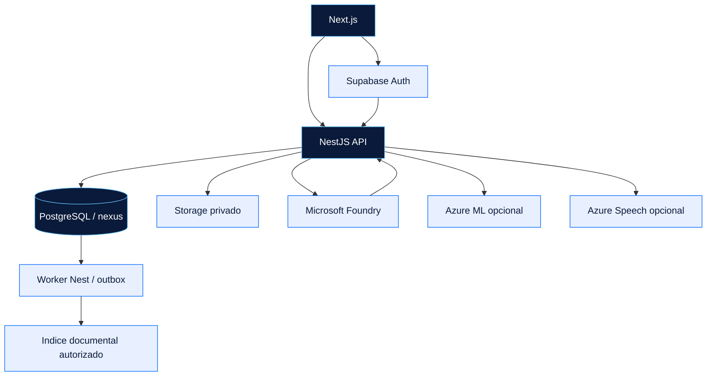
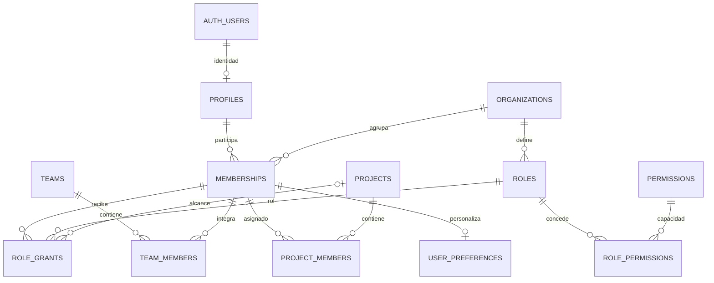
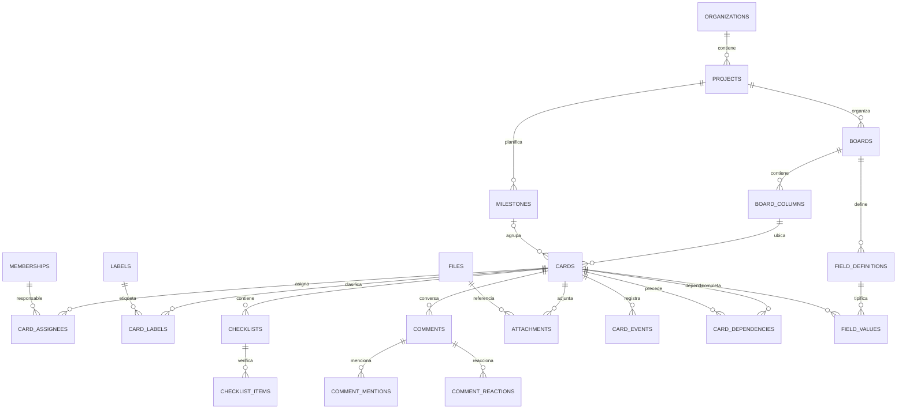
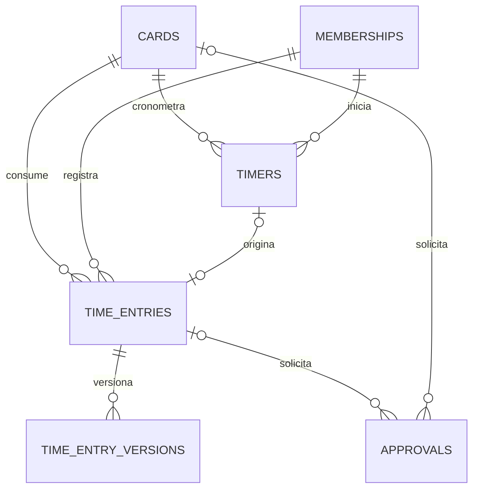
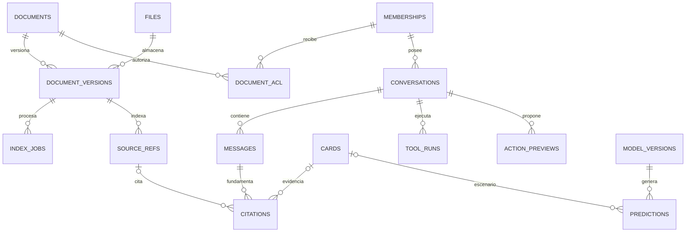
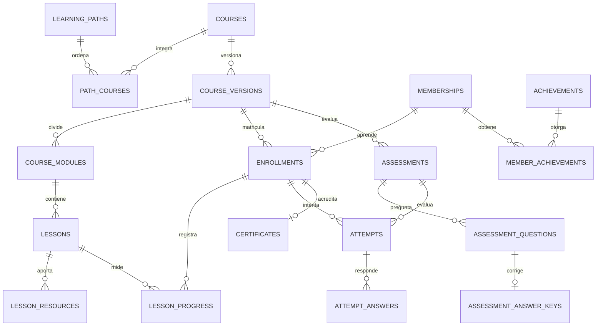
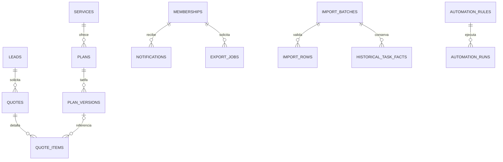

# MTA NEXUS | Modelo relacional

**Arquitectura de persistencia y mapa de dominios**

    

> Estado: propuesta técnica para implementación. No representa una base de datos desplegada ni una auditoría de seguridad completada.

---

## 1. Decisiones de arquitectura

La base de datos pertenece al backend NestJS. Next.js no importa esquemas Drizzle ni utiliza la clave de administración de Supabase. La autenticación se delega a Supabase Auth; las entidades de negocio viven en `nexus`, esquema privado no expuesto en Data API. El backend valida JWT y membresía, opera en transacciones y aplica RLS. Los archivos binarios se guardan en Storage privado. MIA consulta herramientas Nest autorizadas; jamás recibe una conexión SQL libre.

**Fuentes de diseño:** `MTA_Nexus_Especificacion.md`, secciones 06, 08–30 y 32–33; `MTA_Nexus_Arquitectura_Backend.md`, secciones 8–10 y 12–16; `MTA_Nexus_Stack_Backend_v1.1.md` (PostgreSQL, Drizzle, seguridad y migraciones); `MTA_Nexus_Arquitectura_Frontend.md` (features y flujo service/mock/API). Este diseño amplía el modelo lógico anterior; fija nombres definitivos propuestos para evitar sinónimos duplicados. No presupone que existan tablas o cuentas reales.

## 2. Inventario modular

| Dominio | Tablas | Función |
|---|---:|---|
| 01. Identidad, organización y permisos | 13 | `organizations`, `profiles`, `memberships`, `roles`, `permissions`, `role_permissions`, `role_grants`, `invitations`, `user_preferences`, `organization_settings`, `teams`, `team_members`, `availability` |
| 02. Proyectos, tableros y tarjetas | 21 | `projects`, `project_members`, `milestones`, `boards`, `board_columns`, `cards`, `card_assignees`, `labels`, `card_labels`, `field_definitions`, `field_values`, `checklists`, `checklist_items`, `card_dependencies`, `comments`, `comment_mentions`, `comment_reactions`, `files`, `attachments`, `card_watchers`, `card_events` |
| 03. Tiempo, agenda, soporte y colaboración | 12 | `timers`, `time_entries`, `time_entry_versions`, `approvals`, `calendar_events`, `calendar_attendees`, `tickets`, `ticket_comments`, `ticket_links`, `card_templates`, `automation_rules`, `automation_runs` |
| 04. Knowledge Center y RAG | 5 | `documents`, `document_versions`, `document_acl`, `index_jobs`, `source_refs` |
| 05. MIA Academy | 19 | `learning_paths`, `courses`, `course_versions`, `path_courses`, `course_modules`, `lessons`, `lesson_resources`, `enrollments`, `lesson_progress`, `assessments`, `assessment_questions`, `assessment_answer_keys`, `attempts`, `attempt_answers`, `mentoring_sessions`, `forum_posts`, `achievements`, `member_achievements`, `certificates` |
| 06. MIA, voz, analítica y Machine Learning | 9 | `conversations`, `messages`, `citations`, `tool_runs`, `action_previews`, `speech_sessions`, `model_versions`, `predictions`, `usage_records` |
| 07. Servicios, planes y cotizaciones | 6 | `services`, `plans`, `plan_versions`, `leads`, `quotes`, `quote_items` |
| 08. Operación, notificaciones y auditoría | 12 | `notifications`, `notification_preferences`, `audit_events`, `outbox`, `jobs`, `import_batches`, `import_rows`, `historical_task_facts`, `export_jobs`, `integration_settings`, `quota_limits`, `idempotency_keys` |

**Total: 97 tablas.** No se crean todas en la primera entrega: cada módulo se activa cuando sus invariantes y políticas estén probadas.

## 3. Diagramas entidad-relación por dominio

Los diagramas son vistas resumidas de las relaciones; el diccionario y el DDL enumeran las claves exactas, incluidas las compuestas. `1:N` significa uno a muchos; `N:M` se representa con tabla puente. En cada tabla de organización, `organization_id` además enlaza con `organizations`. Las referencias opcionales aparecen como `o|`.

### Identidad y autorización

El UUID de Auth no equivale al UUID de perfil ni al UUID de membresía. `profiles.auth_user_id` identifica una cuenta. `memberships.id` se usa para responsables, autores, supervisores y propietarios dentro de una organización. Un usuario puede tener varias membresías. `role_grants.project_id` nulo es un permiso organizacional; un líder recibe un rol con proyecto específico y nunca se convierte en administrador global.

### Proyectos, Kanban y colaboración

### Horas y aprobación

`approvals` exige exactamente un padre. El cronómetro abierto es único por membresía; si se necesita impedir ejecución simultánea entre organizaciones, agregar una restricción de identidad global o lock por perfil. El estado de tarjeta proviene de la semántica de su columna, no de una columna `status` duplicada en cards. `completed_at` registra cierre efectivo; actualizar ambos en la misma transacción.

### Documentos y MIA

### Academy

### Comercial y operación

## 4. Convenciones de nombres y representación

| Concepto | SQL | TypeScript / DTO | Regla |
|---|---|---|---|
| Identificador | `id uuid` | `id: string` | Generado en servidor; no números secuenciales expuestos |
| Organización | `organization_id uuid` | `organizationId: string` | Desde sesión validada, no asignable libremente |
| Fechas | `created_at timestamptz` | `createdAt: string` | ISO 8601; almacenar instante UTC |
| Vencimiento | `due_date date` | `dueDate: string` | YYYY-MM-DD, zona de organización |
| Duración | `estimated_minutes integer` | `estimatedMinutes: number` | Minutos enteros; UI divide por 60 |
| Dinero | `amount numeric(14,2)` | `amount: string` | Decimal exacto; no Number para cálculos monetarios |
| Orden | `position numeric(20,8)` | `position: string` | Fraccional; desempatar por id |
| Concurrencia | `version integer` | `version: number` | Incremento atómico y 409 ante conflicto |
| Archivo | `archived_at timestamptz` | `archivedAt: string \| null` | Borrado lógico; no destruir evidencia |
| JSONB | `description` / `payload` | esquema tipado | Validación Zod/DTO y límites de tamaño |

**Estado y color:** los códigos son estables y en inglés; los labels traducidos y colores semánticos se resuelven en `design-tokens`/frontend. El color personalizado se persiste solo cuando el usuario lo configura (etiquetas, columnas e insignias). Nunca se guarda HTML de un badge como fuente de verdad. Light/Dark Mode usa el mismo código de estado con tokens distintos.

| Código | Etiqueta | Color de referencia claro | Uso |
|---|---|---|---|
| `todo` | Por hacer | #64748B | Columna pendiente |
| `doing` | En progreso | #0066FF | Trabajo activo |
| `review` | En revisión | #00A1FF | Validación |
| `done` | Finalizado | #166534 | Cierre |
| `blocked` | Bloqueado | #991B1B | Bloqueo explícito |
| `urgent` | Urgente | #991B1B | Prioridad, no estado |
| `submitted` | Enviado | #075985 | Horas a revisión |
| `approved` | Aprobado | #166534 | Decisión registrada |
| `withdrawn` | Retirado | #64748B | Documento fuera de vigencia |

## 5. Reglas que requieren transacciones o validaciones adicionales

Las FK impiden cruces de organización y proyecto cuando se declaran compuestas, pero no verifican permisos vigentes ni todas las relaciones semánticas. CHECK valida la fila, no otras tablas. Antes de liberar cada módulo deben implementarse los siguientes controles y sus pruebas. Usar bloqueo de padre o serializable con retry cuando haya invariantes concurrentes.

| Caso | Invariante | Implementación requerida |
|---|---|---|
| Alta de miembro y rol | No conceder un rol superior al delegable; scope coincide con `roles.scope`; grant vigente y actor no es beneficiario | Servicio RBAC, lock de concesiones, RLS, auditoría; expirados se revocan antes de renovar |
| Creación proyecto | Crear proyecto, tablero, columnas y miembro supervisor como una unidad | Transacción; política de bootstrap específica, no apertura general |
| Movimiento Kanban | Columna/tablero/proyecto coherentes; posición calculada por servidor; `version` esperada | FK compuesta, lock del tablero/columna, update condicional, WIP y evento |
| Cierre de tarjeta | Dependencias listas, checklist obligatorio, revisión aprobada si aplica | Servicio de transición; lock, `completed_at`, eventos y notificaciones |
| Dependencias y subtareas | Sin ciclos, sin autoenlace; padre del mismo proyecto | CTE recursiva con lock por proyecto para evitar ciclos concurrentes |
| Etiquetas | Global de misma organización o local de mismo proyecto; archivada no reasignable | FK org, validación de ámbito, índices parciales, restauración con conflicto explícito |
| Campos personalizados | Definición del mismo tablero que la tarjeta; tipo JSON correcto | Validación/trigger; bloqueo si cambia definición |
| Asignación y menciones | Miembro activo, no retirado y visible en proyecto | FK compuesta cuando existe, policy y validación de vigencia |
| Archivos | `ready`, propietario o recurso autorizado, sin reutilización de archivo ajeno | Storage y service con comprobación de vínculo; hash/MIME/tamaño |
| Horas | Timer y parte coherentes; no solapamiento según política; aprobar sin ser titular | Índices parciales, FK, lock; una decisión pendiente por objetivo si aplica |
| Aprobación | `reviewed_by` no es titular del parte ni autor de entrega; no solo distinto del solicitante | Comparación con padre dentro de transacción; registro inmutable de decisión |
| Documento | Una versión publicada a la vez, válida y aprobada por otra persona | Índice parcial; retirar anterior y activar nueva versión en transacción; invalidar RAG |
| Academy | Lección, evaluación, pregunta y matrícula de la misma versión | Validación por joins; añadir FK compuestas adicionales al implementar; lock para máximo de intentos |
| Academy | No cambiar contenido publicado, resultados ni puntaje desde cliente | Servicio editorial, permisos y snapshots; versión nueva para cambios |
| Comercial | No solapar vigencias de precio publicado; cotización congelada | Lock de plan y consulta de solapamiento; recalcular con numeric; no asumir impuestos reales |
| IA | Modelo y resultado corresponden al tipo; conversación y mensaje coherentes; fuente vigente | Servicio de ML/MIA y FK; no reutilizar resultados de otra organización |
| Histórico | `historical_task_facts` solo en organización `demo`; importación no crea cuentas Auth | Guard+trigger específico pendiente, entorno demo separado, idempotencia |
| Auditoría y outbox | Cambio, evento y notificación en la misma transacción; no editar historia | Grants append-only y servicio; consumidor idempotente |

## 6. Lecturas derivadas y métricas

No persistir los contadores del Dashboard como valores manuales. Aplicar scope antes de agrupar y paginar. Pueden implementarse consultas o vistas `security_invoker` (verificar versión PostgreSQL); no publicar vistas de owner que eludan RLS.

| Indicador | Fuente | Definición |
|---|---|---|
| Tareas activas | cards + board_columns | No archivadas con categoría todo/doing/review/blocked |
| Tareas finalizadas | cards + board_columns | No archivadas, categoría done |
| Pendientes vencidas | cards | No done y due_date anterior a día local de corte |
| Cierre tardío | cards | completed_at convertido a fecha local > due_date; sin fecha = desconocido |
| Horas registradas | time_entries | Suma minutes excluyendo void; mostrar estado de aprobación |
| Horas aprobadas | time_entries | Suma minutes con status approved |
| Desviación | cards + time_entries | Minutos aprobados menos estimated_minutes; NULL si falta base |
| Capacidad | availability + partes | Comparar por persona/fecha; evitar duplicar por N:M |
| Progreso curso | lesson_progress + lessons | Lecciones obligatorias completadas / lecciones de versión |
| Riesgo predicho | predictions | Último resultado válido con versión y timestamp; no es retraso real |
| Dataset demo | historical_task_facts | Agregados separados, sin mezclar con producción |

## 7. Mapa de implementación por módulo NestJS

| Módulo | Tablas o responsabilidad |
|---|---|
| `auth` | profiles, memberships, invitations (Auth administrado externamente) |
| `users` | profiles, user_preferences |
| `organizations` | organizations, organization_settings |
| `access-control` | roles, permissions, role_permissions, role_grants |
| `team` | teams, team_members, project_members, availability |
| `dashboard` | consultas autorizadas, sin tabla duplicada |
| `projects` | projects, milestones, project_members |
| `boards` | boards, board_columns, field_definitions, card_templates |
| `cards` | cards, card_assignees, card_watchers, field_values, card_events |
| `labels` | labels, card_labels |
| `comments` | comments, comment_mentions, comment_reactions |
| `checklists` | checklists, checklist_items |
| `dependencies` | card_dependencies |
| `attachments` | files, attachments |
| `time-tracking` | timers, time_entries, time_entry_versions |
| `approvals` | approvals |
| `calendar` | calendar_events, calendar_attendees |
| `support` | tickets, ticket_comments, ticket_links |
| `notifications` | notifications, notification_preferences |
| `automation` | automation_rules, automation_runs |
| `knowledge` | documents, document_versions, document_acl, index_jobs, source_refs |
| `academy` | learning_paths, courses, course_versions, path_courses, course_modules, lessons, lesson_resources, enrollments, lesson_progress, assessments, assessment_questions, assessment_answer_keys, attempts, attempt_answers, mentoring_sessions, forum_posts, achievements, member_achievements, certificates |
| `mia` | conversations, messages, citations, tool_runs, action_previews |
| `speech` | speech_sessions |
| `analytics` | consultas operativas y historical_task_facts |
| `predictions` | model_versions, predictions |
| `services` | services |
| `plans` | plans, plan_versions |
| `quotes` | leads, quotes, quote_items |
| `audit` | audit_events |
| `imports` | import_batches, import_rows, historical_task_facts |
| `exports` | export_jobs |
| `jobs` | jobs, outbox, idempotency_keys |
| `integrations` | integration_settings, quota_limits, usage_records |
| `health` | métricas técnicas, sin tabla propia |
| `admin` | fachadas de configuración, identidad y seguridad; no duplica tablas |

## 8. Referencias de implementación

- [PostgreSQL: constraints](https://www.postgresql.org/docs/current/ddl-constraints.html)
- [Supabase: asegurar Data API](https://supabase.com/docs/guides/api/securing-your-api)
- [Supabase: RLS](https://supabase.com/docs/guides/database/postgres/row-level-security)

Consultar el diccionario y el documento RLS antes de implementar servicios.
